# 03. Atendimento

O atendimento mostra quem está cuidando de cada conversa no Nitzap Omni. Cada atendimento é uma **Tarefa** do Salesforce, ligada ao cliente, que fica com um atendente ou na fila de uma equipe. A equipe vê na lista quem está atendendo cada cliente, pode puxar conversas da fila, transferir para um colega ou equipe e fechar o atendimento quando terminar. Tudo fica registrado na Tarefa.

**Como ler as imagens:** os círculos vermelhos numerados apontam para a parte da tela que está sendo explicada. O número no círculo é o mesmo da coluna **Nº** da tabela logo abaixo da imagem.

<!-- sumario:inicio -->
**Neste artigo:**

- [Configurar o atendimento (administrador)](#nitzap/atendimento/configurar-o-atendimento-administrador)
- [Ativar os filtros de atendimento](#nitzap/atendimento/ativar-os-filtros-de-atendimento)
- [Abrir um atendimento](#nitzap/atendimento/abrir-um-atendimento)
- [Puxar uma conversa da fila](#nitzap/atendimento/puxar-uma-conversa-da-fila)
- [Durante o atendimento](#nitzap/atendimento/durante-o-atendimento)
- [Transferir um atendimento](#nitzap/atendimento/transferir-um-atendimento)
- [Fechar um atendimento](#nitzap/atendimento/fechar-um-atendimento)
- [A Tarefa do atendimento](#nitzap/atendimento/a-tarefa-do-atendimento)
- [Problemas comuns](#nitzap/atendimento/problemas-comuns)

<!-- sumario:fim -->

## Configurar o atendimento (administrador)

### Na conexão

O atendimento é ligado por conexão. Em **Nitzap Config** > **Conexões**, clique na engrenagem da conexão e abra a aba **Configurações** (indicada pela seta).

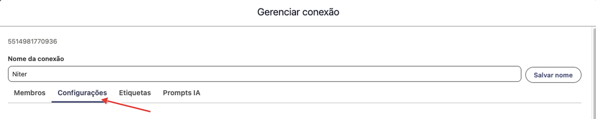

Desça até o bloco **Atendimento**:

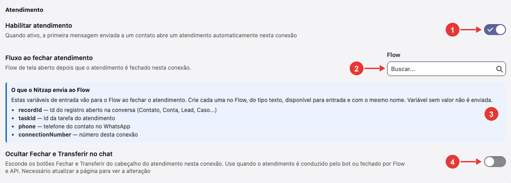

| Nº | Configuração | O que faz |
| :---: | --- | --- |
| 1 | **Habilitar atendimento** | Quando ligada, a primeira mensagem que o atendente **envia** a um contato sem atendimento aberto abre um atendimento automaticamente nessa conexão. Não vale para grupos. |
| 2 | **Fluxo ao fechar atendimento** | Um Flow de tela do Salesforce que abre logo depois que o atendimento é fechado nessa conexão, por exemplo para registrar o resultado. Busque o Flow pelo nome. Só aparece com o atendimento habilitado. |
| 3 | **O que o Nitzap envia ao Flow** | As informações que o Flow recebe ao abrir (tabela abaixo). |
| 4 | **Ocultar Fechar e Transferir no chat** | Esconde os botões **Fechar** e **Transferir** da barra de atendimento na conversa. Use quando o atendimento é conduzido pelo bot ou fechado por Flow ou API. Atualize a página para aplicar. |

Para o Flow receber essas informações, crie no Flow uma variável para cada uma, do tipo **Texto**, **disponível para entrada** e com exatamente o mesmo nome. Variável sem valor não é enviada.

| Variável | O que contém |
| --- | --- |
| `recordId` | Id do registro aberto na conversa (Contato, Conta, Lead, Caso...). |
| `taskId` | Id da Tarefa do atendimento. |
| `phone` | Telefone do contato no WhatsApp. |
| `connectionNumber` | Número da conexão. |

### No Nitzap Config

Estas configurações valem para todas as conexões. Em **Nitzap Config**, abra **Configuração** > **Preferências** e vá até o bloco **Conversas e atendimento**:

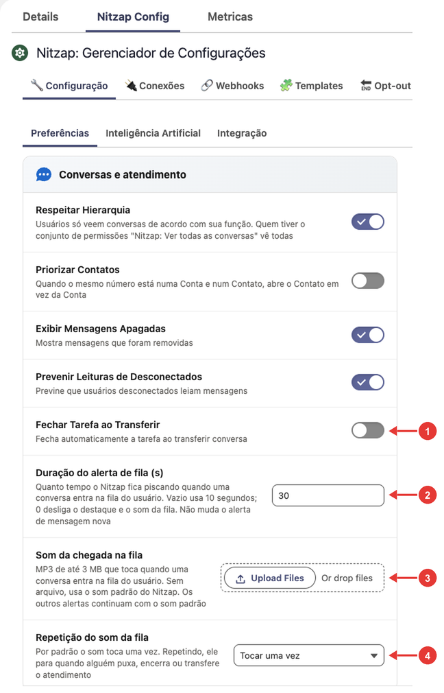

| Nº | Configuração | O que faz |
| :---: | --- | --- |
| 1 | **Fechar Tarefa ao Transferir** | Na transferência para um **usuário**, fecha a Tarefa de quem passou o atendimento e cria uma nova para quem recebeu. Assim cada atendente fica com a sua própria Tarefa. |
| 2 | **Duração do alerta de fila (s)** | Por quanto tempo a conversa que chega na fila fica piscando. Vazio usa 10 segundos; **0** desliga o destaque e o som. Não muda o alerta de mensagem nova. |
| 3 | **Som da chegada na fila** | O som tocado quando uma conversa entra na fila. Aceita um MP3 de até 3 MB; sem arquivo, toca o som padrão do Nitzap. |
| 4 | **Repetição do som da fila** | **Tocar uma vez**, **Repetir até alguém puxar** ou **Repetir por um tempo**. Repetindo, o som para quando alguém puxa, transfere ou fecha o atendimento. |

Na opção **Repetir por um tempo** aparece também **Tempo tocando (s)**: por quanto tempo o som repete. Vazio usa 30 segundos; o máximo é 600.

As outras opções do bloco (**Respeitar Hierarquia**, **Priorizar Contatos**, **Exibir Mensagens Apagadas** e **Prevenir Leituras de Desconectados**) valem para as conversas em geral, não só para o atendimento. Sobre a hierarquia, veja [Ver conversas de outros usuários](#nitzap/omni/ver-conversas-de-outros-usuarios), no guia do Omni.

### Equipes (filas)

As equipes do atendimento são as **Filas** do próprio Salesforce. Os membros de uma fila veem as conversas que chegam nela, e as filas aparecem como opção ao abrir e ao transferir um atendimento. Para criar uma fila:

**1. Abrir as Filas no Setup.** Em **Configuração** do Salesforce, digite **filas** na busca rápida e clique em **Filas**.

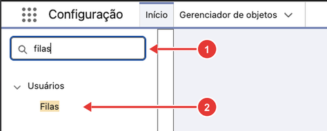

**2. Criar uma fila nova.** Clique em **Criar**.

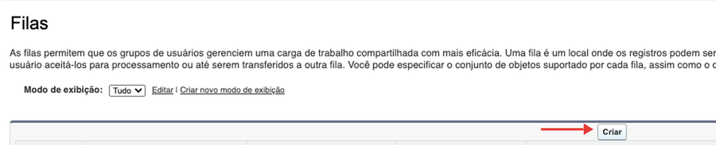

**3. Preencher a fila.**

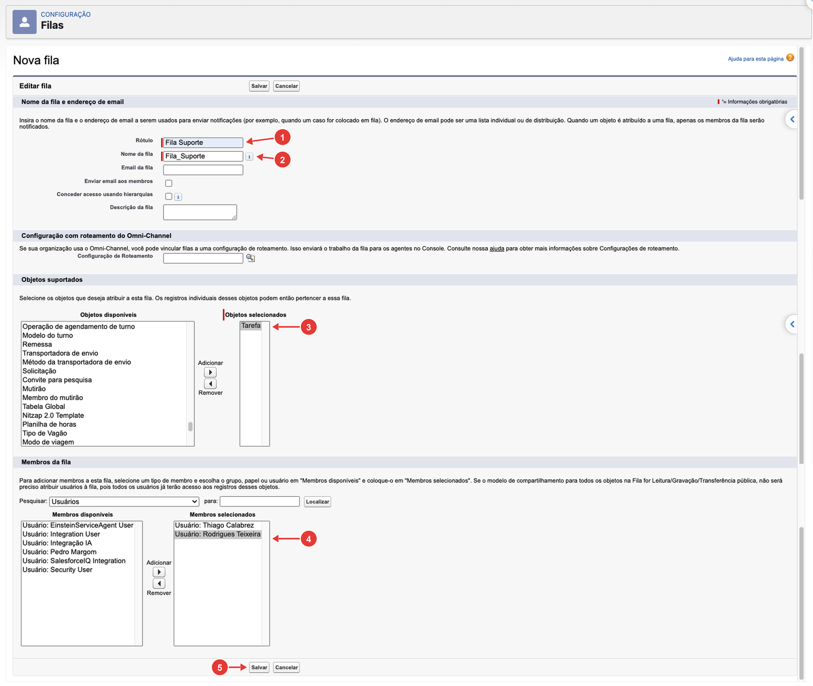

| Nº | Campo | O que fazer |
| :---: | --- | --- |
| 1 | **Rótulo** | O nome da equipe, como aparece no Nitzap (ex.: **Fila Suporte**). |
| 2 | **Nome da fila** | O nome técnico. O Salesforce preenche a partir do rótulo. |
| 3 | **Objetos selecionados** | Adicione **Tarefa**. Sem isso, a fila não pode ficar com o atendimento. |
| 4 | **Membros selecionados** | Os usuários da equipe. Escolha em **Membros disponíveis** e clique em **Adicionar**. |
| 5 | **Salvar** | Cria a fila. |

Os demais campos são opcionais.

## Ativar os filtros de atendimento

Antes de começar a atender, cada usuário liga a preferência **Habilitar filtros de atendimento** no Omni (nº 9 nas [Preferências do Omni](#nitzap/omni/preferencias)). A página recarrega e o botão **Não Lidas** dá lugar ao filtro **Atendimento**.

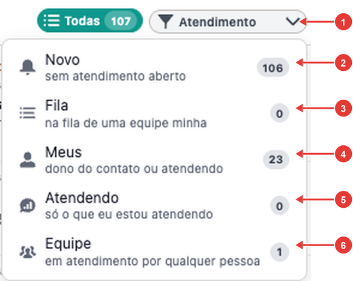

| Nº | Filtro | O que mostra |
| :---: | --- | --- |
| 1 | **Atendimento** | Abre a lista de filtros. O número ao lado de cada um é a quantidade de conversas. |
| 2 | **Novo** | Conversas **sem atendimento aberto**, inclusive de números que não estão salvos no Salesforce. |
| 3 | **Fila** | Conversas **na fila de uma equipe sua**, esperando alguém puxar. |
| 4 | **Meus** | Conversas que você está atendendo **ou** de clientes dos quais você é o proprietário no Salesforce. |
| 5 | **Atendendo** | Só as conversas que **você** está atendendo. |
| 6 | **Equipe** | Conversas em atendimento por **qualquer pessoa** da equipe. |

Em **Fila**, **Meus**, **Atendendo** e **Equipe** aparecem também dois subfiltros:

- **A responder:** a última mensagem foi do cliente, ou há mensagens não lidas.
- **Respondido:** a última mensagem foi sua e não há nada por ler.

Clique de novo no subfiltro escolhido para desligá-lo.

Para receber alertas só das suas conversas, ligue também a preferência **Receber notificações apenas de quem eu estiver atendendo**.

## Abrir um atendimento

Há três jeitos:

- **Automático:** com **Habilitar atendimento** ligado na conexão, basta enviar a primeira mensagem ao cliente.
- **Pelo botão direito:** abre o atendimento para você, para outro usuário ou direto na fila de uma equipe (veja abaixo).
- **Pelo bot:** quando o bot ou agente transfere a conversa, ela entra na fila da equipe. Veja o guia do [Einstein Bot e Agentforce](../connect_einstein_bot.md).

Se o cliente já tem um atendimento aberto naquela conexão, o Nitzap avisa **Atendimento já aberto** e mostra com quem está.

### Criar o atendimento pelo botão direito

Na lista de conversas, clique com o botão direito no cliente e escolha **Criar atendimento**. A opção só aparece quando o número está salvo no Salesforce, não há atendimento aberto e a conversa não é de grupo.

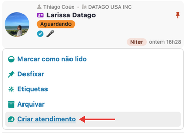

Abre a janela **Novo Atendimento**. À esquerda, o atendimento para um usuário; à direita, para uma fila:

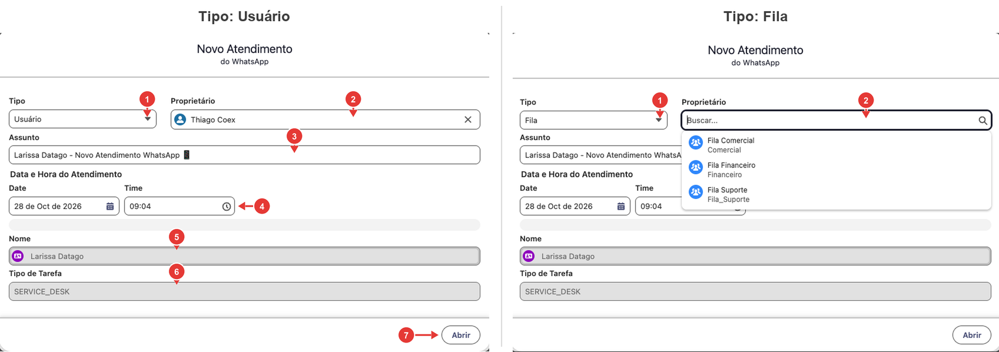

| Nº | Campo | O que fazer |
| :---: | --- | --- |
| 1 | **Tipo** | **Usuário** para entregar a uma pessoa, ou **Fila** para mandar à fila de uma equipe. |
| 2 | **Proprietário** | Quem fica com o atendimento. Com **Usuário**, já vem preenchido com você; troque se for para outra pessoa. Com **Fila**, busque e escolha a fila. |
| 3 | **Assunto** | Vem preenchido com o nome do cliente e *Novo Atendimento WhatsApp 📱*. Pode ser alterado. |
| 4 | **Data e Hora do Atendimento** | Quando o atendimento começa. Vem com o momento atual. |
| 5 | **Nome** | O cliente da conversa. Não pode ser alterado. |
| 6 | **Tipo de Tarefa** | **SERVICE_DESK**, o código do tipo **Atendimento**. Não pode ser alterado. |
| 7 | **Abrir** | Cria o atendimento. |

Aberto para uma fila, o atendimento aparece como **Na fila (equipe)** e os membros da fila podem puxar.

## Puxar uma conversa da fila

Quando uma conversa chega na fila de uma equipe sua, a lista destaca a conversa e toca um som (conforme a configuração do administrador).

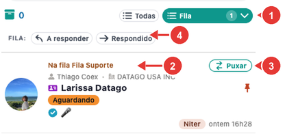

| Nº | O que é |
| :---: | --- |
| 1 | Filtro **Fila**: as conversas na fila das suas equipes. O número é a quantidade. |
| 2 | **Na fila (equipe)**: em qual fila a conversa está esperando. |
| 3 | **Puxar**: assume o atendimento. |
| 4 | Subfiltros **A responder** e **Respondido** (veja [Ativar os filtros de atendimento](#nitzap/atendimento/ativar-os-filtros-de-atendimento)). |

Também dá para puxar pelo botão direito na conversa, em **Puxar atendimento**.

O atendimento passa para você, aparece **Atendimento puxado: O atendimento agora é seu** e a lista muda para o filtro **Atendendo**. O som da fila para quando alguém puxa, transfere ou fecha o atendimento.

Na conversa, as notas internas mostram o caminho do atendimento:

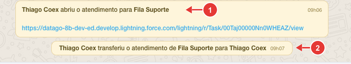

| Nº | O que é |
| :---: | --- |
| 1 | Nota de abertura: quem abriu o atendimento, para qual fila, e o link da Tarefa. |
| 2 | Nota de quando alguém puxou: aparece como transferência da fila para quem puxou. |

O cliente não recebe essas notas.

## Durante o atendimento

Com o atendimento aberto, a conversa mostra uma barra logo abaixo do nome do cliente.

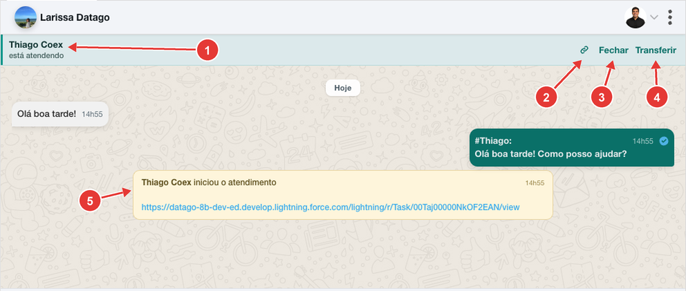

| Nº | O que é |
| :---: | --- |
| 1 | Quem está atendendo. Quando a conversa está na fila, aparece **Aguardando Atendimento**. |
| 2 | **Vincular:** liga o atendimento a um Caso ou Oportunidade (veja abaixo). |
| 3 | **Fechar:** encerra o atendimento. Só aparece para quem está atendendo. |
| 4 | **Transferir:** passa o atendimento para outro usuário ou fila. |
| 5 | Nota interna de abertura, com o link da Tarefa do atendimento. O cliente não recebe. |

Na lista de conversas, cada cliente mostra a situação do atendimento acima do nome:

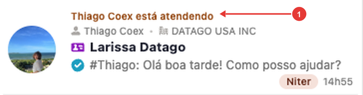

- **1:** **(nome) está atendendo**, ou **Na fila (equipe)** quando ninguém puxou ainda. Clique nesse texto para abrir a Tarefa.

### Vincular a um Caso ou Oportunidade

Clique no ícone de link (nº 2 da barra) para ligar o atendimento a um registro do Salesforce.

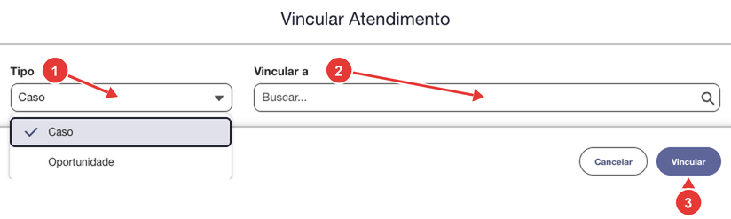

| Nº | O que fazer |
| :---: | --- |
| 1 | **Tipo:** escolha **Caso** ou **Oportunidade**. |
| 2 | **Vincular a:** busque o registro. |
| 3 | Clique em **Vincular**. |

Depois de vinculado, a barra mostra o nome do registro e o botão muda para **Trocar vínculo**.

## Transferir um atendimento

Clique em **Transferir** (nº 4 da barra).

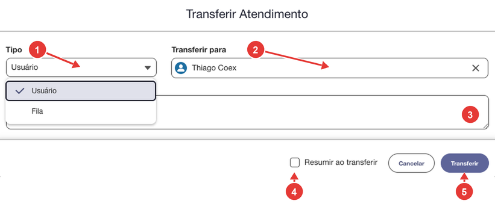

| Nº | O que fazer |
| :---: | --- |
| 1 | **Tipo:** **Usuário** para passar a uma pessoa, ou **Fila** para mandar à fila de uma equipe. |
| 2 | **Transferir para:** escolha o usuário ou a fila. |
| 3 | **Mensagem:** um recado para quem vai receber, como o que já foi combinado com o cliente. |
| 4 | **Resumir ao transferir:** a IA resume a conversa desde o início do atendimento e junta o resumo à nota. Só aparece com a IA configurada. |
| 5 | Clique em **Transferir**. |

Depois da transferência:

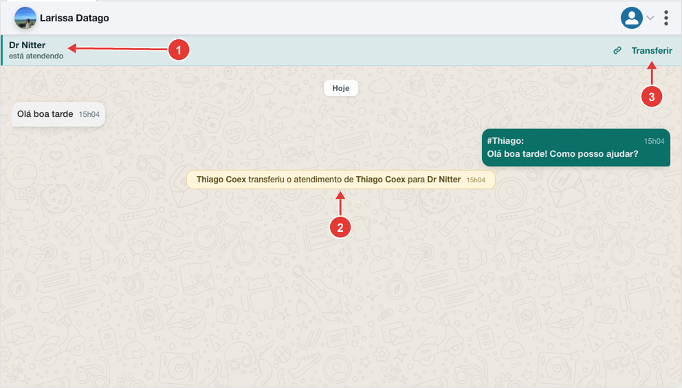

| Nº | O que é |
| :---: | --- |
| 1 | A barra passa a mostrar o novo responsável. |
| 2 | Nota interna com quem transferiu, de quem para quem, e a mensagem e o resumo, se houver. O cliente não recebe. |
| 3 | Para quem não está atendendo, a barra mostra só **Transferir**: o **Fechar** fica com o novo responsável. |

Quem recebe é avisado: a conversa pisca com som no Omni, aparece a notificação **🎧 Novo atendimento para você** e chega uma notificação do Salesforce **Transferência**. Quando a transferência é para uma fila, os membros recebem **📥 Nova conversa na fila (equipe)**.

## Fechar um atendimento

Clique em **Fechar** (nº 3 da barra) e confirme em **Tem certeza que deseja fechar o atendimento?**.

Também dá para fechar pelo botão direito na lista, em **Fechar Atendimento**; nesse caso não há pergunta de confirmação.

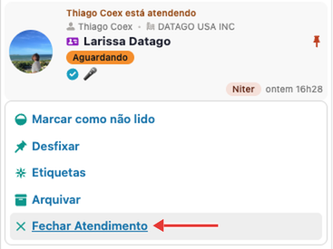

Ao fechar:

- aparece na conversa a nota interna **(nome) fechou o atendimento**;
- a Tarefa recebe a data de fechamento e os horários da primeira mensagem;
- se a conexão tiver bot ou agente, ele volta a atender esse cliente na próxima mensagem;
- se o administrador configurou um **Fluxo ao fechar atendimento**, ele abre em seguida.

O Nitzap não pede motivo nem resumo para fechar. Se a empresa precisa registrar o resultado do atendimento, use o **Fluxo ao fechar atendimento**.

Nas conexões com bot ou agente, o atendimento também é fechado sozinho quando o cliente para de responder e a **Mensagem por falta de resposta** é enviada. Veja o guia do [Einstein Bot e Agentforce](../connect_einstein_bot.md).

## A Tarefa do atendimento

Cada atendimento é uma Tarefa do tipo **Atendimento**. Abra pelo link da nota de abertura ou clicando em **(nome) está atendendo** na lista. A imagem mostra uma Tarefa depois de fechada.

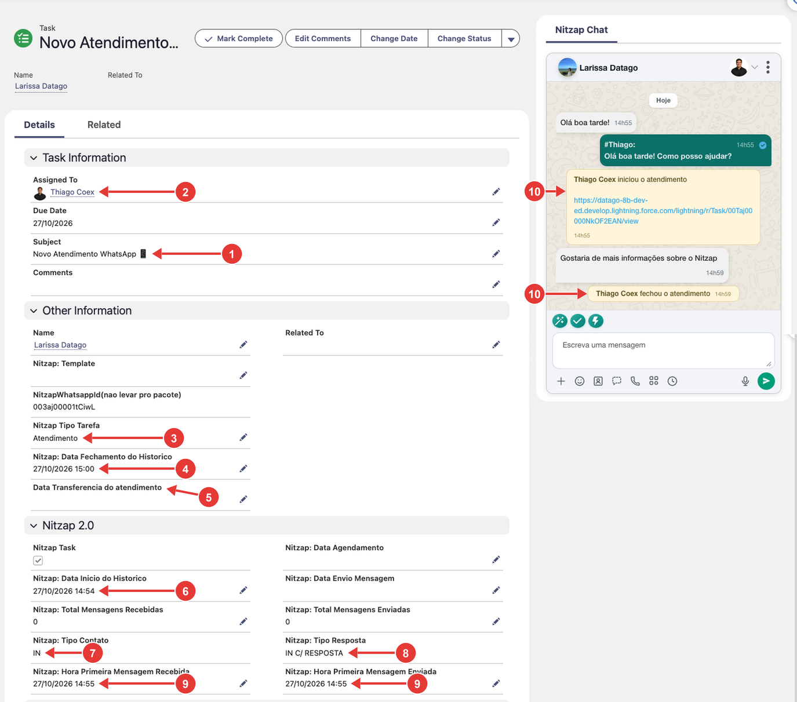

| Nº | Campo | O que mostra |
| :---: | --- | --- |
| 1 | **Subject** (Assunto) | *Novo Atendimento WhatsApp 📱*. Aberto pelo botão direito, começa com o nome do cliente. |
| 2 | **Assigned To** (Atribuído a) | Quem está com o atendimento, ou a fila. Muda a cada transferência. |
| 3 | **Nitzap Tipo Tarefa** | **Atendimento**. |
| 4 | **Nitzap: Data Fechamento do Historico** | Quando o atendimento foi fechado. Fica vazio enquanto está aberto. |
| 5 | **Data Transferencia do atendimento** | Quando houve a última transferência. Vazio se não houve. |
| 6 | **Nitzap: Data Inicio do Historico** | Quando o atendimento começou. |
| 7 | **Nitzap: Tipo Contato** | Quem falou primeiro: **IN** se foi o cliente, **OUT** se foi a empresa, **NA** se ainda não houve mensagem. |
| 8 | **Nitzap: Tipo Resposta** | Quem começou a conversa e se houve resposta (valores na tabela abaixo). |
| 9 | **Nitzap: Hora Primeira Mensagem Recebida / Enviada** | O horário da primeira mensagem do cliente e da primeira resposta da empresa no atendimento. Servem para medir o tempo de resposta. |
| 10 | **Nitzap Chat** | A conversa na própria página da Tarefa, com as notas de abertura e fechamento. |

Os valores de **Nitzap: Tipo Resposta** (nº 8):

| Valor | O que significa |
| --- | --- |
| **IN C/ RESPOSTA** | O cliente escreveu primeiro e a empresa respondeu. |
| **IN S/ RESPOSTA** | O cliente escreveu primeiro e ainda não teve resposta. |
| **OUT C/ RESPOSTA** | A empresa escreveu primeiro e o cliente respondeu. |
| **OUT S/ RESPOSTA** | A empresa escreveu primeiro e o cliente ainda não respondeu. |
| **NA** | Ainda não houve mensagem no atendimento. |

Os campos **Tipo Contato** e **Tipo Resposta** são calculados a partir dos horários da primeira mensagem recebida e enviada (nº 9), então mudam sozinhos conforme a conversa acontece.

## Problemas comuns

| Situação | O que fazer |
| --- | --- |
| Não aparece **Criar atendimento** no botão direito. | O número não está salvo no Salesforce, a conversa é de grupo ou já existe um atendimento aberto. |
| O atendimento não abre sozinho ao enviar mensagem. | Peça ao administrador para ligar **Habilitar atendimento** na conexão. |
| Não aparece o botão **Fechar** na conversa. | Só quem está atendendo vê o **Fechar**. Puxe ou peça a transferência. Se nem o responsável vê, confira **Ocultar Fechar e Transferir no chat** na conexão. |
| Não aparece o filtro **Atendimento** na lista. | Ligue **Habilitar filtros de atendimento** nas Preferências do Omni. |
| A fila não aparece para abrir ou transferir. | A fila precisa existir no Salesforce e ter **Tarefa** nos objetos suportados (veja [Equipes (filas)](#nitzap/atendimento/equipes-filas)). |
| O som da fila não toca. | Confira se a **Duração do alerta de fila** não está em 0 e se o navegador permite som e notificações para o Salesforce. |
