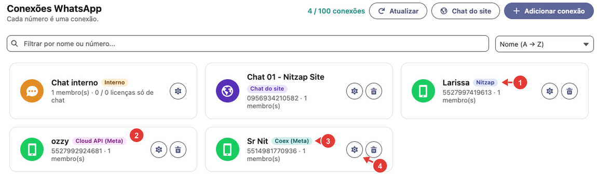
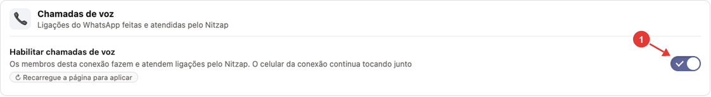
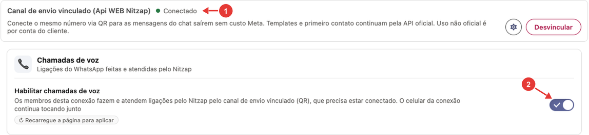
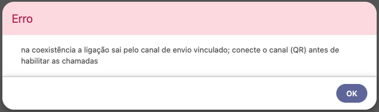
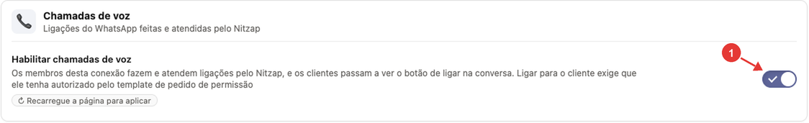
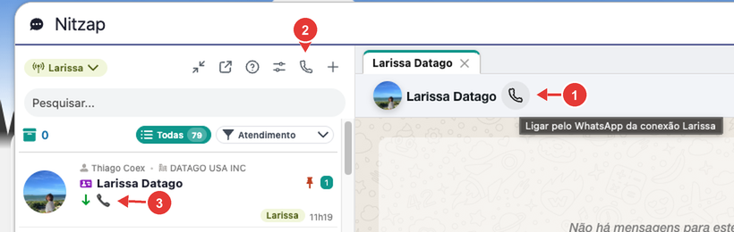
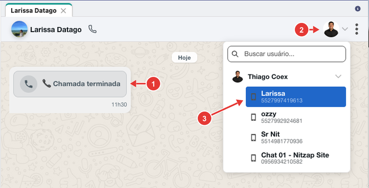
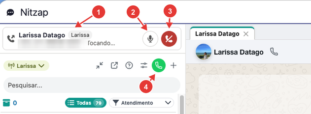
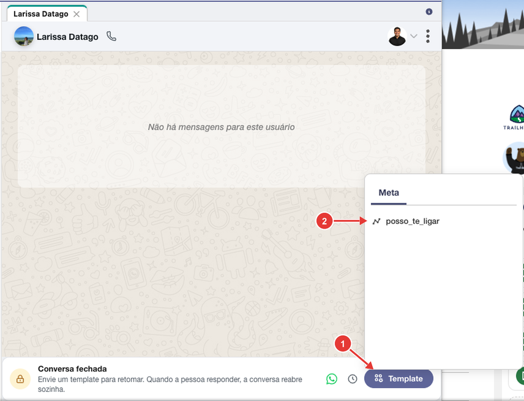
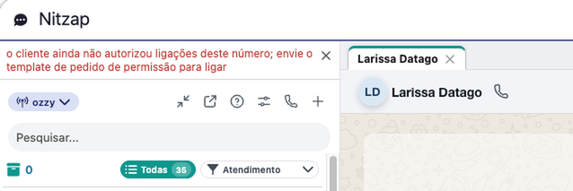

# 13. Chamadas de voz (ligações pelo WhatsApp)

Com as chamadas de voz ligadas, os membros de uma conexão fazem e atendem ligações do WhatsApp direto pelo Nitzap, no Salesforce, sem pegar o celular. O funcionamento muda conforme o tipo de conexão: **QR Code**, **API oficial com Coexistência** ou **API Cloud (só API oficial)**.

**Como ler as imagens:** os círculos vermelhos numerados apontam para a parte da tela que está sendo explicada. O número no círculo é o mesmo da coluna **Nº** da tabela logo abaixo da imagem.

<!-- sumario:inicio -->
**Neste artigo:**

- [Como funciona em cada tipo de conexão](#nitzap/chamadas-de-voz/como-funciona-em-cada-tipo-de-conexao)
- [Antes de começar](#nitzap/chamadas-de-voz/antes-de-comecar)
- [Habilitar as chamadas na conexão (administrador)](#nitzap/chamadas-de-voz/habilitar-as-chamadas-na-conexao-administrador)
- [Fazer uma ligação](#nitzap/chamadas-de-voz/fazer-uma-ligacao)
- [Durante a chamada](#nitzap/chamadas-de-voz/durante-a-chamada)
- [Receber uma ligação](#nitzap/chamadas-de-voz/receber-uma-ligacao)
- [Depois da chamada: registro e histórico](#nitzap/chamadas-de-voz/depois-da-chamada-registro-e-historico)
- [API Cloud: pedir permissão para ligar](#nitzap/chamadas-de-voz/api-cloud-pedir-permissao-para-ligar)
- [Problemas comuns](#nitzap/chamadas-de-voz/problemas-comuns)

<!-- sumario:fim -->

## Como funciona em cada tipo de conexão

| | **QR Code** | **API oficial com Coexistência** | **API Cloud (só API oficial)** |
| --- | --- | --- | --- |
| **Por onde a ligação passa** | Pela própria conexão QR Code. | Pelo [canal de envio vinculado](#nitzap/conexao-whatsapp/canal-de-envio-vinculado), que é o mesmo número conectado pelo QR Code. | Pela API oficial da Meta. |
| **O que precisa antes** | Só ligar a opção na conexão. | O canal de envio vinculado **conectado**. Sem ele, o Nitzap não deixa ligar a opção. | Para **ligar para o cliente**, ele precisa ter autorizado pelo [template de pedido de permissão](#nitzap/chamadas-de-voz/api-cloud-pedir-permissao-para-ligar). |
| **O celular toca junto?** | Sim. Dá para atender no Nitzap ou no celular. | Sim. Dá para atender no Nitzap ou no celular. | Não. O número não existe mais no celular. |
| **O cliente pode ligar para a empresa?** | Sim, como em qualquer WhatsApp. | Sim, como em qualquer WhatsApp. | Sim. Com as chamadas ligadas, o cliente passa a ver o botão de ligar na conversa com a empresa. |

As chamadas não existem no **chat do site** nem no **chat interno**, e não funcionam em grupos.

Para saber o tipo de cada conexão, veja a etiqueta ao lado do nome em **Nitzap Config** > **Conexões**:

| Nº | O que é |
| :---: | --- |
| 1 | **Nitzap:** conexão por QR Code. |
| 2 | **Cloud API (Meta):** conexão só pela API oficial. |
| 3 | **Coex (Meta):** conexão oficial com Coexistência. |
| 4 | **Engrenagem:** abre **Gerenciar conexão**, onde as chamadas são ligadas. |

## Antes de começar

- **O Nitzap precisa estar na barra de utilitários**, no rodapé do Salesforce. É ele que faz, toca e atende as ligações. O botão de ligar aparece também nas outras telas do Nitzap, como o Nitzap Web, mas a ligação acontece no painel do rodapé, que abre sozinho.
- **Libere o microfone** quando o navegador pedir, na primeira ligação. Sem o microfone, o cliente não ouve você.
- **Use fone de ouvido** com microfone, para o som do alto-falante não voltar para o cliente.
- **API Cloud:** o áudio vai direto do navegador para a Meta. Algumas redes de empresa bloqueiam esse tipo de conexão. Se a ligação não completar, veja [Problemas comuns](#nitzap/chamadas-de-voz/problemas-comuns).

## Habilitar as chamadas na conexão (administrador)

1. Em **Nitzap Config** > **Conexões**, clique na **engrenagem** da conexão.
2. Abra a aba **Configurações**.
3. No bloco **Chamadas de voz**, ligue **Habilitar chamadas de voz**.
4. **Recarregue a página** do Salesforce. Cada membro da conexão também precisa recarregar a página para ver o botão de ligar.

A opção vale para todos os membros da conexão. O texto abaixo dela muda conforme o tipo de conexão.

### Conexão QR Code

| Nº | O que é |
| :---: | --- |
| 1 | **Habilitar chamadas de voz**. Os membros fazem e atendem as ligações pelo Nitzap, e o celular da conexão continua tocando junto. |

### Conexão oficial com Coexistência

Na Coexistência, a ligação não sai pela API oficial: sai pelo **canal de envio vinculado**. Vincule e conecte o canal antes, como mostra [Canal de envio vinculado](#nitzap/conexao-whatsapp/canal-de-envio-vinculado).

| Nº | O que é |
| :---: | --- |
| 1 | O canal de envio vinculado precisa estar **Conectado**. |
| 2 | **Habilitar chamadas de voz**. As ligações passam pelo canal vinculado, e o celular da conexão continua tocando junto. |

Se o canal vinculado não estiver conectado, o Nitzap mostra este aviso e não liga a opção:

Se o canal vinculado cair depois, as ligações param até ele ser conectado de novo.

### Conexão API Cloud (só API oficial)

| Nº | O que é |
| :---: | --- |
| 1 | **Habilitar chamadas de voz**. Os membros fazem e atendem as ligações pelo Nitzap, e os clientes passam a ver o botão de ligar na conversa com a empresa. |

Para **ligar para o cliente** nessa conexão, ele precisa autorizar antes. Veja [API Cloud: pedir permissão para ligar](#nitzap/chamadas-de-voz/api-cloud-pedir-permissao-para-ligar).

## Fazer uma ligação

| Nº | O que é |
| :---: | --- |
| 1 | **Ligar:** o telefone ao lado do nome do contato. Passe o mouse para ver por qual conexão a ligação vai sair. |
| 2 | **Chamadas:** abre o histórico de ligações (veja [Depois da chamada](#nitzap/chamadas-de-voz/depois-da-chamada-registro-e-historico)). |
| 3 | Na lista de conversas, o telefone indica que a última mensagem da conversa foi uma ligação. |

1. Abra a conversa com o cliente.
2. Clique no telefone ao lado do nome do contato (nº 1). O botão fica girando enquanto a ligação começa, e o painel do Nitzap no rodapé abre.
3. Aguarde o cliente atender. O andamento aparece no topo do Nitzap (veja [Durante a chamada](#nitzap/chamadas-de-voz/durante-a-chamada)).

O botão só aparece em conversas individuais de uma conexão com as chamadas ligadas.

A ligação sai pela **conexão escolhida na conversa**. Se você atende por mais de um número, confira a conexão antes de ligar:

| Nº | O que é |
| :---: | --- |
| 1 | Registro da ligação na conversa (**Chamada terminada**). |
| 2 | Seletor de conexão da conversa. |
| 3 | A conexão escolhida, por onde a ligação sai. |

## Durante a chamada

O andamento da ligação aparece numa faixa no topo do Nitzap, visível em qualquer tela do painel.

| Nº | O que é |
| :---: | --- |
| 1 | Com quem é a ligação, a conexão usada e a situação: **Iniciando…**, **Tocando…**, **Conectando…** e, depois que o cliente atende, o tempo da chamada. |
| 2 | **Mudo** / **Tirar do mudo**. |
| 3 | **Desligar**. |
| 4 | O botão **Chamadas** fica verde enquanto você está em uma ligação. |

Quando a ligação termina, a faixa mostra o motivo por alguns segundos:

| Aviso | Quando aparece |
| --- | --- |
| **Chamada encerrada.** | Alguém desligou. |
| **Chamada recusada.** | O cliente recusou. |
| **Ninguém atendeu.** | O tempo de toque acabou sem resposta. |
| **Ocupado.** | O cliente estava em outra ligação. |
| **Atendida em outro aparelho.** | A ligação foi atendida no celular da conexão (QR Code e Coexistência). |
| **Chamada cancelada.** | A ligação foi cancelada antes de ser atendida. |
| **A chamada falhou.** | Erro na ligação. Tente de novo. |

Se o áudio cair no meio da ligação, aparece **"O áudio caiu. Se não voltar em alguns segundos, a chamada será encerrada."**

## Receber uma ligação

Quando um cliente liga para uma conexão com as chamadas ligadas:

- o Nitzap **toca** e a aba **Nitzap** do rodapé pisca com o nome de quem liga (por exemplo, *📞 Larissa Datago ligando*);
- o painel do Nitzap abre e mostra a ligação no topo, com os botões **Atender** e **Recusar**;
- todos os membros da conexão recebem a ligação. Quem atender primeiro fica com ela, e para os outros aparece **Atendida por outra pessoa**;
- nas conexões QR Code e Coexistência, o celular da conexão também toca. Se alguém atender pelo celular, o Nitzap mostra **Atendida em outro aparelho**.

Cada conexão atende uma ligação por vez. Se chegar outra ligação enquanto a conexão já está em uma chamada, ou enquanto você já está em uma, ela aparece como **Tocando · conexão ocupada**, sem toque e só com o botão **Recusar**.

## Depois da chamada: registro e histórico

- **Na conversa:** cada ligação fica registrada como uma mensagem, por exemplo **Chamada terminada** (nº 1 da imagem de [Fazer uma ligação](#nitzap/chamadas-de-voz/fazer-uma-ligacao)).
- **No histórico:** o botão **Chamadas**, na barra do Nitzap, abre a lista de ligações feitas e recebidas. Cada linha mostra o nome do registro do Salesforce (ou o número, se não houver registro), a conexão, a data e a situação: **Chamada Aceita**, **Chamada Terminada**, **Chamada Rejeitada** e outras. As ligações recusadas ou perdidas aparecem em vermelho, e as atendidas, em verde. A lista se atualiza sozinha ao fim de cada ligação.

## API Cloud: pedir permissão para ligar

Na conexão **API Cloud (só API oficial)**, a Meta só deixa a empresa ligar para quem **autorizou**. O pedido é feito por um template com o botão **Permitir ligações**. O cliente escolhe se autoriza por **7 dias** ou **sem prazo**.

O cliente sempre pode ligar para a empresa, sem autorização.

### 1. Criar o template de permissão

Crie o template pelo Salesforce, como em [Criar o template pelo Salesforce](#nitzap/templates/criar-o-template-pelo-salesforce), e ligue a opção **Pedir permissão para ligar**. A prévia passa a mostrar o botão **Permitir ligações**, que substitui os botões de resposta rápida. Escreva no corpo por que você quer ligar, por exemplo: *Olá {{nome_cliente}}, posso te ligar pelo WhatsApp para falarmos do seu pedido?*

Aguarde a aprovação da Meta, como qualquer template.

### 2. Enviar o template ao cliente

| Nº | O que é |
| :---: | --- |
| 1 | **Template**: abre a lista de templates aprovados. |
| 2 | O template de pedido de permissão (neste exemplo, *posso_te_ligar*). |

Veja o passo a passo em [Enviar o template pelo Omni](#nitzap/templates/enviar-o-template-pelo-omni).

### 3. Ligar depois que o cliente autorizar

Quando o cliente tocar em **Permitir ligações**, use o botão de ligar normalmente. Se ele ainda não autorizou, ou se a autorização venceu, aparece este aviso:

Nesse caso, envie o template de permissão de novo.

## Problemas comuns

| Situação | O que fazer |
| --- | --- |
| O botão de ligar não aparece na conversa. | Confira se as chamadas estão ligadas na conexão escolhida na conversa e recarregue a página. O botão não aparece em grupos, no chat interno nem no chat do site. |
| Aparece **"Abra o Nitzap para ligar"**. | A ligação é feita pelo Nitzap da barra de utilitários. Abra o Nitzap no rodapé do Salesforce e clique em ligar de novo. Se o app não tem o Nitzap no rodapé, peça ao administrador para incluir. |
| Não consigo ligar a opção na Coexistência. | O canal de envio vinculado precisa estar **Conectado**. Veja [Canal de envio vinculado](#nitzap/conexao-whatsapp/canal-de-envio-vinculado). |
| **"o cliente ainda não autorizou ligações deste número"** (API Cloud). | Envie o [template de pedido de permissão](#nitzap/chamadas-de-voz/api-cloud-pedir-permissao-para-ligar) e aguarde o cliente tocar em **Permitir ligações**. |
| O cliente não me ouve. | Libere o microfone para o Salesforce no navegador (cadeado ao lado do endereço) e confira se o botão **Mudo** está desligado. |
| **"Não foi possível conectar o áudio ao WhatsApp. A rede pode estar bloqueando a ligação."** (API Cloud) | A rede da empresa está bloqueando o áudio. Teste em outra rede e, se funcionar, peça à TI para liberar as chamadas de voz do WhatsApp. |
| **"Este navegador não liberou WebRTC para o Salesforce"** (API Cloud) | Use um navegador atualizado (Chrome ou Edge) e confira se nenhuma extensão ou política da empresa bloqueia o WebRTC. |
| **"Não foi possível conectar o áudio ao Nitzap"** (QR Code ou Coexistência) | A conexão de áudio com o servidor do Nitzap falhou. Recarregue a página e tente de novo. Se continuar, avise o administrador com o código que aparece na mensagem. |
| **"Seu usuário não tem login no Nitzap."** | Crie o login no cartão **Nitzap Connect** do seu perfil (veja [Se você não administra: Nitzap Connect](#nitzap/conexao-whatsapp/se-voce-nao-administra-nitzap-connect)). |
| A ligação tocou só no celular. | Confira se as chamadas estão ligadas na conexão e se a página foi recarregada depois disso. Na Coexistência, confira também se o canal vinculado continua **Conectado**. |
| A ligação aparece só com **Recusar**. | A conexão já está em outra ligação, ou você já está em uma. Cada conexão atende uma ligação por vez. |
