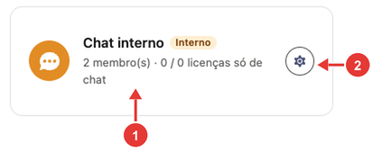
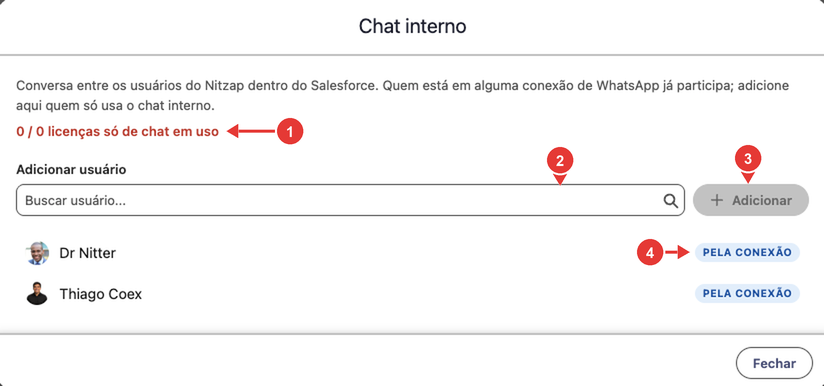
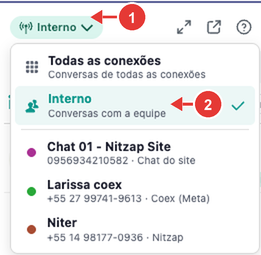
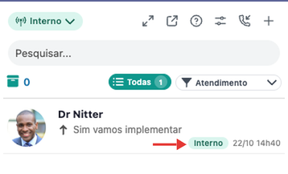

# 08. Chat interno

O chat interno é uma conversa entre os usuários do Nitzap dentro do Salesforce, sem passar pelo WhatsApp. Serve para a equipe trocar recados, tirar dúvidas sobre um cliente ou combinar uma transferência sem sair do Nitzap Omni. As mensagens ficam só entre os colegas: nenhum cliente recebe.

**Como ler as imagens:** os círculos vermelhos numerados apontam para a parte da tela que está sendo explicada. O número no círculo é o mesmo da coluna **Nº** da tabela logo abaixo da imagem.

<!-- sumario:inicio -->
**Neste artigo:**

- [Quem participa e as licenças](#nitzap/chat-interno/quem-participa-administrador)
- [Ver as conversas internas no Omni](#nitzap/chat-interno/ver-as-conversas-internas-no-omni)
- [Começar uma conversa com um colega](#nitzap/chat-interno/comecar-uma-conversa-com-um-colega)
- [O que dá para fazer na conversa](#nitzap/chat-interno/dentro-da-conversa-interna)
- [Avisos de mensagem nova](#nitzap/chat-interno/avisos-de-mensagem-nova)
- [Problemas comuns](#nitzap/chat-interno/problemas-comuns)

<!-- sumario:fim -->

## Quem participa (administrador)

Todo usuário que está em pelo menos uma conexão de WhatsApp já participa do chat interno, sem custo a mais. Para quem **não** atende WhatsApp, mas precisa falar com a equipe, o administrador libera o acesso só ao chat, usando uma **licença só de chat**.

O cadastro fica em **Nitzap Config** > **Conexões**, no cartão **Chat interno**. O cartão só aparece quando o plano da empresa inclui o chat interno.

| Nº | O que é |
| :---: | --- |
| 1 | Quantas pessoas participam do chat interno e quantas licenças só de chat estão em uso, do total contratado. |
| 2 | **Gerenciar membros:** abre a lista de participantes. |

| Nº | O que é |
| :---: | --- |
| 1 | Licenças só de chat em uso, do total contratado. Fica em vermelho quando todas estão em uso. |
| 2 | **Adicionar usuário:** busque o usuário do Salesforce que vai usar só o chat interno. |
| 3 | **Adicionar:** libera o chat interno para ele e consome uma licença só de chat. |
| 4 | **Pela conexão:** o usuário já participa por estar em uma conexão de WhatsApp. Não consome licença só de chat e não pode ser removido aqui. |

Quem foi adicionado só para o chat aparece com um **X** no lugar do selo **Pela conexão**: clique nele para tirar o usuário do chat interno e liberar a licença.

## Ver as conversas internas no Omni

As conversas com os colegas aparecem na lista do Nitzap Omni junto com as de clientes, com a etiqueta **Interno**. Para ver só elas, use o filtro de conexões:

| Nº | O que é |
| :---: | --- |
| 1 | Botão de **conexões**. Mostra o nome do filtro escolhido. |
| 2 | **Interno:** mostra só as conversas com a equipe. |

A etiqueta **Interno** (indicada pela seta) identifica a conversa com um colega.

As conversas internas aparecem com os filtros **Todas** e **Não Lidas**. Com os [filtros de atendimento](#nitzap/atendimento/ativar-os-filtros-de-atendimento) (**Novo**, **Fila**, **Meus**...), elas ficam de fora, porque não têm atendimento.

Quem usa só o chat interno, sem nenhuma conexão de WhatsApp, vê no Omni apenas as conversas com a equipe.

## Começar uma conversa com um colega

Clique em **Meus Contatos** (o **+** no topo da lista) e abra a aba **Internos**. Veja a imagem em [Iniciar uma conversa nova](#nitzap/omni/iniciar-uma-conversa-nova), no guia do Omni.

- A lista mostra os colegas que participam do chat interno, com quem está **online** primeiro (bolinha verde).
- Use **Buscar colega...** para achar pelo nome.
- Clique no colega para abrir a conversa.

O Nitzap lembra a última aba usada (**Contatos** ou **Internos**). Para quem não tem conexão de WhatsApp, a aba **Internos** já abre direto.

## Dentro da conversa interna

O cabeçalho mostra o nome do colega, **online** quando ele está conectado e a etiqueta **Chat interno**. No menu ao lado dela fica **Apagar conversa**.

O que dá para fazer:

| Recurso | Como funciona no chat interno |
| --- | --- |
| **Texto, arquivos, áudio e emoji** | Como em uma conversa de WhatsApp. |
| **Responder** uma mensagem | Igual ao WhatsApp. |
| **Reagir** | Nas mensagens recebidas do colega. |
| **Editar** | Só as suas mensagens de texto, imagem, vídeo e documento, sem limite de tempo. |
| **Apagar mensagem** | Só as suas; apaga para os dois, sem limite de tempo. |
| **Apagar conversa** | Some só para você. O colega continua com as mensagens. |

O que não aparece no chat interno, por não fazer sentido entre colegas: **modo sussurro**, **enviar contato**, **templates**, **encaminhar**, **resumir conversa** e a assinatura com o seu nome no início da mensagem. A conversa interna também **não abre atendimento**.

## Avisos de mensagem nova

Quando um colega manda mensagem, a conversa sobe na lista, pisca com som e mostra a quantidade de não lidas. Se o navegador permitir notificações, aparece também um aviso **(nome) · Chat interno** com o começo da mensagem; clique nele para abrir a conversa.

## Problemas comuns

| Situação | O que fazer |
| --- | --- |
| Não aparece a opção **Interno** no filtro nem a aba **Internos**. | O chat interno não está disponível para você. Peça ao administrador para conferir se você está em uma conexão ou na lista do chat interno. |
| Não aparece o cartão **Chat interno** no Nitzap Config. | O plano da empresa não inclui o chat interno. Fale com o suporte do Nitzap. |
| Não consigo adicionar um usuário. | Todas as licenças só de chat estão em uso (contador em vermelho). Remova alguém que não usa mais ou contrate mais licenças. |
| Um usuário aparece com **Pela conexão** e não sai da lista. | Ele participa por estar em uma conexão de WhatsApp. Para tirá-lo do chat, ele precisa sair das conexões. |
| As conversas internas sumiram da lista. | Confira se não está com um filtro de atendimento ligado. Use **Todas** ou escolha **Interno** no filtro de conexões. |
| Não recebo aviso de mensagem nova. | Libere as notificações do navegador para o Salesforce. |
