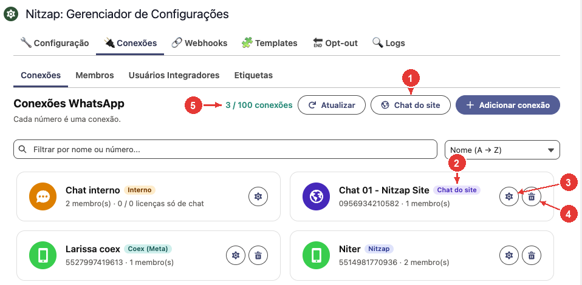
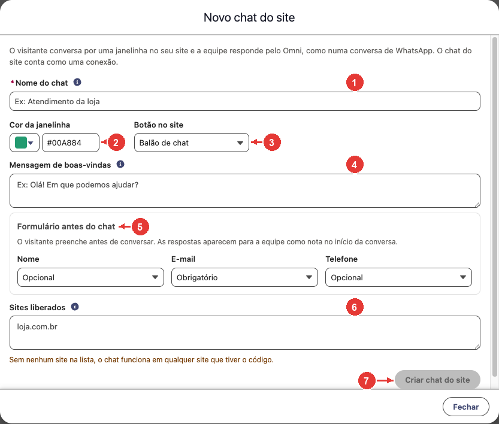
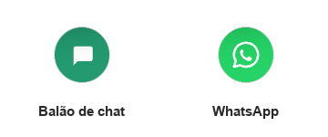
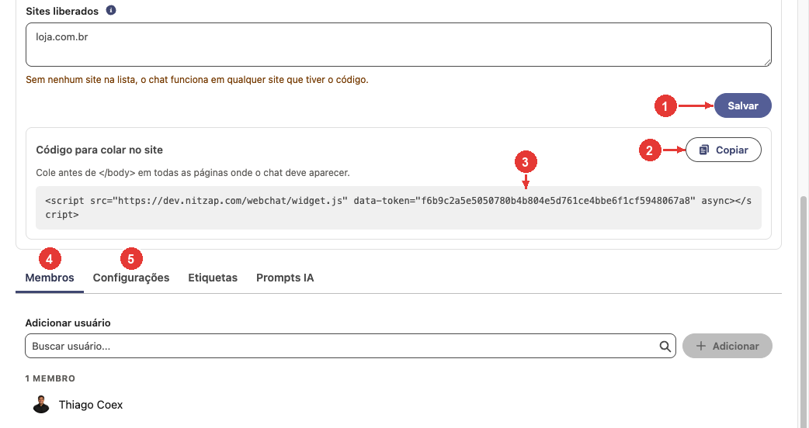
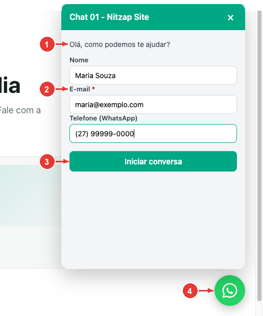
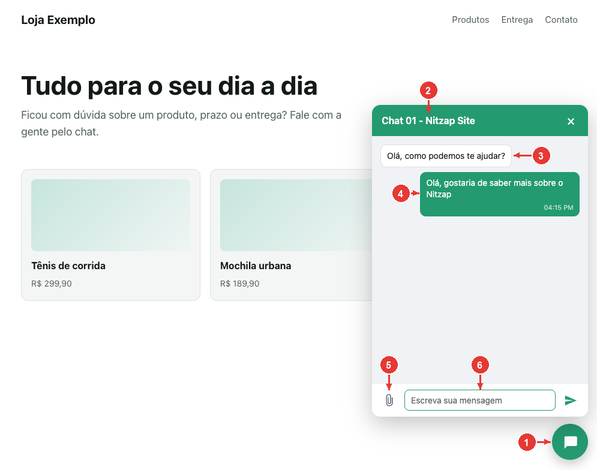
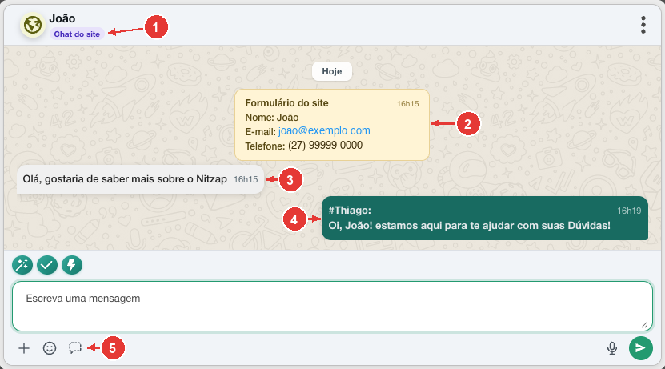

# 06. Chat do site

O chat do site coloca um botão de conversa no site da sua empresa. O visitante clica, preenche um formulário curto e conversa por uma janelinha; a equipe responde pelo Nitzap Omni, no Salesforce, como se fosse uma conversa de WhatsApp. O visitante não precisa ter WhatsApp nem instalar nada.

**Como ler as imagens:** os círculos vermelhos numerados apontam para a parte da tela que está sendo explicada. O número no círculo é o mesmo da coluna **Nº** da tabela logo abaixo da imagem.

<!-- sumario:inicio -->
**Neste artigo:**

- [Como funciona](#nitzap/chat-site/como-funciona)
- [Criar o chat do site](#nitzap/chat-site/criar-o-chat-do-site)
- [Preencher a configuração](#nitzap/chat-site/preencher-a-configuracao)
- [Colocar o chat no site](#nitzap/chat-site/colocar-o-chat-no-site)
- [O que o visitante vê](#nitzap/chat-site/o-que-o-visitante-ve)
- [Atender pelo Omni](#nitzap/chat-site/atender-pelo-omni)
- [Quem volta ao site](#nitzap/chat-site/quem-volta-ao-site)
- [Problemas comuns](#nitzap/chat-site/problemas-comuns)

<!-- sumario:fim -->

## Como funciona

1. O administrador cria o chat do site no Nitzap Config e copia um código.
2. Quem cuida do site cola esse código nas páginas. Aparece um botão no canto da tela.
3. O visitante clica no botão, preenche nome, e-mail ou telefone e começa a conversa.
4. A conversa chega no Omni para os membros do chat do site, com as respostas do formulário.
5. A resposta da equipe aparece na hora na janelinha do site.

Cada chat do site **conta como uma conexão** na licença do Nitzap, como um número de WhatsApp. Dá para ter mais de um, por exemplo um para cada site ou para cada área da empresa.

## Criar o chat do site

O chat do site é criado em **Nitzap Config** > **Conexões**. Só administradores acessam essa tela.

| Nº | O que é |
| :---: | --- |
| 1 | **Chat do site:** abre o cadastro de um chat do site novo. |
| 2 | O chat do site já criado. Ele aparece junto das conexões de WhatsApp, com o globo roxo e a etiqueta **Chat do site**. |
| 3 | **Engrenagem:** abre o chat do site para mudar a configuração, copiar o código de novo, escolher os membros e ligar o bot. |
| 4 | **Lixeira:** remove o chat do site. O código colado no site para de funcionar e todos os membros saem. |
| 5 | Quantas conexões estão em uso e quantas a licença permite. O chat do site entra nessa conta. |

## Preencher a configuração

Ao clicar em **Chat do site**, abre o formulário de cadastro.

| Nº | Campo | O que fazer |
| :---: | --- | --- |
| 1 | **Nome do chat** | Aparece no topo da janelinha do site e como nome da conexão no Nitzap. Ex.: **Atendimento da loja**. |
| 2 | **Cor da janelinha** | A cor do topo da janelinha, do botão e das mensagens do visitante. Use a cor da sua marca. |
| 3 | **Botão no site** | O desenho do botão que fica no canto da página: **Balão de chat** ou **WhatsApp** (veja abaixo). |
| 4 | **Mensagem de boas-vindas** | Texto que o visitante vê ao abrir o chat, antes de escrever. Ex.: **Olá! Em que podemos ajudar?** |
| 5 | **Formulário antes do chat** | O que o visitante preenche antes de conversar. Para **Nome**, **E-mail** e **Telefone**, escolha **Não pedir**, **Opcional** ou **Obrigatório**. O **e-mail ou o telefone precisa ser obrigatório**: é o que identifica quem volta ao site. |
| 6 | **Sites liberados** | Os endereços em que o chat pode funcionar, um por linha (ex.: `minhaempresa.com.br`). Um endereço libera também as variações dele: `minhaempresa.com.br` libera `www.minhaempresa.com.br`. Com a lista vazia, o chat funciona em qualquer site que tiver o código. |
| 7 | **Criar chat do site** | Salva. O botão só funciona com o nome preenchido e com e-mail ou telefone como obrigatório. |

Quem cria o chat do site já entra como membro e passa a receber as conversas no Omni.

**Botão no site:** o botão pode ser o balão de chat, na cor escolhida no campo 2, ou o símbolo do WhatsApp, sempre verde. Nos dois casos o visitante conversa pela janelinha do site, não pelo aplicativo do WhatsApp.

## Colocar o chat no site

Depois de salvar, a mesma tela mostra o código para colar no site. Para ver de novo mais tarde, clique na engrenagem do chat do site (nº 3 em [Criar o chat do site](#nitzap/chat-site/criar-o-chat-do-site)).

| Nº | O que é |
| :---: | --- |
| 1 | **Salvar:** grava as mudanças na configuração. Cor, textos, formulário e botão mudam no site sem precisar colar o código de novo. |
| 2 | **Copiar:** copia o código. |
| 3 | O código que vai no site. Mande para quem cuida do site e peça para colar antes de `</body>` em todas as páginas onde o chat deve aparecer. |
| 4 | **Membros:** quem atende as conversas do site no Omni. Adicione aqui os atendentes. |
| 5 | **Configurações:** bot ou agente (Agentforce ou Einstein Bot), mensagem de saudação e abertura de atendimento, do mesmo jeito que numa conexão de WhatsApp. |

O código é sempre o mesmo para aquele chat do site. Em plataformas como WordPress ou Wix, ele entra no campo de código personalizado do rodapé.

## O que o visitante vê

Ao clicar no botão, o visitante vê primeiro o formulário.

| Nº | O que é |
| :---: | --- |
| 1 | A mensagem de boas-vindas. |
| 2 | Os campos escolhidos na configuração. O asterisco vermelho marca os obrigatórios; sem eles, o botão não avança. |
| 3 | **Iniciar conversa:** envia o formulário e abre o chat. |
| 4 | O botão do canto da página, aqui no estilo **WhatsApp**. |

Depois do formulário, abre a conversa.

| Nº | O que é |
| :---: | --- |
| 1 | O botão que abre e fecha a janelinha. Quando chega resposta com a janelinha fechada, aparece uma bolinha vermelha nele. |
| 2 | O nome do chat do site. |
| 3 | A mensagem de boas-vindas. |
| 4 | A mensagem do visitante. |
| 5 | **Anexar:** envia imagem, áudio, vídeo ou documento de até 10 MB. |
| 6 | Onde o visitante escreve. **Enter** envia; **Shift + Enter** quebra a linha. |

A conversa fica guardada no navegador do visitante: se ele fechar a página e voltar, ela continua de onde parou, sem preencher o formulário de novo.

## Atender pelo Omni

A conversa do site aparece na lista do Omni como as outras, com o ícone do globo no lugar da foto. Ao abrir:

| Nº | O que é |
| :---: | --- |
| 1 | O nome que o visitante preencheu (sem nome, aparece **Visitante do site**) e a etiqueta **Chat do site**. |
| 2 | **Formulário do site:** as respostas do formulário. Só a equipe vê essa nota; o visitante não. |
| 3 | A mensagem do visitante. |
| 4 | A resposta do atendente, que aparece na hora para o visitante, com a assinatura e com **negrito**, *itálico* e links. |
| 5 | **Modo sussurro:** nota interna para a equipe, que o visitante não vê. |

No chat do site **não há**: templates da Meta, cartão de contato, encaminhar, reagir, editar ou apagar mensagem. O visitante também não vira Lead nem Contato no Salesforce, porque não tem um número de WhatsApp; o e-mail e o telefone dele ficam na nota do formulário.

## Quem volta ao site

Quem volta com o **mesmo e-mail** cai na mesma conversa do Omni, e a equipe vê todo o histórico. Sem e-mail no formulário, vale o **mesmo telefone**; o Nitzap compara só os números, então `(27) 99999-1234` e `+55 27 9999-1234` são a mesma pessoa.

Por segurança, **o visitante vê só a conversa a partir daquele formulário**. O Nitzap não confirma que o e-mail ou o telefone é de quem preencheu; mostrar o histórico deixaria qualquer pessoa ler a conversa de outra só digitando o e-mail dela.

## Problemas comuns

| Situação | O que fazer |
| --- | --- |
| O botão não aparece no site. | Confira se o código foi colado na página e se o endereço do site está em **Sites liberados** (nº 6 em [Preencher a configuração](#nitzap/chat-site/preencher-a-configuracao)). Para testar em outro endereço, inclua esse endereço na lista. |
| Não dá para salvar: **Deixe o e-mail ou o telefone como obrigatório**. | No **Formulário antes do chat**, deixe **E-mail** ou **Telefone** como **Obrigatório**. |
| Aparece **Limite de conexões atingido** ao criar. | O chat do site conta como conexão. Remova uma conexão que não é mais usada ou fale com a DataGo para aumentar a licença. |
| A conversa do site não aparece no Omni de um atendente. | O atendente precisa ser membro do chat do site (nº 4 em [Colocar o chat no site](#nitzap/chat-site/colocar-o-chat-no-site)). |
| O visitante não viu a resposta. | Ele só vê com o site aberto. Quando voltar ao site no mesmo navegador, a resposta estará na conversa. O Nitzap não avisa por e-mail. |
| Mudei a cor ou os textos e o site não mudou. | Recarregue a página do site. O código não precisa ser colado de novo. |
