# 01. Conectar um número de WhatsApp ao Nitzap

Cada número de WhatsApp usado no Nitzap é uma **conexão**. Você pode conectar um número de duas formas: lendo um **QR Code** com o celular (WhatsApp Web) ou pela **API oficial da Meta**, entrando com o Facebook. Este guia mostra as duas, de onde começar e o que fazer depois que o número aparece na lista.

<!-- sumario:inicio -->
**Neste artigo:**

- [Qual forma de conexão escolher](#nitzap/conexao-whatsapp/qual-forma-escolher)
- [Onde adicionar uma conexão](#nitzap/conexao-whatsapp/por-onde-comecar)
- [Conectar pelo QR Code](#nitzap/conexao-whatsapp/conectar-via-qr-code)
- [Conectar pela API oficial com Coexistência](#nitzap/conexao-whatsapp/conectar-pela-api-oficial-coexistencia)
- [Conectar pela API oficial (Cloud API)](#nitzap/conexao-whatsapp/api-cloud-so-api-oficial)
- [Dar nome à conexão e adicionar membros](#nitzap/conexao-whatsapp/depois-de-conectar-nome-e-membros)
- [Reconectar um número](#nitzap/conexao-whatsapp/reconectar)
- [Alternar entre canal oficial e não oficial (canal vinculado)](#nitzap/conexao-whatsapp/canal-de-envio-vinculado)
- [Problemas comuns](#nitzap/conexao-whatsapp/problemas-comuns)

<!-- sumario:fim -->

## Qual forma escolher

| Forma | Como funciona | Indicada para |
| --- | --- | --- |
| **WhatsApp (QR)** | O Nitzap entra como um aparelho conectado ao seu WhatsApp, como o WhatsApp Web. | Começar rápido com um número que já está no celular. |
| **WhatsApp Business: API Coex (Coexistência)** | API oficial da Meta ligada a um número que **continua ativo no app WhatsApp Business**. As mensagens aparecem no celular e no Nitzap ao mesmo tempo. | Empresas que já atendem pelo celular e não querem perder o número, os contatos nem o histórico. |
| **WhatsApp Business: API Cloud (só API oficial)** | O número funciona só pela API oficial e **deixa de existir no celular**. Se ele estiver ativo no WhatsApp ou no WhatsApp Business, a conta precisa ser excluída no app antes. | Números novos ou dedicados a atendimento em escala, automação e vários atendentes. |

Os templates aprovados na Meta e os disparos de campanha só funcionam nas conexões oficiais (Coex ou Cloud).

Na Coexistência, dá para ligar também o mesmo número pelo QR Code e alternar o envio entre o canal oficial e o não oficial. Veja [Canal de envio vinculado](#nitzap/conexao-whatsapp/canal-de-envio-vinculado).

## Por onde começar

As duas formas de conexão abrem a mesma janela, **Adicionar conexão**. O ponto de partida depende do seu acesso.

### Se você administra o Nitzap: Nitzap Config

1. Clique na sua foto, no canto superior direito do Salesforce, e depois no seu nome para abrir o perfil.

   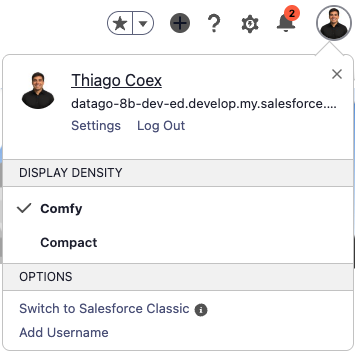

2. No perfil, abra a aba **Nitzap Config** e depois **Conexões**.

   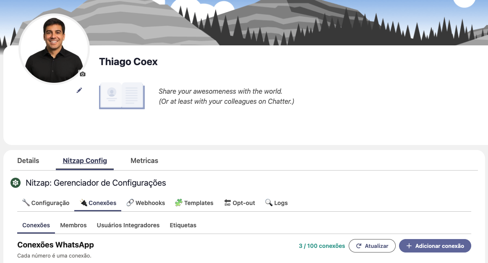

3. Clique em **Adicionar conexão**. O contador ao lado mostra quantas conexões a organização já usa do limite contratado.

   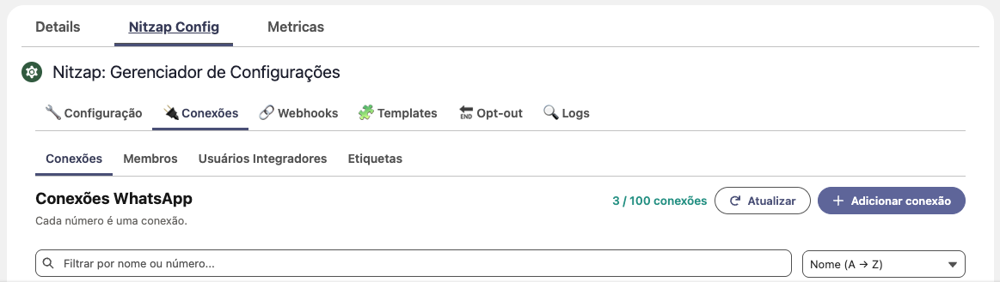

Uma conexão criada pelo Nitzap Config começa **sem membros**. Depois de conectar, adicione quem vai atender por ela (veja [Depois de conectar](#nitzap/conexao-whatsapp/depois-de-conectar-nome-e-membros)).

### Se você não administra: Nitzap Connect

1. Clique na sua foto, no canto superior direito, e depois no seu nome para abrir o perfil.
2. No cartão **Nitzap Connect**, clique em **Conectar meu WhatsApp**.

   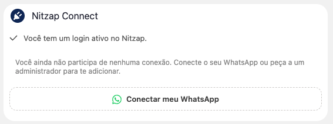

Quando a conexão termina, **você entra automaticamente como membro** dela e o número passa a aparecer no cartão, em **Conexões que você participa**.

Se o cartão mostrar **"Você ainda não tem um login no Nitzap"**, clique antes em **Criar login no Nitzap**. Só o próprio usuário consegue criar o seu login e conectar o seu WhatsApp. No perfil de outra pessoa, o botão não aparece.

## Escolher o tipo de conexão

A janela **Adicionar conexão** pergunta como você quer conectar o número.

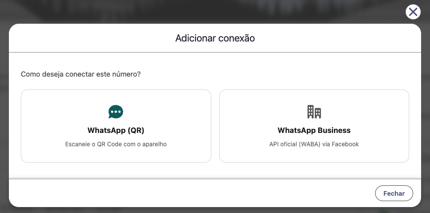

- **WhatsApp (QR):** siga a seção [Conectar via QR Code](#nitzap/conexao-whatsapp/conectar-via-qr-code).
- **WhatsApp Business:** siga a seção [Conectar pela API oficial (Coexistência)](#nitzap/conexao-whatsapp/conectar-pela-api-oficial-coexistencia).

## Conectar via QR Code

1. Em **Escolha como conectar**, deixe **QR Code** selecionado e clique em **Gerar conexão**.

   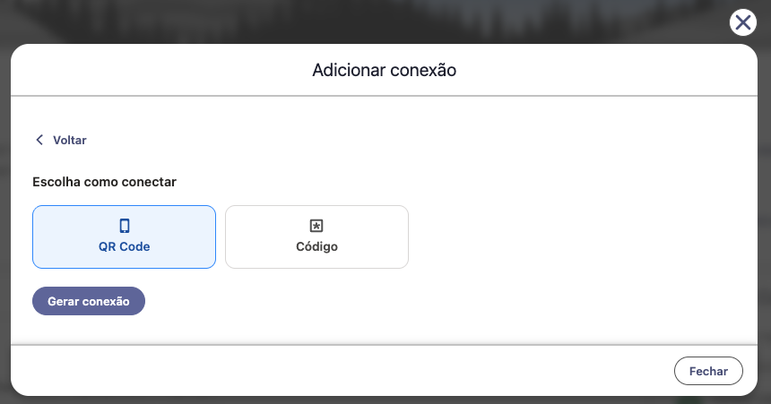

2. O QR Code aparece na tela. No celular, abra o WhatsApp e vá em **Aparelhos conectados** > **Conectar aparelho**.
3. Aponte a câmera do celular para o QR Code da tela.
4. Aguarde a mensagem **Conectado!**. A janela fecha sozinha e o número aparece na lista de conexões.

### Sem câmera: conectar com código

Se não der para ler o QR Code, use um código de pareamento:

1. Selecione **Código**.
2. Em **Número com DDI**, digite o número completo, só com dígitos: DDI + DDD + número (exemplo: `5511999999999`).
3. Clique em **Gerar conexão**. O Nitzap mostra um código.
4. No celular, abra o WhatsApp, vá em **Aparelhos conectados** > **Conectar aparelho** e escolha **Conectar com número de telefone**.
5. Digite o código que aparece no Nitzap.

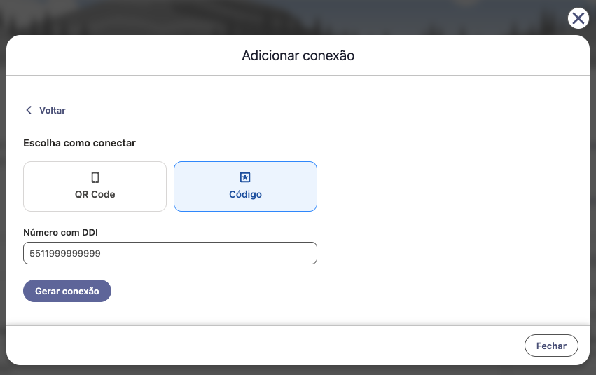

O Nitzap espera a leitura por até 10 minutos. Se passar disso, aparece **"Tempo esgotado aguardando a conexão"**: clique em **Gerar conexão** de novo para gerar um novo QR Code ou código.

## Conectar pela API oficial (Coexistência)

A conexão oficial é feita em uma janela do Facebook, na sua conta da Meta. Tenha à mão:

- O login do **Facebook** de quem administra o portfólio empresarial (Business Manager) da empresa.
- O **celular com o app WhatsApp Business** do número, que vai receber uma mensagem para confirmar a conexão.

### 1. Escolher Coexistência e entrar com o Facebook

Em **Como este número é usado hoje?**, deixe selecionado **API Coex (Coexistência)** e clique em **Entrar com Facebook**.

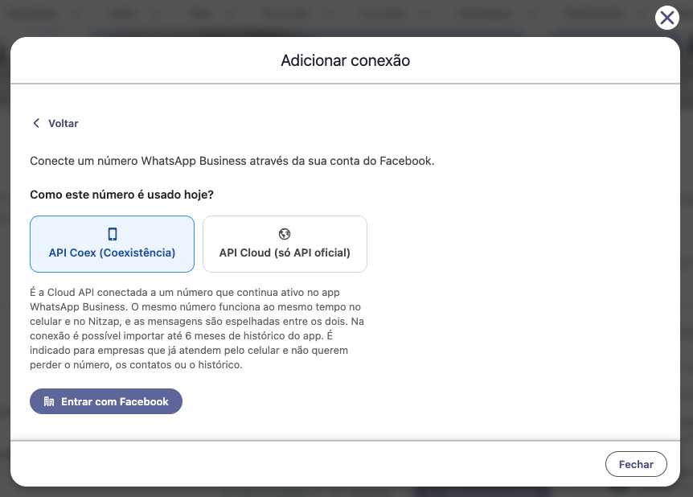

Abre uma janela **Conectando ao WhatsApp Business**. Mantenha essa janela aberta: ela fecha sozinha no final.

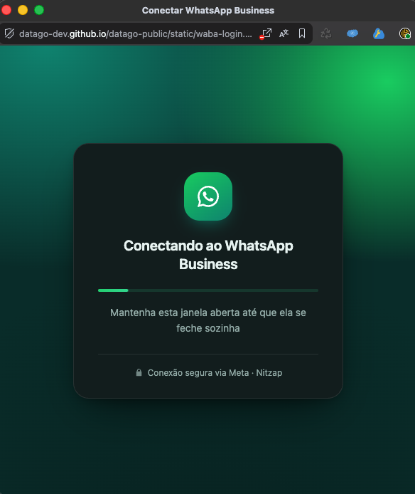

Se o navegador bloquear o pop-up do Facebook, libere pop-ups para o site (no Chrome, clique no ícone de pop-up bloqueado na barra de endereço e escolha **Sempre permitir**) e clique no link do facebook na parte superior.

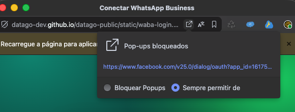

### 2. Seguir os passos no Facebook

1. Na tela **Conecte sua conta facilmente a Datago Tecnologia**, clique em **Continuar**.

   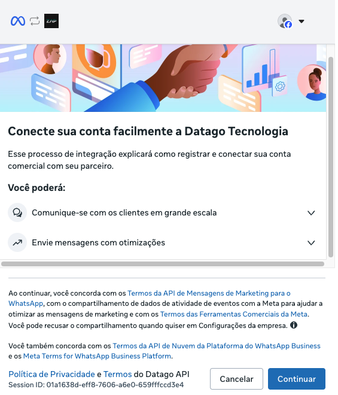

2. Em **Adicione seu número de telefone do WhatsApp**, informe o número que está no app WhatsApp Business, escolha como receber a verificação (**SMS** ou **Ligação telefônica**) e clique em **Avançar**.

   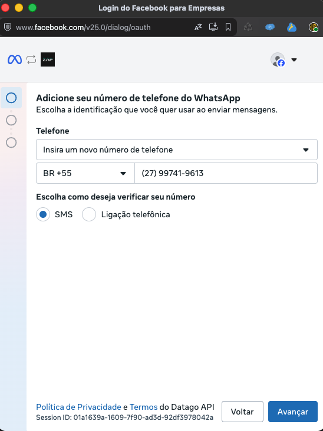

3. Em **Verifique os detalhes da sua conta**, confira o nome e a foto do perfil comercial e clique em **Avançar**. Se algo estiver errado, volte e corrija o número.

   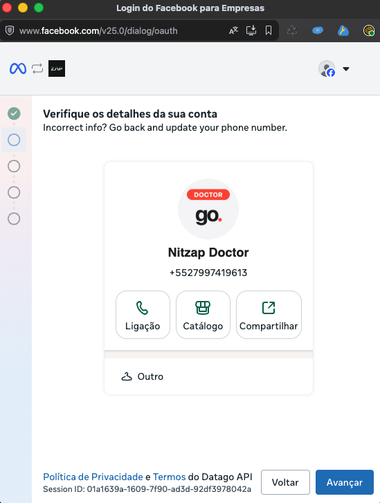

4. Em **Portfólio empresarial**, escolha o portfólio (Business Manager) da empresa e clique em **Avançar**.

   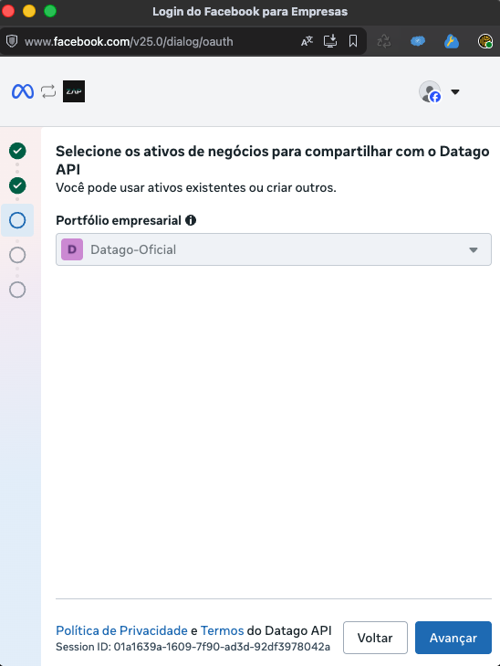

5. A tela **Importar contatos e histórico de conversas** mostra um QR Code para ler com o app WhatsApp Business. Deixe essa tela aberta e pegue o celular: o botão **Avançar** só é liberado depois que você confirmar no celular.

   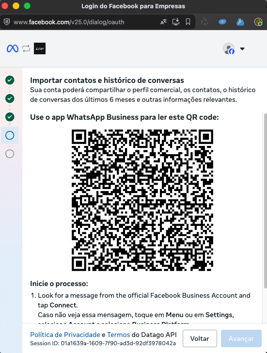

### 3. Confirmar no celular

Ao mesmo tempo em que o QR Code aparece no Facebook, o WhatsApp Business do celular recebe uma mensagem da conta oficial do **Facebook Business**: *Connect to the Business Platform*. Você pode seguir por essa mensagem ou ler o QR Code com o app. Os dois caminhos levam às mesmas telas.

1. Abra a mensagem e toque em **Connect**. Se a mensagem não chegar, no app WhatsApp Business vá em **Configurações** > **Conta** > **Plataforma comercial** e leia o QR Code da tela do Facebook.

   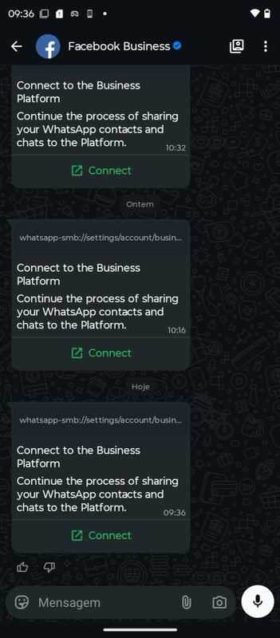

2. Na tela **Conectar à Plataforma comercial**, toque em **Conectar à Plataforma comercial**.

   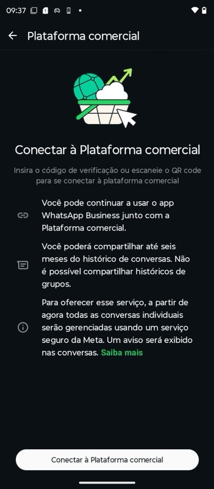

3. Escolha se quer trazer o histórico e toque em **Confirmar**:
   - **Compartilhar todas as conversas:** traz até 6 meses de histórico das conversas individuais. Histórico de grupos não é compartilhado.
   - **Não compartilhar conversas:** as conversas começam do zero na plataforma.

   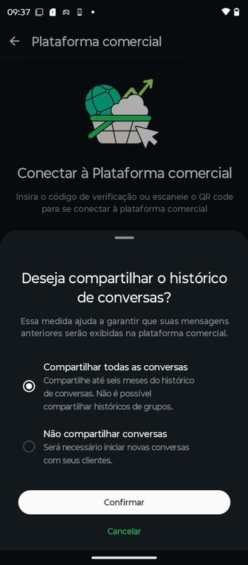

4. Aguarde. A conexão pode levar até 45 segundos.

   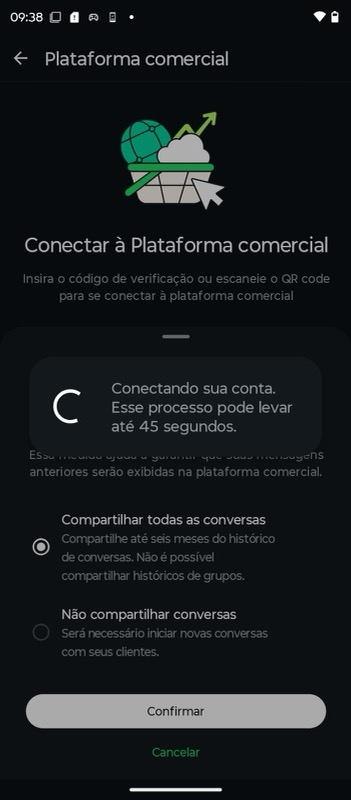

5. Quando aparecer **Sua conta está conectada à empresa Datago Tecnologia**, toque em **OK**.

   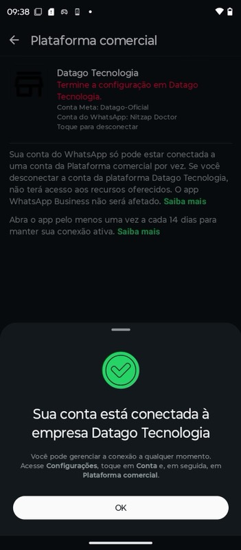

Para manter a coexistência ativa, **abra o app WhatsApp Business no celular pelo menos uma vez a cada 14 dias**. A conexão pode ser gerenciada no app em **Configurações** > **Conta** > **Plataforma comercial**.

### 4. Concluir no Facebook

Volte para a janela do Facebook no computador e clique em **Avançar** na tela do QR Code.

1. Em **Confirme ou edite sua conta do WhatsApp Business**, confira o **nome da conta** e o **fuso horário** e clique em **Avançar**.

   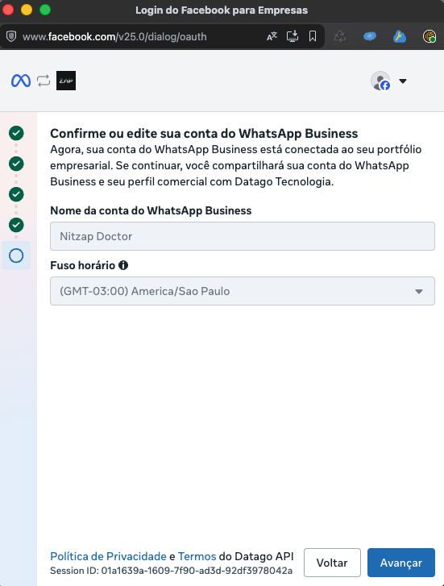

2. Em **Reveja o que você vai compartilhar com Datago API**, confira a empresa, a conta do WhatsApp e as permissões e clique em **Confirmar**.

   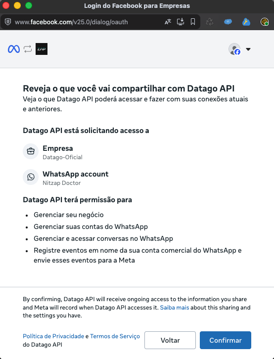

3. Na tela **Sua conta está conectada a Datago Tecnologia**, clique em **Concluir**. A forma de pagamento da Meta pode ser cadastrada depois.

   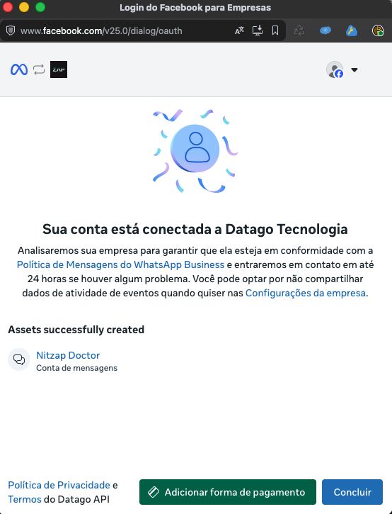

Aguarde a janela do Facebook fechar e o número aparece na lista de conexões com a etiqueta **Coex (Meta)**.

### API Cloud (só API oficial)

O caminho é o mesmo: selecione **API Cloud (só API oficial)** e clique em **Entrar com Facebook**. A diferença é que não existe a etapa no celular, porque é uma conexão apenas oficial sem utilizar o número no app de whatsapp. Antes de começar, confira se o número **não está ativo** no WhatsApp nem no WhatsApp Business. Se estiver, exclua a conta no app primeiro.

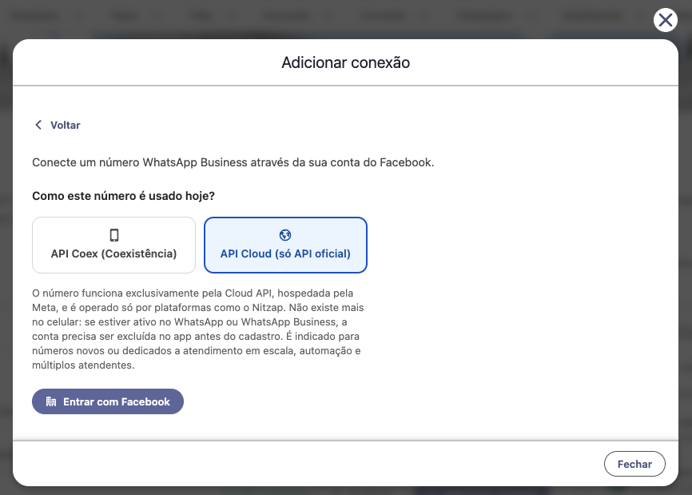

## Depois de conectar: nome e membros

A conexão nova aparece em **Nitzap Config** > **Conexões**, identificada pelo número.

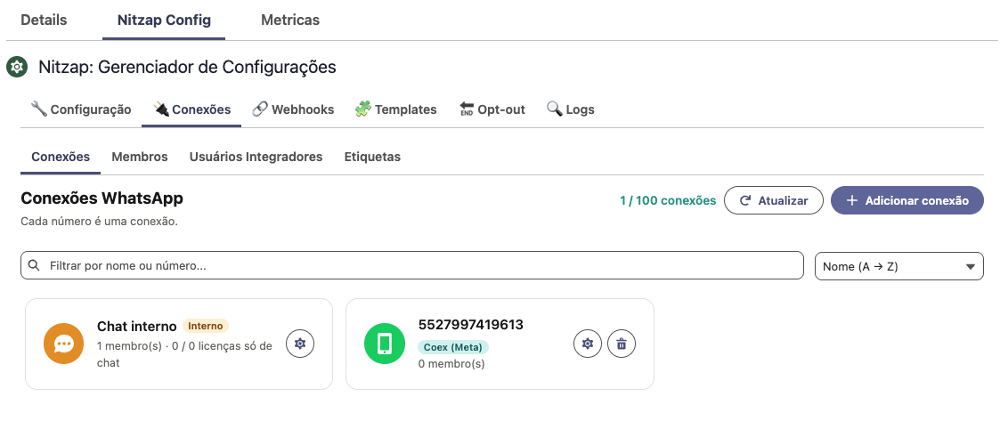

Cada conexão tem dois botões:

| Botão | O que faz |
| --- | --- |
| **Engrenagem** (⚙) | Abre **Gerenciar conexão**, onde você dá nome à conexão e adiciona membros. |
| **Lixeira** | Remove a conexão. O Nitzap pede confirmação antes. Ao confirmar, o WhatsApp é desconectado e **todos os membros saem da conexão**. Para usar o número de novo, será preciso conectá-lo do zero, com um novo QR Code ou um novo login no Facebook. |

Clique na engrenagem (⚙) para continuar.

### Dar um nome à conexão

Em **Nome da conexão**, digite um nome fácil de reconhecer (por exemplo, o setor ou a pessoa que usa o número) e clique em **Salvar nome**. Esse nome aparece no lugar do número nas listas do Nitzap.

### Adicionar membros

Os membros são os usuários do Salesforce que atendem por essa conexão.

1. Na aba **Membros**, em **Adicionar usuário**, busque o usuário pelo nome.
2. Clique em **Adicionar**.

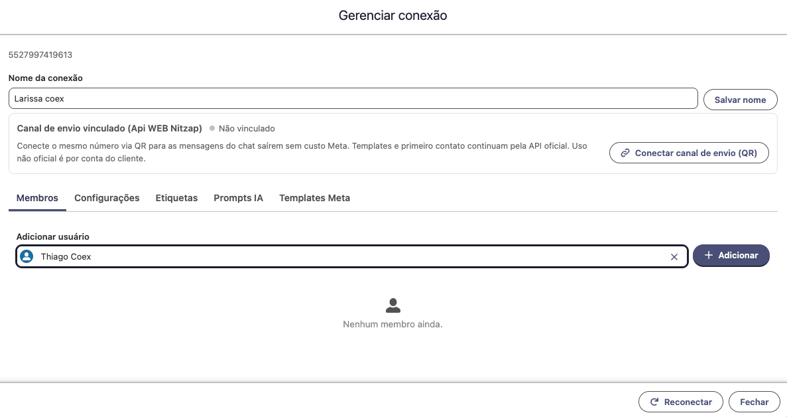

O usuário aparece na lista de membros. Repita para cada pessoa que vai usar o número.

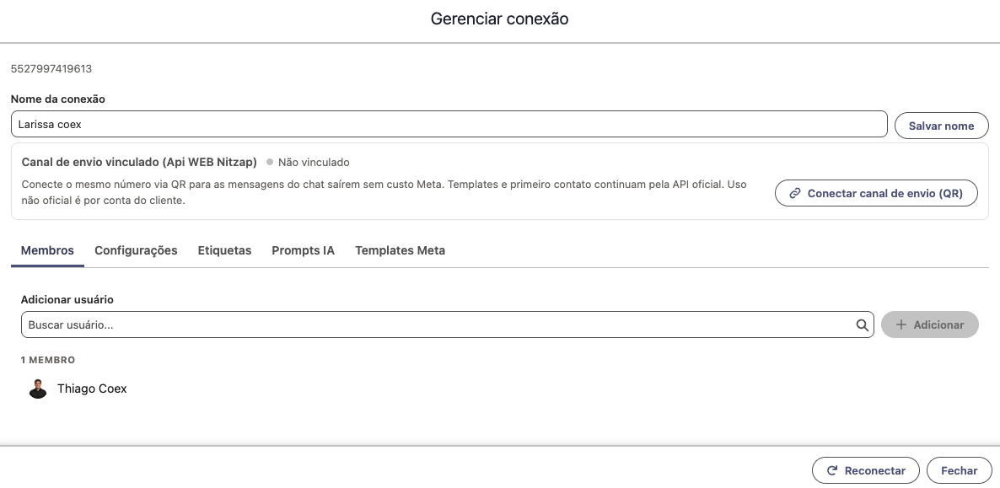

### Reconectar

Use **Reconectar** quando a conexão cair ou o celular for trocado. O botão fica no rodapé da tela **Gerenciar conexão** e abre de novo a janela **Adicionar conexão**, para refazer a ligação do número pelo mesmo caminho usado na primeira vez (QR Code ou Facebook). Diferente da lixeira, **Reconectar não remove a conexão nem os membros**.

Quando uma conexão fica inativa, ela aparece na lista marcada como **inativa** e o botão **Reconectar** aparece também ali, ao lado da engrenagem.

### Outros pontos da tela Gerenciar conexão

- [Canal de envio vinculado (Api WEB Nitzap)](#nitzap/conexao-whatsapp/canal-de-envio-vinculado)
- [Configurações](#nitzap/conexao-whatsapp/configuracoes-da-conexao)
- [Etiquetas](etiquetas.md)
- [Prompts IA](#nitzap/conexao-whatsapp/prompts-ia)
- [Templates Meta](#nitzap/templates/criar-o-template-pelo-salesforce)

## Canal de envio vinculado

Uma conexão pela **API oficial com Coexistência** pode ter também um **canal de envio vinculado**: o mesmo número conectado pelo QR Code (**Api WEB Nitzap**). Com os dois ligados, o Nitzap alterna o envio das mensagens do chat entre o canal **oficial** (Meta) e o **não oficial** (Api WEB).

| Canal | O que é | Custo |
| --- | --- | --- |
| **API oficial (Meta)** | A conexão Coexistência, ligada pelo Facebook. | A Meta pode cobrar pelas mensagens. |
| **Canal vinculado (Api WEB)** | O mesmo número, conectado pelo QR Code como um aparelho, igual ao WhatsApp Web. | Sem custo da Meta. |

**O que sempre sai pela API oficial:** os **templates** e o **primeiro contato** com o cliente. O canal vinculado só envia as mensagens do chat.

**Atenção:** o canal vinculado usa o WhatsApp por um caminho que não é o oficial da Meta. Esse uso é por conta e risco da empresa.

O canal vinculado só aparece em conexões **Coexistência**. Não aparece nas conexões só QR Code nem nas **API Cloud (só API oficial)**, porque o número da API Cloud não existe mais no celular.

**Como ler as imagens:** os círculos vermelhos numerados apontam para a parte da tela que está sendo explicada. O número no círculo é o mesmo da coluna **Nº** da tabela logo abaixo da imagem.

### 1. Vincular o número pelo QR Code

Em **Nitzap Config** > **Conexões**, clique na engrenagem (⚙) da conexão Coexistência para abrir **Gerenciar conexão**.

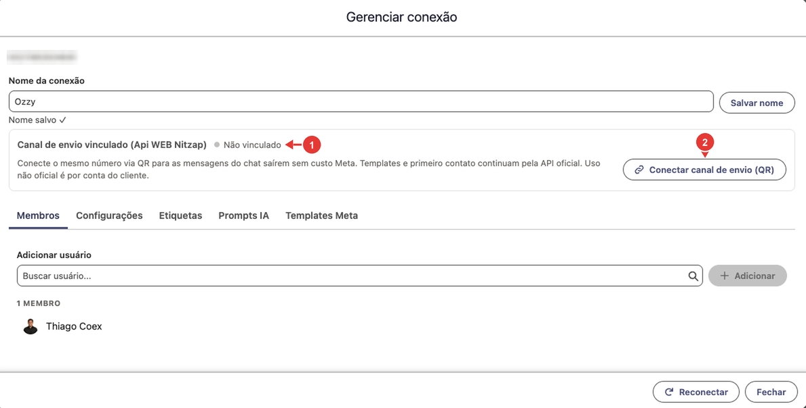

| Nº | O que é |
| :---: | --- |
| 1 | Situação do canal: **Não vinculado**. |
| 2 | **Conectar canal de envio (QR):** abre a janela para vincular. |

A janela **Adicionar conexão** já vem com o número da conexão oficial. Leia o QR Code com o **mesmo celular** em que está o WhatsApp Business desse número.

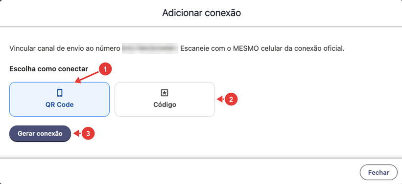

| Nº | O que é |
| :---: | --- |
| 1 | **QR Code:** para ler com a câmera do celular. |
| 2 | **Código:** se não der para ler o QR Code. O número já vem preenchido. Veja [Sem câmera: conectar com código](#nitzap/conexao-whatsapp/sem-camera-conectar-com-codigo). |
| 3 | **Gerar conexão:** mostra o QR Code (ou o código). |

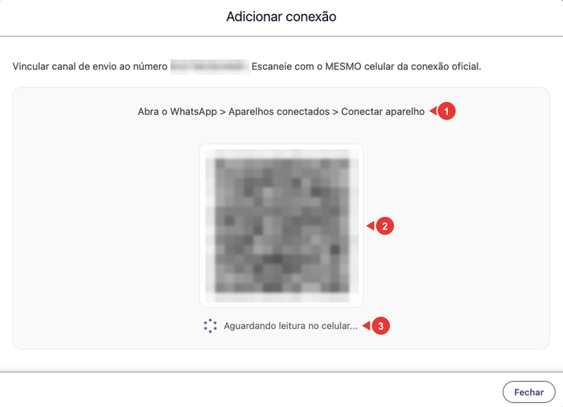

| Nº | O que fazer |
| :---: | --- |
| 1 | No celular, abra o WhatsApp Business e vá em **Aparelhos conectados** > **Conectar aparelho**. |
| 2 | Aponte a câmera para o QR Code. |
| 3 | Aguarde: enquanto aparece **Aguardando leitura no celular...**, o Nitzap ainda não recebeu a leitura. |

### 2. Conferir se o canal está conectado

Depois da leitura, a janela fecha e o cartão muda:

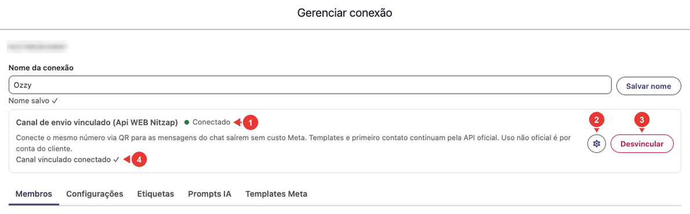

| Nº | O que é |
| :---: | --- |
| 1 | Situação: **Conectado** (bolinha verde). Se aparecer **Desconectado**, o celular perdeu a ligação com o Nitzap (veja [Problemas comuns](#nitzap/conexao-whatsapp/problemas-comuns)). |
| 2 | **Engrenagem:** abre as configurações do canal vinculado (passo 3). |
| 3 | **Desvincular:** remove o canal vinculado. |
| 4 | Confirmação **Canal vinculado conectado ✓**. |

A partir daqui, com a configuração padrão, as mensagens do chat já saem pelo canal vinculado e **1 a cada 20** sai pela API oficial.

### 3. Escolher como alternar entre oficial e não oficial

Clique na **engrenagem** do cartão. As configurações são salvas sozinhas, logo depois de você mudar: não há botão Salvar.

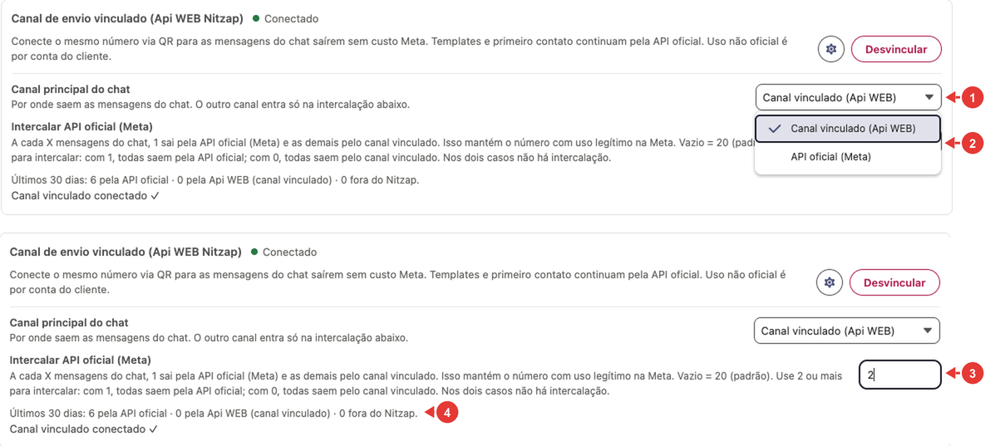

| Nº | Campo | O que é |
| :---: | --- | --- |
| 1 | **Canal principal do chat** | Por onde sai a maioria das mensagens do chat. |
| 2 | Opções do canal principal | **Canal vinculado (Api WEB)** (padrão) ou **API oficial (Meta)**. |
| 3 | **Intercalar** | De quantas em quantas mensagens 1 sai pelo outro canal (tabela abaixo). O nome do campo muda conforme o canal principal: **Intercalar API oficial (Meta)** ou **Intercalar canal vinculado (Api WEB)**. |
| 4 | Resumo dos **últimos 30 dias** | Quantas mensagens saíram pela API oficial, quantas pelo canal vinculado e quantas **fora do Nitzap** (enviadas direto do celular). |

#### Como o número da intercalação funciona

Com o canal principal **Canal vinculado (Api WEB)**, o campo se chama **Intercalar API oficial (Meta)**:

| Valor no campo | Como as mensagens do chat saem |
| --- | --- |
| Vazio | Igual a 20 (padrão): a cada 20 mensagens, 1 pela API oficial e 19 pelo canal vinculado. |
| **2** ou mais | A cada X mensagens, 1 pela API oficial e as demais pelo canal vinculado. Com **2**, alterna uma e uma. |
| **1** | Todas pela API oficial. Não há intercalação. |
| **0** | Todas pelo canal vinculado. Não há intercalação. |

Com o canal principal **API oficial (Meta)**, a lógica se inverte e o campo se chama **Intercalar canal vinculado (Api WEB)**:

| Valor no campo | Como as mensagens do chat saem |
| --- | --- |
| Vazio | Igual a 20 (padrão): a cada 20 mensagens, 1 pelo canal vinculado e 19 pela API oficial. |
| **2** ou mais | A cada X mensagens, 1 pelo canal vinculado e as demais pela API oficial. |
| **1** | Todas pelo canal vinculado. Não há intercalação. |
| **0** | Todas pela API oficial. Não há intercalação. |

**Por que intercalar:** manter algumas mensagens saindo pela API oficial mostra para a Meta que o número continua em uso legítimo na conexão oficial.

### 4. Ver por onde cada mensagem saiu

Na conversa, as mensagens enviadas pelo canal vinculado têm uma **bolinha verde** ao lado do horário. Passe o mouse sobre ela para ver **Enviada pela conexão vinculada (Api WEB Nitzap)**.

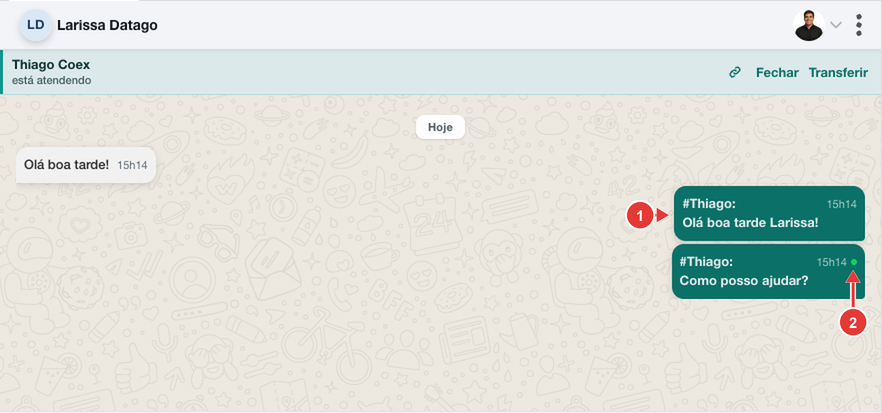

| Nº | O que é |
| :---: | --- |
| 1 | Sem bolinha: a mensagem saiu pela **API oficial**. |
| 2 | Com bolinha verde: a mensagem saiu pelo **canal vinculado (Api WEB)**. |

No exemplo, a intercalação está em **2**: uma mensagem sai pela API oficial e a seguinte pelo canal vinculado.

Para o cliente, não muda nada: as duas mensagens chegam do mesmo número, na mesma conversa.

### 5. Acompanhar os envios nos Logs (administrador)

Em **Nitzap Config** > **Logs**, duas subabas mostram por onde as mensagens saíram.

#### Envios por canal

Soma, por dia e por conexão, quantas mensagens saíram por cada canal. É aqui que dá para conferir se a intercalação está funcionando como você configurou.

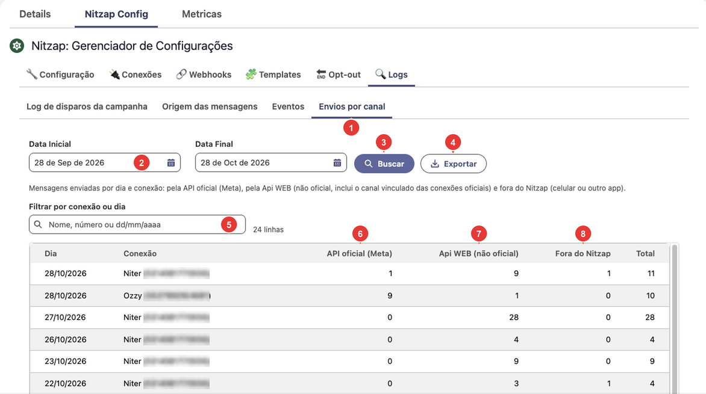

| Nº | O que é |
| :---: | --- |
| 1 | Subaba **Envios por canal**. Ao abrir, já carrega os **últimos 30 dias**. |
| 2 | **Data Inicial** e **Data Final** do período. |
| 3 | **Buscar:** carrega o período escolhido. |
| 4 | **Exportar:** baixa as linhas da tabela em CSV, com uma linha de **Total do período** no final. |
| 5 | **Filtrar por conexão ou dia:** filtra as linhas já carregadas pelo nome ou número da conexão ou pela data (dd/mm/aaaa), sem buscar de novo. Ao lado aparece quantas linhas estão na tabela. |
| 6 | **API oficial (Meta):** mensagens enviadas pela API oficial. |
| 7 | **Api WEB (não oficial):** mensagens enviadas pelas conexões QR Code e pelo canal vinculado das conexões oficiais. |
| 8 | **Fora do Nitzap:** mensagens enviadas direto do celular ou por outro app. |

A coluna **Total** soma as três. No fim da tabela, a linha **Total do período** soma todas as linhas que estão aparecendo.

Em uma conexão oficial com canal vinculado (como a **Ozzy**, no exemplo), a coluna **Api WEB** conta as mensagens que saíram pelo canal vinculado e a coluna **API oficial** as que saíram pela Meta.

#### Origem das mensagens

Mostra, conversa por conversa, **quem** enviou: um usuário pelo Nitzap, uma integração ou alguém direto pelo WhatsApp.

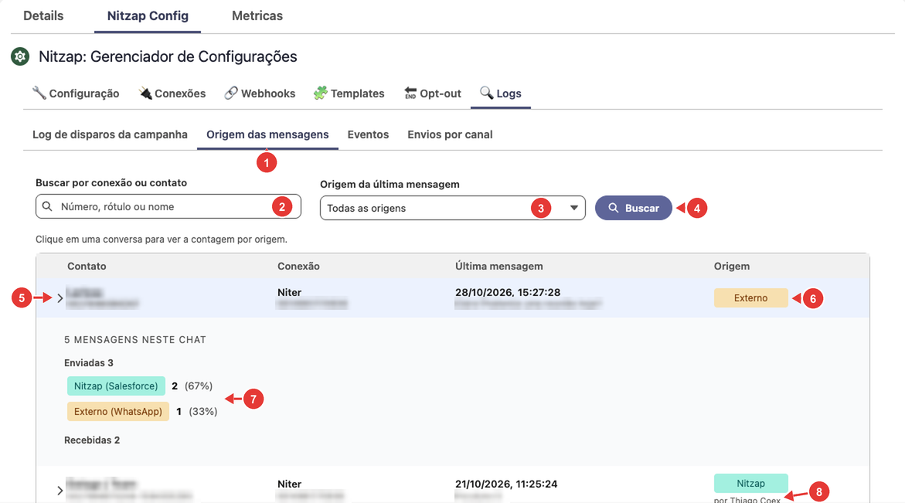

| Nº | O que é |
| :---: | --- |
| 1 | Subaba **Origem das mensagens**. |
| 2 | **Buscar por conexão ou contato:** número, nome da conexão ou nome do contato. |
| 3 | **Origem da última mensagem:** mostra só as conversas cuja última mensagem enviada veio de uma origem (tabela abaixo). |
| 4 | **Buscar.** |
| 5 | Clique na conversa para abrir a contagem por origem. |
| 6 | **Origem** da última mensagem enviada na conversa. |
| 7 | Contagem da conversa: total de mensagens, quantas foram **enviadas** (por origem, com a porcentagem) e quantas foram **recebidas** do contato. |
| 8 | Quando a origem é **Nitzap**, aparece o nome do usuário que enviou. |

| Origem | Quem enviou |
| --- | --- |
| **Nitzap (Salesforce)** | Um usuário, pelo Nitzap dentro do Salesforce. |
| **Integração (API)** | Um sistema, pela API do Nitzap (por exemplo, com um [usuário integrador](#nitzap/usuario-integrador-postman/1-criar-a-credencial)). |
| **Externo (WhatsApp)** | Alguém direto no WhatsApp do celular ou em outro app, fora do Nitzap. |
| **Sem origem** | O Nitzap não conseguiu identificar. |

A lista mostra 20 conversas por página; use as setas abaixo da tabela para passar de página.

### Desvincular

Clique em **Desvincular** no cartão e confirme. O canal vinculado é removido e **todas as mensagens do chat voltam a sair pela API oficial**. A conexão oficial e os membros continuam como estavam.

## Problemas comuns

| Mensagem ou situação | O que fazer |
| --- | --- |
| O navegador bloqueou a janela de login. | Libere pop-ups para o site e clique em **Entrar com Facebook** de novo. |
| Tempo esgotado aguardando a conexão. | O QR Code ou o código expirou. Clique em **Gerar conexão** para gerar outro. |
| Tempo esgotado aguardando o login do Facebook. | A janela do Facebook ficou aberta sem terminar. Feche-a e recomece em **Entrar com Facebook**. |
| A mensagem do Facebook Business não chegou no celular. | Confira se o número informado no Facebook é o mesmo do app WhatsApp Business e se o app está atualizado. |
| O número conectado não aparece no chat de um usuário. | O usuário não é membro da conexão. Adicione-o em **Gerenciar conexão** > **Membros**. |
| A coexistência caiu depois de alguns dias. | O app WhatsApp Business ficou mais de 14 dias sem ser aberto. Abra o app e use **Reconectar** se precisar. |
| O botão **Conectar canal de envio (QR)** não aparece. | O canal vinculado só existe em conexões **Coexistência**. Conexões só QR Code e **API Cloud** não têm essa opção. |
| O canal vinculado aparece como **Desconectado**. | O celular desconectou o aparelho do Nitzap (por exemplo, em **Aparelhos conectados**). Clique em **Desvincular** e vincule de novo pelo QR Code. |
| Nenhuma mensagem tem a bolinha verde. | Confira na engrenagem do canal vinculado se o campo **Intercalar** não está em **1** (com o canal vinculado como principal), o que manda tudo pela API oficial. |
