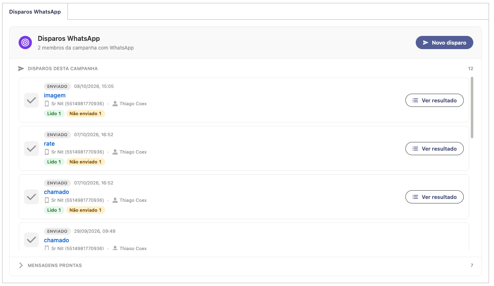
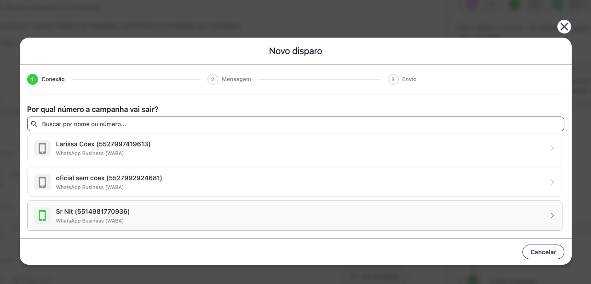
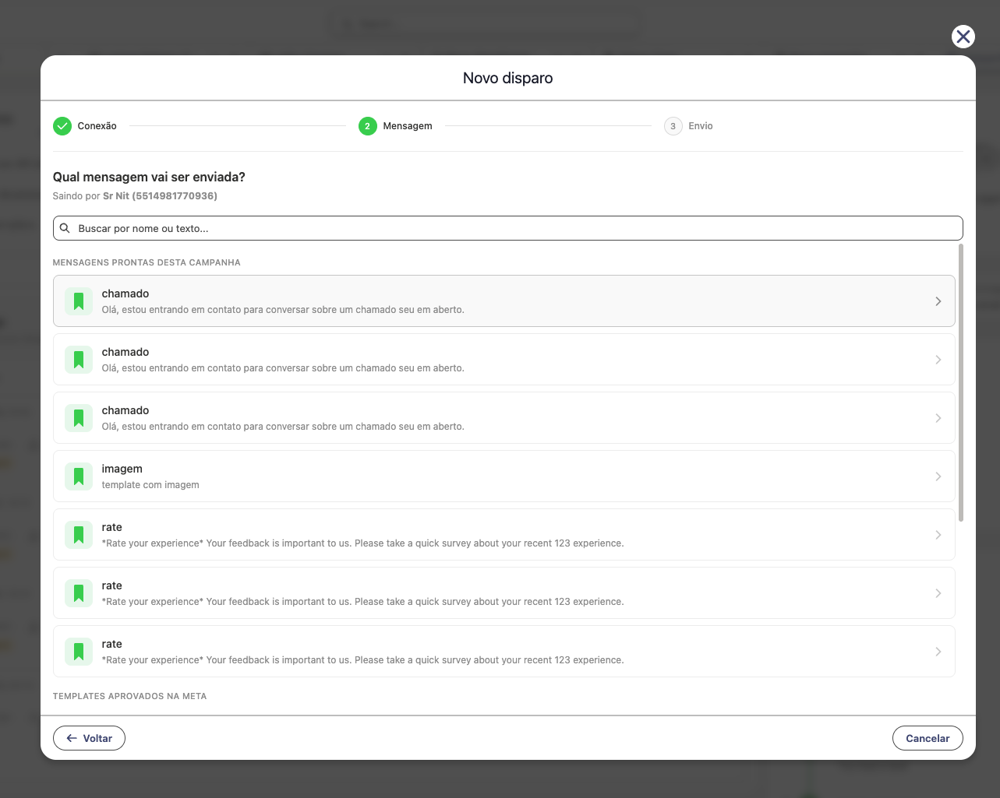
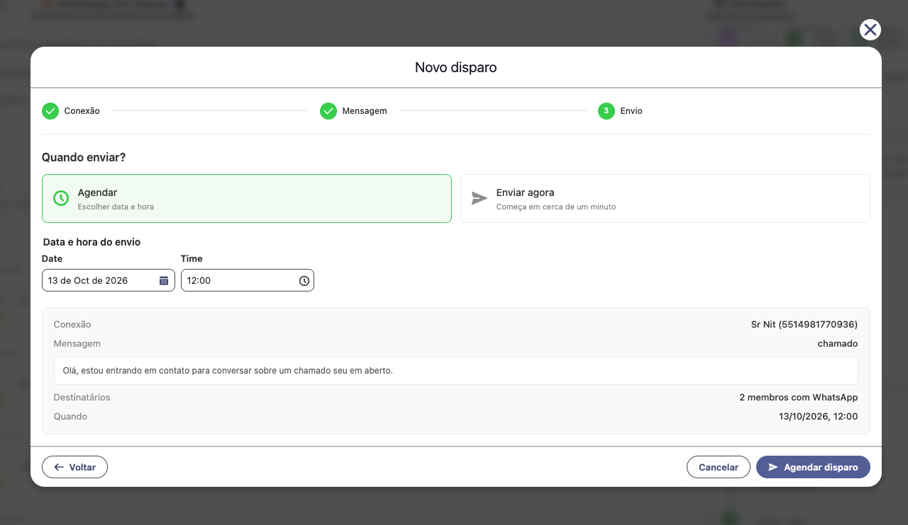
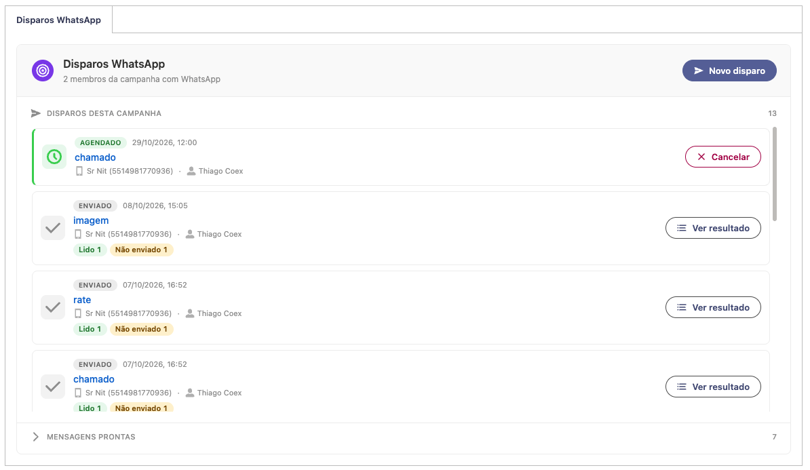

# 03. Disparo de campanha pelo WhatsApp

O disparo de campanha envia um template aprovado na Meta para todos os membros de uma Campanha do Salesforce que têm WhatsApp cadastrado. Tudo é feito na aba **Disparos WhatsApp** da própria Campanha: você escolhe o número de saída, a mensagem e quando enviar, e depois acompanha quem recebeu, quem leu e quem ficou de fora.

<!-- sumario:inicio -->
**Neste artigo:**

- [Antes de começar](#nitzap/disparo-campanha/antes-de-comecar)
- [1. Abrir a aba Disparos WhatsApp](#nitzap/disparo-campanha/1-abrir-a-aba-disparos-whatsapp)
- [2. Conexão: por qual número a campanha vai sair](#nitzap/disparo-campanha/2-conexao-por-qual-numero-a-campanha-vai-sair)
- [3. Mensagem: o que vai ser enviado](#nitzap/disparo-campanha/3-mensagem-o-que-vai-ser-enviado)
  - [Mensagens prontas desta campanha](#nitzap/disparo-campanha/mensagens-prontas-desta-campanha)
  - [Templates aprovados na Meta](#nitzap/disparo-campanha/templates-aprovados-na-meta)
- [4. Envio: quando enviar](#nitzap/disparo-campanha/4-envio-quando-enviar)
- [5. Acompanhar o disparo](#nitzap/disparo-campanha/5-acompanhar-o-disparo)
  - [O que cada contador significa](#nitzap/disparo-campanha/o-que-cada-contador-significa)
  - [Ver resultado](#nitzap/disparo-campanha/ver-resultado)
- [Cancelar um disparo agendado](#nitzap/disparo-campanha/cancelar-um-disparo-agendado)
- [Reutilizar uma mensagem pronta](#nitzap/disparo-campanha/reutilizar-uma-mensagem-pronta)
- [Números duplicados](#nitzap/disparo-campanha/numeros-duplicados)
- [Problemas comuns](#nitzap/disparo-campanha/problemas-comuns)

<!-- sumario:fim -->

## Antes de começar

Confira estes quatro pontos. Quase todo "não consigo disparar" é um deles.

- **Conexão oficial (WABA).** O disparo sai só por número conectado no WhatsApp Business oficial. Conexões não oficiais não aparecem na lista.
- **Template aprovado na Meta** nessa conexão. Template em análise ou recusado não aparece.
- **Membros com WhatsApp.** Só recebe o membro (Lead ou Contato) com o campo **Nitzap WhatsApp Id** preenchido (em Conta Pessoal, vale o campo da Conta). O topo da aba mostra quantos membros da campanha têm WhatsApp.
- **Aba na página da Campanha.** Se a aba **Disparos WhatsApp** não aparece, peça ao administrador do Salesforce para adicionar o componente **Nitzap: Campaign Template Manager Tabs** à página de registro de Campanha, no Criador de Aplicativo Lightning.

## 1. Abrir a aba Disparos WhatsApp

Abra a Campanha e vá até a aba **Disparos WhatsApp**. Ela tem três partes:

- **Cabeçalho:** quantos membros da campanha têm WhatsApp e o botão **Novo disparo**.
- **Disparos desta campanha:** tudo que já foi enviado ou está agendado, do mais recente para o mais antigo.
- **Mensagens prontas:** as mensagens que você já preencheu nesta campanha, para reutilizar (clique no título para abrir).

Clique em **Novo disparo**. O assistente tem três passos: **Conexão**, **Mensagem** e **Envio**.

## 2. Conexão: por qual número a campanha vai sair

Escolha o número de WhatsApp que vai enviar. Com muitas conexões, use a busca por nome ou número.

- A lista traz **todas as conexões oficiais da organização**, não só as suas.
- Se a organização tem **uma conexão oficial só**, este passo é pulado e o assistente já abre na mensagem.

## 3. Mensagem: o que vai ser enviado

A tela mostra as mensagens disponíveis para a conexão escolhida, em dois grupos. Use a busca para filtrar por nome ou por trecho do texto.

### Mensagens prontas desta campanha

São mensagens que alguém já preencheu nesta campanha, por esta mesma conexão. Clicar em uma delas leva direto para o passo de envio, sem preencher nada de novo.

### Templates aprovados na Meta

É a lista de templates aprovados da conexão, separada por categoria (Marketing, Utilitários, Autenticação). A lista é buscada na Meta na hora, então um template recém-aprovado já aparece.

Ao clicar em um template, abre a tela de preenchimento:

1. Confira a prévia de como a mensagem chega no WhatsApp.
2. Preencha cada variável do template. Você pode **digitar um texto fixo** ou **inserir um campo do membro da campanha**, para cada pessoa receber o próprio valor (nome, cidade, vendedor).
3. Se o template tem **botão com link dinâmico** ou **imagem, vídeo ou documento no cabeçalho**, dá para personalizar o final do link e a mídia. Em branco, vale o padrão do template.
4. Clique em **Concluir**.

A mensagem preenchida fica salva em **Mensagens prontas** e pode ser usada em novos disparos da mesma campanha.

## 4. Envio: quando enviar

Escolha uma das duas opções:

| Opção | O que acontece |
| --- | --- |
| **Agendar** | Você escolhe a data e a hora. A sugestão inicial é a próxima hora cheia. A data precisa estar no futuro. |
| **Enfileirar agora** | O disparo entra na fila e começa em cerca de um minuto. Em versões anteriores do pacote a opção se chama **Enviar agora**, como na imagem. |

Antes de confirmar, leia o resumo: **Conexão**, **Mensagem** (com o texto que vai sair), **Destinatários** e **Quando**.

Dois avisos podem aparecer nesta tela:

- **"Nenhum membro desta campanha tem WhatsApp cadastrado."** O botão de confirmar fica bloqueado. Adicione membros com número e abra o disparo de novo.
- **"N número(s) duplicado(s) na campanha."** O disparo é permitido, mas o mesmo número recebe a mensagem mais de uma vez. Veja a seção **Números duplicados**, mais abaixo.

Confirme em **Agendar disparo** ou **Disparar agora**.

## 5. Acompanhar o disparo

O disparo aparece no topo da lista.

Cada linha mostra a situação, a data, o nome da mensagem, a conexão de saída e quem criou o disparo. Clicar no nome da mensagem abre a Tarefa do Salesforce que representa o disparo.

| Situação | O que significa |
| --- | --- |
| **Agendado** | Ainda não saiu. Mostra a data marcada e o botão **Cancelar**. |
| **Enviado** | O envio já foi processado. Mostra a data em que rodou. |

**Enviado não quer dizer que todo mundo recebeu.** O que aconteceu com cada pessoa está nos contadores coloridos abaixo da linha e no botão **Ver resultado**.

### O que cada contador significa

| Contador | O que significa |
| --- | --- |
| **Enviado** | A Meta aceitou a mensagem e ainda não confirmou a entrega. |
| **Recebido** | A mensagem chegou no aparelho. |
| **Lido** | A pessoa abriu a mensagem. Só aparece para quem mantém a confirmação de leitura ligada no WhatsApp. |
| **Erro** | A Meta aceitou a mensagem, mas não conseguiu entregar. |
| **Não enviado** | A mensagem nem saiu: membro sem WhatsApp, opt-out ou envio recusado. |

Cada destinatário conta em um contador só, o da etapa mais avançada em que está. Os números mudam conforme as confirmações chegam.

### Ver resultado

O botão **Ver resultado** abre a lista de destinatários do disparo, com **Nome**, **Telefone**, **Status**, **Data** e **Motivo**.

- Os botões no topo filtram por status. **Todos** mostra o disparo inteiro.
- A lista carrega 50 por vez. Use **Carregar mais** para ver o restante.
- O botão de atualizar busca os status mais recentes.
- **Exportar tudo (CSV)** baixa o disparo inteiro, mesmo com um filtro aplicado. A planilha traz Nome, Telefone, Status, Enviado em, Recebido em, Lido em, Falha em e Motivo.

A coluna **Motivo** explica os casos de **Não enviado** e **Erro**. Os mais comuns:

| Motivo | O que fazer |
| --- | --- |
| Sem número de WhatsApp. | Preencha o **Nitzap WhatsApp Id** do Lead ou Contato. |
| Pediu para não receber mensagens (opt-out). | Nada: a pessoa pediu para sair da lista e o Nitzap não envia template para ela. |
| O usuário remetente está inativo no Nitzap. | Quem criou o disparo precisa estar ativo no Nitzap. Reative o usuário ou crie o disparo com outro. |
| Não foi possível montar a mensagem. | Uma variável do template aponta para um campo que não existe ou está vazio para aquele membro. Edite a mensagem pronta e corrija a variável. |
| O servidor não aceitou o envio. | O texto que vem depois é o motivo devolvido pela Meta (número inválido, template pausado, limite da conta). |

Disparos feitos antes da versão **1.743.0** do pacote não guardam o resultado por destinatário. Nesses, o botão **Ver resultado** não aparece.

## Cancelar um disparo agendado

Enquanto a situação for **Agendado**, clique em **Cancelar** na linha do disparo e confirme. Nenhuma mensagem é enviada e o disparo sai da lista.

Depois que o disparo roda, não dá mais para cancelar.

## Reutilizar uma mensagem pronta

Abra a seção **Mensagens prontas**, no fim da aba. Cada mensagem mostra a conexão e quem criou, com três ações:

| Ação | O que faz |
| --- | --- |
| **Enviar** | Abre o assistente já no passo de envio, com a conexão e a mensagem escolhidas. |
| **Editar** (lápis) | Reabre a tela de preenchimento para trocar as variáveis. |
| **Deletar** (lixeira) | Apaga a mensagem pronta. Os disparos já feitos com ela continuam na lista. |

## Números duplicados

Quando dois membros da campanha têm o mesmo número, aparece um alerta no topo da aba: **"N número(s) duplicado(s) encontrado(s)"**.

Enviar a mesma mensagem duas vezes para a mesma pessoa aumenta a chance de bloqueio e de denúncia na Meta. Clique no alerta para ver os números repetidos e remover os membros duplicados da campanha antes de disparar.

## Problemas comuns

**O botão Novo disparo está apagado.**
Não há conexão oficial disponível. Se a aba mostra *"Nenhuma conexão WhatsApp Business (WABA) encontrada"*, conecte um número oficial. Se mostra *"Não foi possível listar as conexões"* em vermelho, o texto ao lado diz o motivo. O mais comum é o usuário não ser administrador do Nitzap.

**O template não aparece na lista.**
Só entram templates com status **aprovado** na Meta, e só os da conexão escolhida. Confira no Gerenciador do WhatsApp se o template foi aprovado e se pertence à conta desse número.

**A mensagem pronta não aparece no assistente.**
Mensagem pronta fica ligada à conexão em que foi criada. Ela só aparece quando você escolhe essa mesma conexão no primeiro passo.

**O disparo ficou como Enviado, mas ninguém recebeu.**
Abra **Ver resultado** e leia a coluna **Motivo**. Se todos estão como **Não enviado** com o mesmo motivo, o problema é do disparo (remetente inativo, variável quebrada). Se o motivo muda de pessoa para pessoa, é do cadastro de cada membro.

**O número de destinatários é menor que o de membros da campanha.**
Só contam os membros com **Nitzap WhatsApp Id** preenchido. Membros sem número não entram no disparo.
