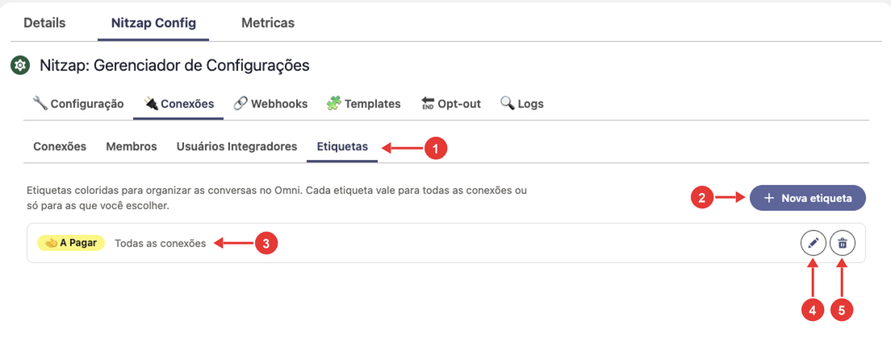
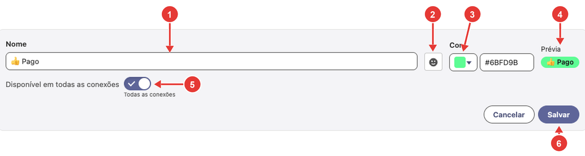
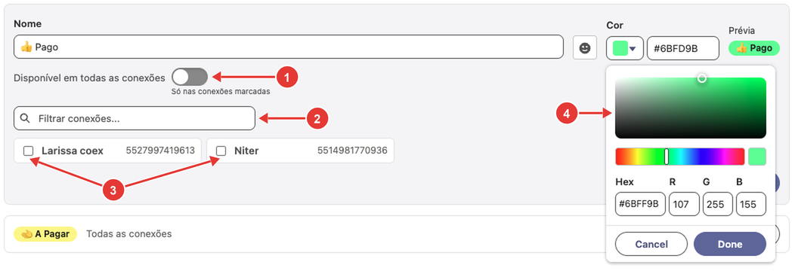
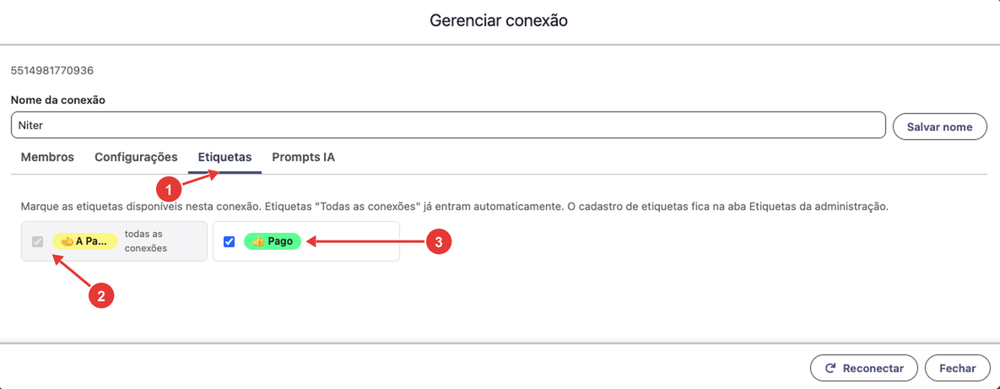
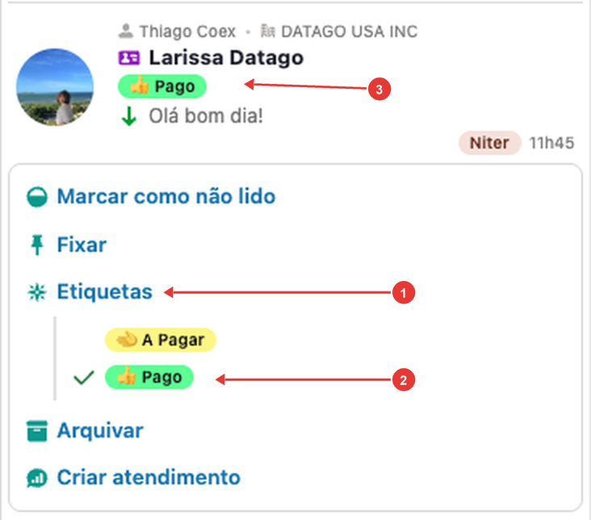

# 04. Etiquetas

As etiquetas são marcadores coloridos que organizam as conversas no Nitzap Omni, como **A pagar**, **Pago** ou **Vencido**. O administrador cria as etiquetas e define em quais conexões cada uma vale; os atendentes aplicam as etiquetas nas conversas, pelo botão direito. Uma mesma conversa pode ter várias etiquetas.

**Como ler as imagens:** os círculos vermelhos numerados apontam para a parte da tela que está sendo explicada. O número no círculo é o mesmo da coluna **Nº** da tabela logo abaixo da imagem.

<!-- sumario:inicio -->
**Neste artigo:**

- [Onde ficam as etiquetas](#nitzap/etiquetas/onde-ficam-as-etiquetas)
- [Criar uma etiqueta](#nitzap/etiquetas/criar-uma-etiqueta)
- [Escolher em quais conexões a etiqueta vale](#nitzap/etiquetas/escolher-em-quais-conexoes-a-etiqueta-vale)
- [Liberar etiquetas em uma conexão](#nitzap/etiquetas/liberar-etiquetas-em-uma-conexao)
- [Editar ou excluir uma etiqueta](#nitzap/etiquetas/editar-ou-excluir-uma-etiqueta)
- [Usar as etiquetas nas conversas](#nitzap/etiquetas/usar-as-etiquetas-no-omni)
- [Problemas comuns](#nitzap/etiquetas/problemas-comuns)

<!-- sumario:fim -->

## Onde ficam as etiquetas

O cadastro de etiquetas fica em **Nitzap Config** > **Conexões** > **Etiquetas**. Só administradores acessam o Nitzap Config; para os demais usuários aparece **Você não tem permissão para acessar esta página**.

| Nº | O que é |
| :---: | --- |
| 1 | Aba **Etiquetas**. |
| 2 | **Nova etiqueta:** abre o formulário de cadastro. |
| 3 | Cada etiqueta cadastrada, com a cor dela e onde vale: **Todas as conexões**, a quantidade de conexões marcadas ou **Nenhuma conexão**. |
| 4 | **Editar** a etiqueta. |
| 5 | **Excluir** a etiqueta. |

## Criar uma etiqueta

Clique em **Nova etiqueta** e preencha o formulário.

| Nº | Campo | O que fazer |
| :---: | --- | --- |
| 1 | **Nome** | O texto da etiqueta, com até 40 caracteres. Use nomes curtos, que digam a situação da conversa. |
| 2 | **Emoji** | Coloca um emoji no início do nome. Escolher outro emoji troca o anterior. |
| 3 | **Cor** | A cor da etiqueta. Clique no quadrado para escolher na paleta ou digite o código da cor (ex.: `#6BFD9B`). A cor do texto se ajusta sozinha para ficar legível. |
| 4 | **Prévia** | Mostra como a etiqueta vai aparecer na lista de conversas. |
| 5 | **Disponível em todas as conexões** | Ligado, a etiqueta vale em todos os números. Desligado, vale só nas conexões que você marcar (veja abaixo). |
| 6 | **Salvar** | Cria a etiqueta. O botão só funciona com o nome preenchido. |

## Escolher em quais conexões a etiqueta vale

Para uma etiqueta valer só em alguns números (por exemplo, **Pago** só no número do financeiro), desligue **Disponível em todas as conexões**.

| Nº | O que fazer |
| :---: | --- |
| 1 | Desligue **Disponível em todas as conexões**. O texto embaixo muda para **Só nas conexões marcadas**. |
| 2 | Se houver muitas conexões, use **Filtrar conexões** para encontrar pelo nome ou número. |
| 3 | Marque as conexões em que a etiqueta vai valer. |
| 4 | Seletor de cor, aberto ao clicar no quadrado de **Cor**. Escolha a cor e clique em **Done**. |

## Liberar etiquetas em uma conexão

Também dá para fazer o caminho contrário: abrir uma conexão e marcar quais etiquetas valem nela. Em **Nitzap Config** > **Conexões**, clique na engrenagem da conexão e abra a aba **Etiquetas**.

| Nº | O que é |
| :---: | --- |
| 1 | Aba **Etiquetas** da conexão. |
| 2 | Etiquetas marcadas como **todas as conexões**: já entram nesta conexão e não podem ser desmarcadas aqui. |
| 3 | As demais etiquetas: marque para liberar nesta conexão, desmarque para tirar. |

As duas telas mexem na mesma informação: marcar uma etiqueta aqui é o mesmo que marcar esta conexão no cadastro da etiqueta. Nesta aba não dá para criar etiquetas; o cadastro é só na aba **Etiquetas** do Nitzap Config.

## Editar ou excluir uma etiqueta

- **Editar** (lápis): muda o nome, o emoji, a cor ou as conexões.
- **Excluir** (lixeira): o Nitzap pede confirmação e **a etiqueta sai de todas as conversas** em que estava aplicada.

## Usar as etiquetas no Omni

No Nitzap Omni, clique com o botão direito em uma conversa da lista e passe o mouse em **Etiquetas**.

| Nº | O que é |
| :---: | --- |
| 1 | **Etiquetas:** abre a lista de etiquetas disponíveis na conexão daquela conversa. |
| 2 | Clique em uma etiqueta para aplicar. As que já estão na conversa aparecem com ✓; clique de novo para tirar. Dá para aplicar várias. |
| 3 | A etiqueta aplicada aparece colorida embaixo do nome do cliente, na lista de conversas. |

A etiqueta fica na conversa daquele cliente **naquela conexão**. Se o mesmo cliente também fala por outro número, cada conversa tem as suas etiquetas.

Veja também [Botão direito na conversa](#nitzap/omni/botao-direito-na-conversa), no guia do Omni.

## Problemas comuns

| Situação | O que fazer |
| --- | --- |
| Aparece **Nenhuma etiqueta disponível nesta conexão** no botão direito. | Nenhuma etiqueta vale para a conexão dessa conversa. O administrador precisa criar uma etiqueta para **todas as conexões** ou liberar alguma nessa conexão. |
| A etiqueta existe, mas não aparece em uma conversa específica. | A etiqueta não está liberada na conexão dessa conversa. Confira a etiqueta (nº 3 em [Onde ficam as etiquetas](#nitzap/etiquetas/onde-ficam-as-etiquetas)) ou a aba **Etiquetas** da conexão. |
| O usuário não encontra a aba **Etiquetas** no Nitzap Config. | O cadastro é só para administradores. Os atendentes usam as etiquetas pelo botão direito no Omni. |
