# 09. Conectar o Nitzap ao Claude (MCP)

Com o conector MCP do Nitzap, o Claude passa a consultar e usar o WhatsApp da empresa: listar as conversas recentes, ler as mensagens de um cliente, ver o volume e o tempo de resposta de cada vendedor e, se você liberar, enviar mensagens. Você pergunta em linguagem normal (por exemplo, *"quais clientes ficaram sem resposta hoje?"*) e o Claude busca a informação no Nitzap.

A configuração tem duas partes: gerar um **token** no Salesforce e **adicionar o conector** no Claude.

**Como ler as imagens:** os círculos vermelhos numerados apontam para a parte da tela que está sendo explicada. O número no círculo é o mesmo da coluna **Nº** da tabela logo abaixo da imagem.

<!-- sumario:inicio -->
**Neste artigo:**

- [O que é preciso antes](#nitzap/mcp-claude/antes-de-comecar)
- [Gerar o token no Salesforce](#nitzap/mcp-claude/1-gerar-o-token-no-salesforce)
- [Adicionar o conector no Claude](#nitzap/mcp-claude/2-adicionar-o-conector-no-claude)
- [Vincular com o token](#nitzap/mcp-claude/3-vincular-com-o-token)
- [Escolher o que o Claude pode fazer sozinho](#nitzap/mcp-claude/4-escolher-o-que-o-claude-pode-fazer-sozinho)
- [Revogar o acesso](#nitzap/mcp-claude/revogar-o-acesso)
- [Problemas comuns](#nitzap/mcp-claude/problemas-comuns)

<!-- sumario:fim -->

## Antes de começar

- **Administrador do Nitzap** para gerar o token, porque ele fica em **Nitzap Config**.
- **Um usuário integrador.** O token do MCP pertence a um usuário integrador. Se ainda não existe nenhum, crie um como explicado em [Criar a credencial](#nitzap/usuario-integrador-postman/1-criar-a-credencial), no guia do usuário integrador. Usuário integrador não consome licença.
- **Uma conta do Claude** com permissão para adicionar conectores personalizados.

## 1. Gerar o token no Salesforce

Em **Nitzap Config** > **Conexões**, abra a aba **Usuários Integradores**.

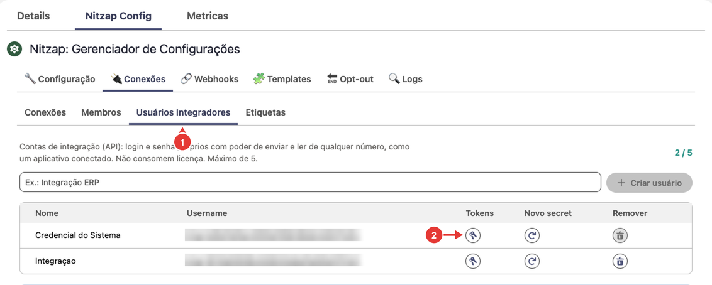

| Nº | O que é |
| :---: | --- |
| 1 | Aba **Usuários Integradores**. |
| 2 | **Tokens:** abre os tokens desse usuário integrador. |

Preencha a janela de tokens:

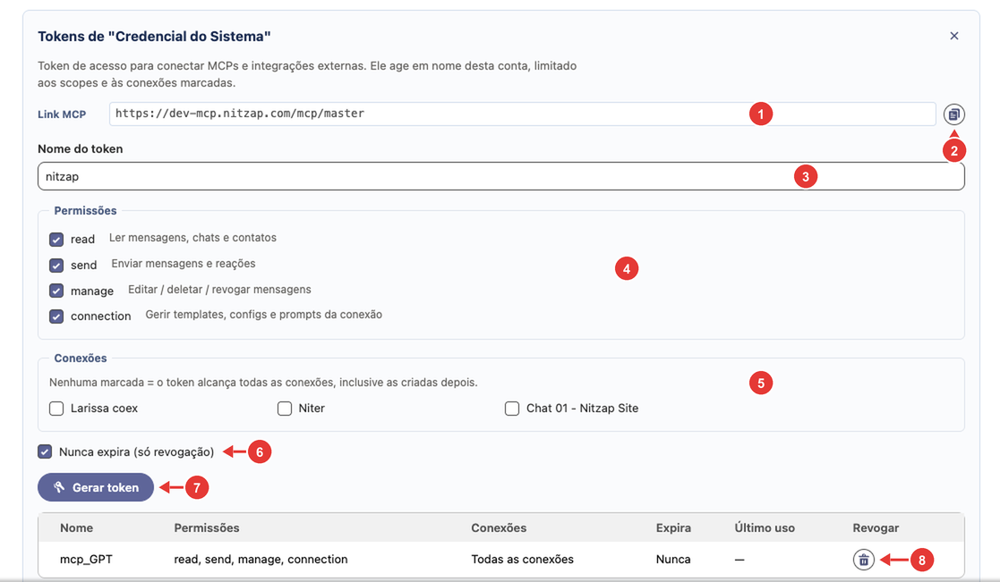

| Nº | Campo | O que fazer |
| :---: | --- | --- |
| 1 | **Link MCP** | O endereço do servidor MCP do Nitzap. É ele que vai no Claude. |
| 2 | **Copiar** | Copia o Link MCP. Guarde-o para o passo 2. |
| 3 | **Nome do token** | Para que serve o token (ex.: `claude-comercial`). Ajuda a reconhecer depois na lista. |
| 4 | **Permissões** | O que o Claude vai poder fazer (tabela abaixo). Marque só o necessário. |
| 5 | **Conexões** | Os números que o Claude vai poder usar. **Nenhuma marcada = todas**, inclusive as conectadas depois. |
| 6 | **Nunca expira** | Marcado, o token vale até ser revogado. Desmarcado, você informa a validade em dias. |
| 7 | **Gerar token** | Cria o token. |
| 8 | **Revogar** | Na lista de tokens já gerados: corta o acesso na hora. A lista também mostra o **Último uso** de cada token. |

| Permissão | Libera |
| --- | --- |
| `read` | Ler mensagens, conversas e contatos. |
| `send` | Enviar mensagens e reações. |
| `manage` | Editar, apagar e revogar mensagens. |
| `connection` | Gerir templates, configurações e prompts da conexão. |

Para começar com segurança, gere um token só com `read`: o Claude consulta tudo, mas não envia nem altera nada.

Depois de clicar em **Gerar token**, ele aparece logo abaixo:

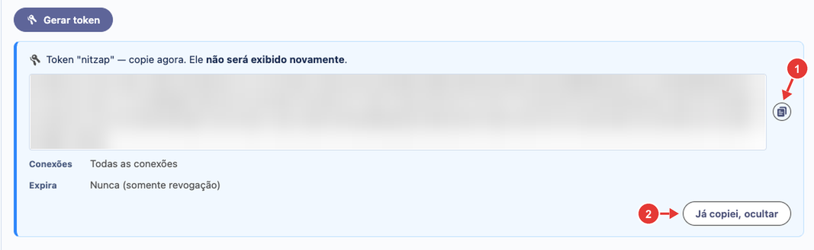

| Nº | O que é |
| :---: | --- |
| 1 | **Copiar** o token. |
| 2 | **Já copiei, ocultar:** fecha a caixa. |

**O token só aparece uma vez.** Copie antes de fechar e guarde em lugar seguro: quem tem o token acessa o Nitzap com as permissões que você marcou. Se perder, revogue e gere outro.

## 2. Adicionar o conector no Claude

No Claude, clique no seu nome, no canto inferior esquerdo, e em **Configurações**.

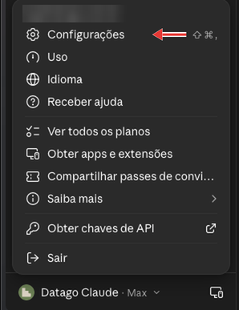

Abra **Personalização** > **Conectores**:

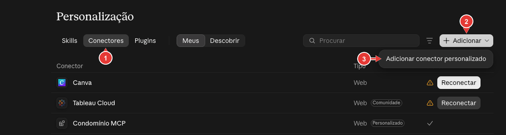

| Nº | O que é |
| :---: | --- |
| 1 | **Conectores.** |
| 2 | **Adicionar.** |
| 3 | **Adicionar conector personalizado.** |

Preencha o nome e o endereço:

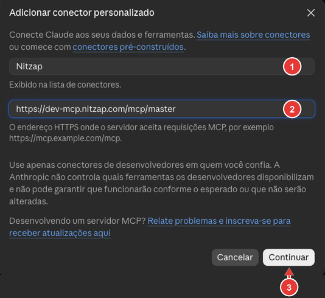

| Nº | Campo | O que fazer |
| :---: | --- | --- |
| 1 | **Nome** | `Nitzap` (é o nome que aparece na lista de conectores). |
| 2 | **URL** | Cole o **Link MCP** copiado no Salesforce (passo 1, nº 2). |
| 3 | **Continuar** | Vai para as opções de autenticação. |

Na tela seguinte, o Claude detecta sozinho como o Nitzap faz o login. Mantenha as opções marcadas como **Detectado**:

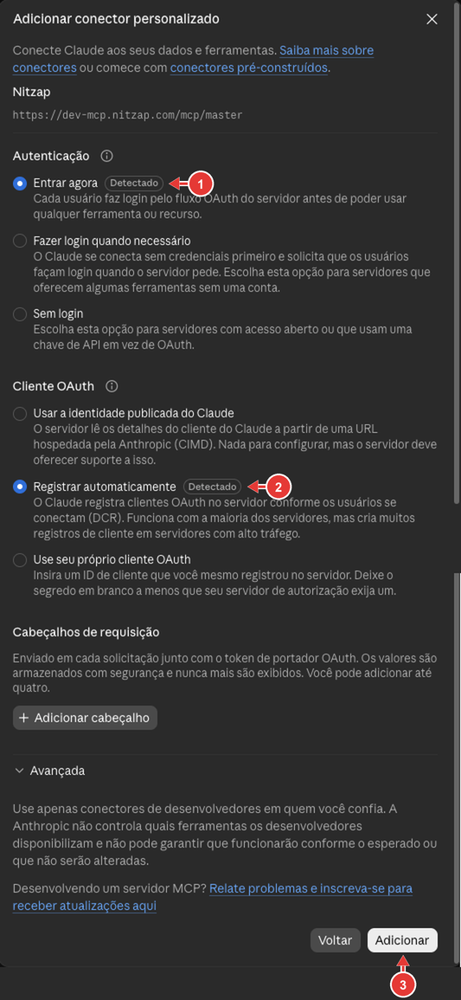

| Nº | Opção | O que deixar |
| :---: | --- | --- |
| 1 | **Autenticação** | **Entrar agora**. |
| 2 | **Cliente OAuth** | **Registrar automaticamente**. |
| 3 | **Adicionar** | Cria o conector. |

Não é preciso preencher **Cabeçalhos de requisição** nem as opções de **Avançada**.

## 3. Vincular com o token

O conector aparece em **Seus conectores** com a mensagem **Você ainda não está conectado a Nitzap**. Clique em **Vincular**.

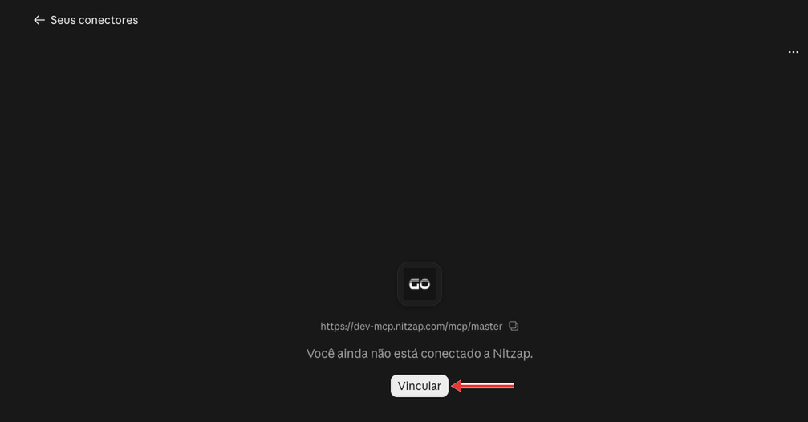

Abre a página **Autorizar acesso ao Nitzap**:

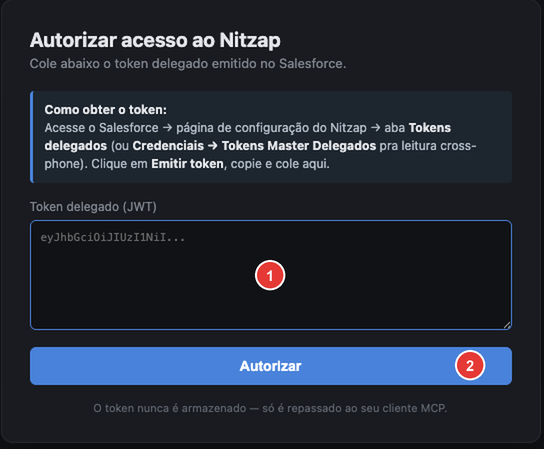

| Nº | O que fazer |
| :---: | --- |
| 1 | Cole o token gerado no Salesforce (passo 1). |
| 2 | Clique em **Autorizar**. |

O Nitzap não guarda o token nessa página: ele é repassado só para o Claude.

## 4. Escolher o que o Claude pode fazer sozinho

Depois de vinculado, o conector mostra as ferramentas do Nitzap que o Claude pode usar.

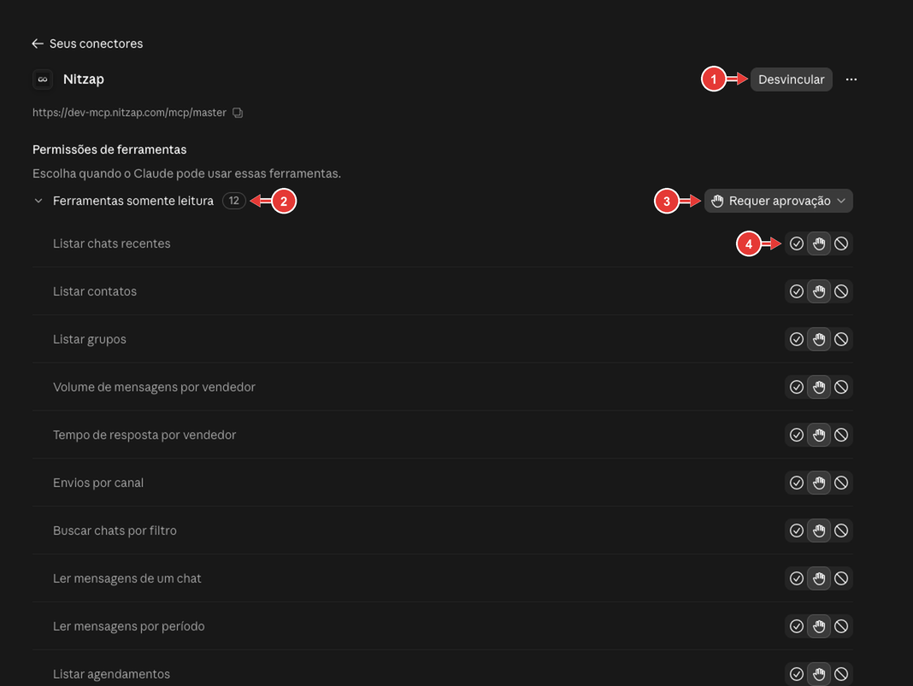

| Nº | O que é |
| :---: | --- |
| 1 | **Desvincular:** desliga o Nitzap deste Claude. |
| 2 | Grupo de ferramentas e a quantidade. Em **Ferramentas somente leitura** ficam as consultas, como **Listar chats recentes**, **Listar contatos**, **Volume de mensagens por vendedor**, **Tempo de resposta por vendedor**, **Ler mensagens de um chat** e **Listar agendamentos**. |
| 3 | Regra para o grupo inteiro. |
| 4 | Regra para uma ferramenta só. |

As regras possíveis:

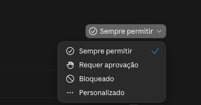

| Regra | O que acontece |
| --- | --- |
| **Sempre permitir** | O Claude usa a ferramenta sem perguntar. |
| **Requer aprovação** | O Claude pede a sua confirmação a cada uso. |
| **Bloqueado** | O Claude não usa a ferramenta. |
| **Personalizado** | Aparece quando as ferramentas do grupo têm regras diferentes. |

Para consultas, **Sempre permitir** deixa o uso mais fluido. Para ferramentas que **enviam** ou **alteram** mensagens, prefira **Requer aprovação**: assim nada sai para um cliente sem você conferir.

O que o Claude consegue fazer depende também das **permissões do token** (passo 1): uma ferramenta de envio só funciona se o token tiver `send`, mesmo que esteja liberada aqui.

## Revogar o acesso

- **No Claude:** abra o conector Nitzap e clique em **Desvincular**.
- **No Salesforce:** em **Usuários Integradores** > **Tokens**, clique em **Revogar** no token. Vale na hora, para qualquer lugar onde o token estiver sendo usado.

Se alguém da equipe sair da empresa ou o token vazar, revogue no Salesforce.

## Problemas comuns

| Situação | O que fazer |
| --- | --- |
| O Claude recusa a URL do conector. | Confira se colou o **Link MCP** inteiro, começando com `https://`. |
| A página **Autorizar** não aceita o token. | O token pode ter sido revogado ou expirado, ou foi colado pela metade. Gere um novo no Salesforce. |
| Perdi o token antes de colar. | Ele não aparece de novo. Revogue o antigo e gere outro. |
| O Claude diz que não tem permissão para uma ação. | O token não tem a permissão necessária (por exemplo, `send` para enviar). Gere um token com a permissão e vincule de novo. |
| O Claude não encontra um número. | O token está limitado a outras conexões. Gere um token sem conexões marcadas (todas) ou marcando esse número. |
| Os botões **Tokens** e **Usuários Integradores** não aparecem. | Só administradores do Nitzap acessam o Nitzap Config. |
