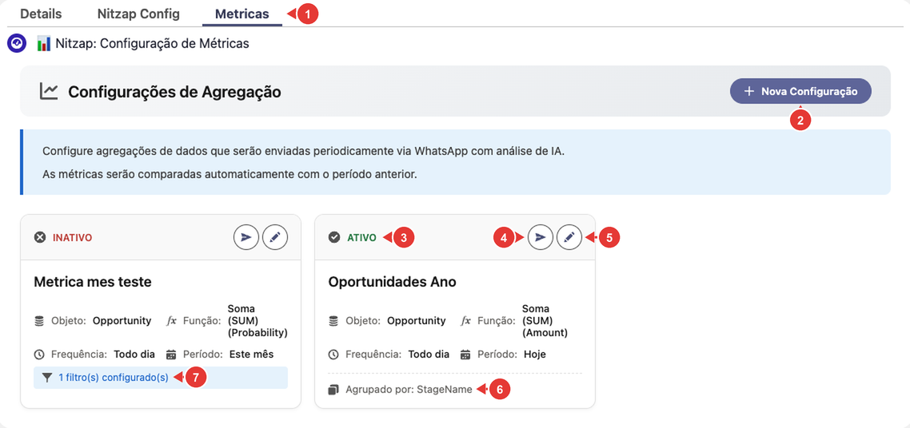
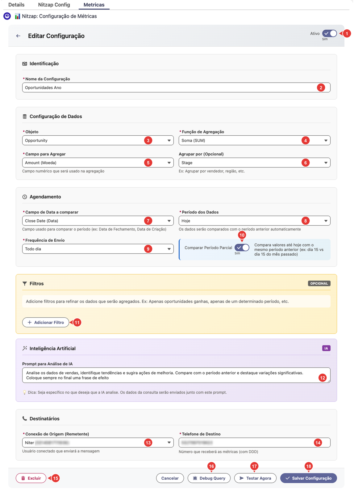

# 11. Métricas no WhatsApp (Nitzap Metrics)

O Nitzap Metrics envia, de forma automática, um resumo de números do Salesforce para um WhatsApp: por exemplo, o valor das oportunidades fechadas no dia, separado por fase, comparado com o dia anterior. Você escolhe o que somar ou contar, de quanto em quanto tempo enviar e para qual número. Se quiser, a IA acrescenta uma análise ao final da mensagem.

**Como ler as imagens:** os círculos vermelhos numerados apontam para a parte da tela que está sendo explicada. O número no círculo é o mesmo da coluna **Nº** da tabela logo abaixo da imagem.

<!-- sumario:inicio -->
**Neste artigo:**

- [Onde ficam as métricas](#nitzap/metricas/onde-ficam-as-metricas)
- [Criar ou editar uma métrica](#nitzap/metricas/criar-ou-editar-uma-metrica)
- [Quando a mensagem é enviada](#nitzap/metricas/quando-a-mensagem-e-enviada)
- [Como o período anterior é calculado](#nitzap/metricas/como-o-periodo-anterior-e-calculado)
- [Filtros](#nitzap/metricas/filtros)
- [O que chega no WhatsApp](#nitzap/metricas/o-que-chega-no-whatsapp)
- [Problemas comuns](#nitzap/metricas/problemas-comuns)

<!-- sumario:fim -->

## Onde ficam as métricas

As métricas ficam na aba **Metricas**, ao lado de **Nitzap Config**. Cada cartão é uma configuração, que vira uma mensagem enviada sozinha.

| Nº | O que é |
| :---: | --- |
| 1 | Aba **Metricas**. |
| 2 | **Nova Configuração:** cria uma métrica. |
| 3 | Situação: **Ativo** (envia na frequência escolhida) ou **Inativo** (não envia). |
| 4 | **Testar agora:** envia a métrica na hora para o número configurado, depois de uma confirmação. |
| 5 | **Editar.** |
| 6 | Resumo da configuração: objeto, função, campo, frequência, período e, se houver, o campo de agrupamento. |
| 7 | Quantos filtros a métrica tem. |

## Criar ou editar uma métrica

Clique em **Nova Configuração** ou no lápis de um cartão. O formulário tem cinco blocos.

| Nº | Campo | O que fazer |
| :---: | --- | --- |
| 1 | **Ativo** | Liga ou desliga o envio automático. |
| 2 | **Nome da Configuração** | Aparece no título da mensagem (ex.: *Vendas do dia por fase*). |
| 3 | **Objeto** | De onde vêm os dados: Oportunidade, Conta, Contato, Lead, Caso, Tarefa, Evento, Pedido, Cotação, Contrato, Campanha, Produto e outros, além dos objetos personalizados da empresa (marcados com **(Custom)**). |
| 4 | **Função de Agregação** | **Soma**, **Contagem**, **Máximo**, **Mínimo** ou **Média**. |
| 5 | **Campo para Agregar** | O campo numérico usado na conta (ex.: **Amount** para somar o valor das oportunidades). |
| 6 | **Agrupar por** | Opcional: separa o resultado por um campo (ex.: **Stage**, vendedor, região). |
| 7 | **Campo de Data a comparar** | A data que define em qual período cada registro entra (ex.: **Close Date**, data de fechamento, ou **Created Date**, data de criação). |
| 8 | **Período dos Dados** | **Hoje**, **Esta semana**, **Este mês**, **Este trimestre**, **Este ano**, **Últimos 7 dias**, **Últimos 30 dias** ou **Últimos 90 dias**. O resultado é sempre comparado com o período anterior. |
| 9 | **Frequência de Envio** | **Todo dia**, **Toda semana**, **Todo mês** ou **Todo trimestre** (veja [Quando a mensagem é enviada](#nitzap/metricas/quando-a-mensagem-e-enviada)). |
| 10 | **Comparar Período Parcial** | Ligado, compara só até o dia de hoje com o mesmo ponto do período anterior (ex.: dia 1 a 15 deste mês com dia 1 a 15 do mês passado). Veja [Como o período anterior é calculado](#nitzap/metricas/como-o-periodo-anterior-e-calculado). |
| 11 | **Adicionar Filtro** | Opcional: limita os registros que entram na conta (veja [Filtros](#nitzap/metricas/filtros)). |
| 12 | **Prompt para Análise de IA** | Opcional: o que a IA deve analisar nos números. Os dados da métrica vão junto com o prompt. Em branco, a mensagem vai sem análise. |
| 13 | **Conexão de Origem** | O número do Nitzap que envia a mensagem. |
| 14 | **Telefone de Destino** | Quem recebe: só números, com DDI e DDD (ex.: `5511999999999`). Também aceita o ID de um grupo do WhatsApp. |
| 15 | **Excluir** | Apaga a configuração, depois de uma confirmação. |
| 16 | **Debug Query** | Mostra a consulta que o Nitzap vai rodar no Salesforce, com o botão **Copiar Query**. Útil para o administrador conferir os números. |
| 17 | **Testar Agora** | Envia a métrica na hora. Só funciona depois de salvar. |
| 18 | **Salvar Configuração** | Salva. O Nitzap avisa se faltar algum campo obrigatório ou se o telefone de destino estiver em formato errado. |

## Quando a mensagem é enviada

O envio automático acontece **por volta das 20h**, só nas métricas **ativas**:

| Frequência | Dia do envio |
| --- | --- |
| **Todo dia** | Todos os dias. |
| **Toda semana** | Aos sábados. |
| **Todo mês** | No último dia do mês. |
| **Todo trimestre** | No último dia do trimestre (março, junho, setembro e dezembro). |

A mesma métrica é enviada no máximo uma vez por dia. Para receber fora desse horário, use **Testar agora**.

Combine a frequência com o período: **Todo dia** com **Hoje** manda o resumo do dia; **Toda semana** com **Esta semana**, o da semana; **Todo mês** com **Este mês**, o do mês.

## Como o período anterior é calculado

| Período dos Dados | Comparado com |
| --- | --- |
| **Hoje** | Ontem. |
| **Últimos 7, 30 ou 90 dias** | Os 7, 30 ou 90 dias antes desses. |
| **Esta semana** (começa no domingo) | A semana anterior. |
| **Este mês** | O mês anterior. |
| **Este trimestre** | O trimestre anterior. |
| **Este ano** | O ano anterior. |

Com **Comparar Período Parcial** desligado, semana, mês, trimestre e ano são contados **inteiros**. Exemplo: no dia 15, **Este mês** soma o mês todo (até o dia 30) e compara com o mês passado inteiro. Ligado, o Nitzap conta só **até hoje** e compara com o **mesmo ponto** do período anterior: do dia 1 ao dia 15 deste mês com o dia 1 ao dia 15 do mês passado. Use **ligado** quando a métrica sai antes de o período acabar, para a comparação ser justa.

## Filtros

Cada filtro tem um **Campo**, um **Operador** e um **Valor**. Os operadores mudam conforme o tipo do campo:

| Tipo de campo | Operadores |
| --- | --- |
| Número, moeda, data | igual a, diferente de, menor que, menor ou igual, maior que, maior ou igual. |
| Texto | igual a, diferente de, contém, não contém. |
| Lista de opções | igual a, diferente de. |
| Caixa de seleção | igual a **Verdadeiro** ou **Falso**. |

Nos campos de data, escolha o **Tipo**: **Data exata** (um dia do calendário) ou **Data literal** (Hoje, Ontem, Esta semana, Mês passado, Últimos 30 dias e outras).

Exemplo: para contar só as oportunidades ganhas, adicione o filtro **Stage** igual a **Closed Won**.

Cada filtro precisa ter campo e valor; se ficar algum incompleto, o Nitzap avisa ao salvar.

## O que chega no WhatsApp

A mensagem traz:

- o **nome da métrica**;
- o **período** e as datas, e o **período de comparação** e as datas dele;
- o **resultado** de cada período e a **variação** entre eles. Se não havia dados no período anterior, aparece **Novo**;
- com **Agrupar por**, o resultado de cada grupo, até 10 grupos (os demais aparecem como "... e mais X itens");
- a **Análise IA**, se houver prompt;
- no fim, *Relatório automático Nitzap*.

## Problemas comuns

| Situação | O que fazer |
| --- | --- |
| A métrica não chegou. | Confira se ela está **Ativo**, se hoje é dia de envio pela frequência escolhida e se já passou das 20h. Para conferir na hora, use **Testar agora**. |
| Não chegou nem com **Testar agora**. | Confira o **Telefone de Destino** (com DDI e DDD) e se a **Conexão de Origem** está conectada. O usuário dono da conexão precisa estar ativo no Salesforce. Se a conexão for oficial (Coex ou API Cloud), a Meta só entrega mensagem sem template para quem escreveu para esse número nas últimas 24 horas. |
| Aparece "Salve a configuração antes de testar". | **Testar Agora** só funciona em uma configuração já salva. Clique em **Salvar Configuração** e teste de novo. |
| O número parece errado. | Use **Debug Query** para ver a consulta e rodar no Salesforce. Confira o **Campo de Data a comparar**, o **Período dos Dados** e os filtros. |
| A comparação parece injusta no meio do mês. | Ligue **Comparar Período Parcial**. |
| A mensagem chegou sem a análise da IA. | O prompt está vazio ou a IA não respondeu. A mensagem com os números é enviada mesmo assim. |
| Não encontro o objeto que quero. | A lista mostra os objetos padrão mais usados e os objetos personalizados a que você tem acesso. |
