# 12. Nitzap Config: o painel do administrador

O **Nitzap Config** é onde o administrador configura o Nitzap para toda a empresa: as preferências gerais, a IA, os números de WhatsApp, quem usa o Nitzap, os webhooks, os templates, o opt-out e os registros (logs). Este guia passa por todos os menus. O que já tem um guia próprio aparece aqui resumido, com o link para a explicação completa.

**Como ler as imagens:** os círculos vermelhos numerados apontam para a parte da tela que está sendo explicada. O número no círculo é o mesmo da coluna **Nº** da tabela logo abaixo da imagem.

<!-- sumario:inicio -->
**Neste artigo:**

- [Quem acessa o Nitzap Config](#nitzap/nitzap-config/quem-acessa)
- [Mapa dos menus](#nitzap/nitzap-config/mapa-dos-menus)
- [Configuração: Preferências, IA e Integração](#nitzap/nitzap-config/configuracao)
- [Conexões: números, membros, integradores e etiquetas](#nitzap/nitzap-config/conexoes)
- [Webhooks](#nitzap/nitzap-config/webhooks)
- [Templates](#nitzap/nitzap-config/templates)
- [Opt-out](#nitzap/nitzap-config/opt-out)
- [Logs](#nitzap/nitzap-config/logs)
- [Metricas](#nitzap/nitzap-config/metricas)

<!-- sumario:fim -->

## Quem acessa

O Nitzap Config é uma aba na página do Nitzap, ao lado de **Metricas**. Só entram os **administradores do Nitzap** (marcados como **Admin** em [Membros](#nitzap/nitzap-config/membros)) e os administradores do Salesforce. Para os demais, aparece **Você não tem permissão para acessar esta página**.

## Mapa dos menus

| Menu | Submenu | O que tem | Onde está explicado |
| --- | --- | --- | --- |
| **Configuração** | Preferências | Regras gerais das conversas, do atendimento e das mensagens. | [Aqui](#nitzap/nitzap-config/preferencias) |
| | Inteligência Artificial | Provedor e token da IA, transcrição de áudio. | [Habilitar a IA](#nitzap/omni/habilitar-a-ia-administrador) |
| | Integração | Servidor do Nitzap, App Key e credenciais do Salesforce. | [Aqui](#nitzap/nitzap-config/integracao) |
| **Conexões** | Conexões | Os números de WhatsApp, o chat do site e o chat interno. | [Conectar um número](#nitzap/conexao-whatsapp) e [abaixo](#nitzap/nitzap-config/conexoes-a-lista-de-numeros) |
| | Membros | Quem usa o Nitzap, licenças e administradores. | [Aqui](#nitzap/nitzap-config/membros) |
| | Usuários Integradores | Logins para sistemas externos (API e MCP). | [Usuário integrador](#nitzap/usuario-integrador-postman/1-criar-a-credencial) |
| | Etiquetas | Etiquetas coloridas das conversas. | [Etiquetas](#nitzap/etiquetas) |
| **Webhooks** | | Envio dos eventos do WhatsApp para outro sistema. | [Webhooks](#nitzap/webhooks) |
| **Templates** | | Mensagens prontas internas do Nitzap. | [Aqui](#nitzap/nitzap-config/templates) |
| **Opt-out** | | Quem não recebe template. | [Opt-out](#nitzap/disparo-campanha/opt-out-quem-nao-quer-receber) |
| **Logs** | Log de disparos da campanha | Cada mensagem enviada nos disparos em massa. | [Log de disparos](#nitzap/disparo-campanha/log-de-disparos-administrador) |
| | Origem das mensagens | Quem enviou: Nitzap, integração ou celular. | [Origem das mensagens](#nitzap/conexao-whatsapp/origem-das-mensagens) |
| | Eventos | Visualização única e chamadas. | [Aqui](#nitzap/nitzap-config/eventos) |
| | Envios por canal | Mensagens por dia: API oficial, Api WEB e fora do Nitzap. | [Envios por canal](#nitzap/conexao-whatsapp/envios-por-canal) |
| **Metricas** (aba ao lado) | | Resumos de números enviados pelo WhatsApp. | [Métricas no WhatsApp](#nitzap/metricas) |

## Configuração

### Preferências

Regras que valem para todas as conexões. Depois de mudar, clique em **Salvar Configurações**.

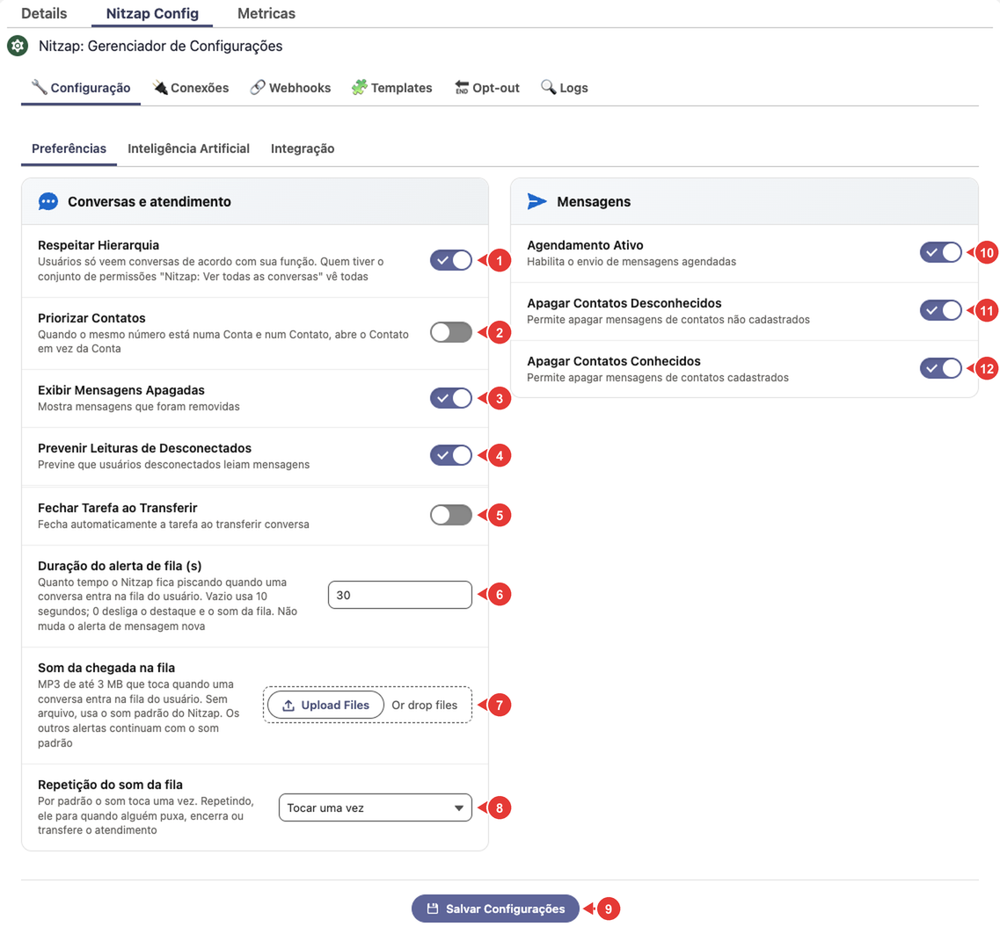

| Nº | Opção | O que faz |
| :---: | --- | --- |
| 1 | **Respeitar Hierarquia** | Cada usuário vê só as conversas dele e as de quem está abaixo na hierarquia de papéis do Salesforce. Quem tem o conjunto de permissões **Nitzap: Ver todas as conversas** vê todas. Veja [Ver conversas de outros usuários](#nitzap/omni/ver-conversas-de-outros-usuarios). |
| 2 | **Priorizar Contatos** | Quando o mesmo número está em uma Conta e em um Contato, a conversa abre no Contato, e não na Conta. |
| 3 | **Exibir Mensagens Apagadas** | Continua mostrando na conversa as mensagens que foram apagadas. Desligada, elas somem. |
| 4 | **Prevenir Leituras de Desconectados** | Impede que usuários desconectados do Nitzap leiam as mensagens. |
| 5 | **Fechar Tarefa ao Transferir** | Ao transferir um atendimento, fecha a Tarefa de quem passou e cria outra para quem recebeu. Veja [Configurar o atendimento](#nitzap/atendimento/no-nitzap-config). |
| 6 | **Duração do alerta de fila (s)** | Por quanto tempo a conversa que entra na fila fica piscando. Vazio usa 10 segundos; **0** desliga o destaque e o som. |
| 7 | **Som da chegada na fila** | Um MP3 de até 3 MB para tocar quando uma conversa entra na fila. Sem arquivo, toca o som padrão. |
| 8 | **Repetição do som da fila** | **Tocar uma vez**, **Repetir até alguém puxar** ou **Repetir por um tempo** (abre **Tempo tocando (s)**: vazio usa 30 segundos, máximo 600). |
| 9 | **Salvar Configurações** | Grava as alterações. |
| 10 | **Agendamento Ativo** | Liga o envio das mensagens agendadas. Desligado, os agendamentos não saem. Veja [Agendar envio](#nitzap/omni/agendar-envio). |
| 11 | **Apagar Contatos Desconhecidos** | Permite apagar mensagens nas conversas com números que não estão cadastrados no Salesforce. |
| 12 | **Apagar Contatos Conhecidos** | Permite apagar mensagens nas conversas com contatos cadastrados no Salesforce. |

### Inteligência Artificial

Aqui ficam o provedor de IA, o modelo e o token da empresa, e as opções de transcrição de áudio: forçar a transcrição para todos, transcrever todos os áudios no servidor (e os de grupos) e o provedor da transcrição.

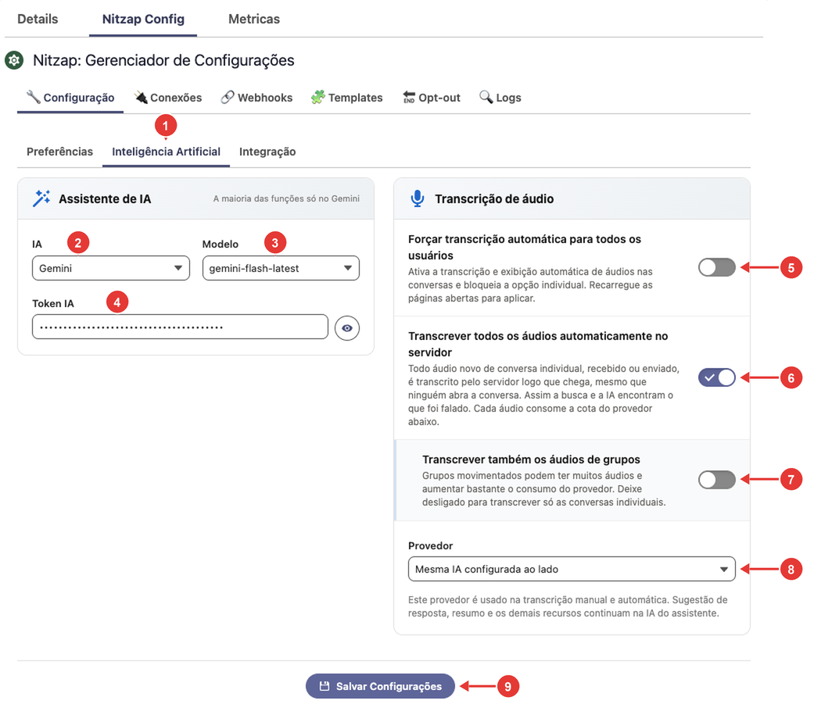

A explicação campo a campo está em [Habilitar a IA (administrador)](#nitzap/omni/habilitar-a-ia-administrador), no guia do Omni.

### Integração

Dados técnicos da ligação entre o Salesforce e o servidor do Nitzap. Normalmente são preenchidos na implantação e só mudam com orientação do suporte.

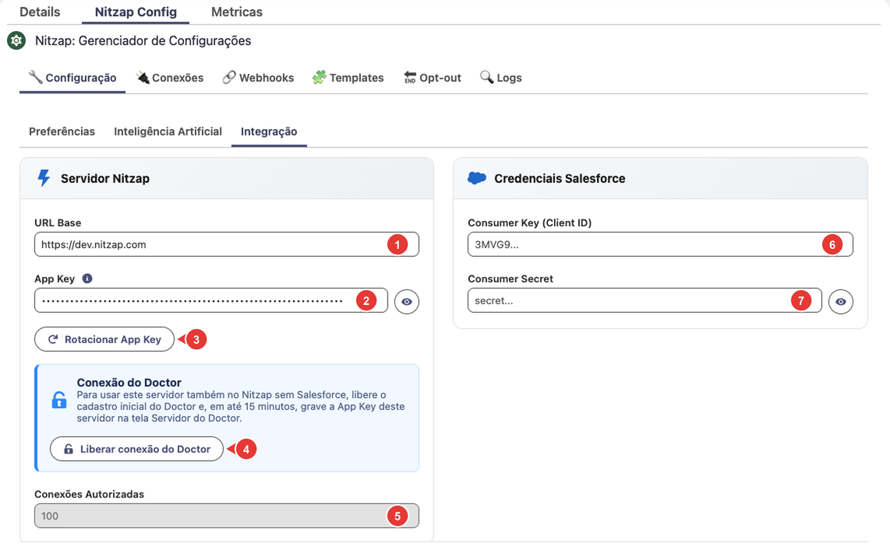

| Nº | Campo | O que é |
| :---: | --- | --- |
| 1 | **URL Base** | O endereço do servidor do Nitzap da empresa. |
| 2 | **App Key** | A chave que liga o Salesforce a esse servidor. O olho mostra ou esconde. Sem App Key salva, as abas **Webhooks** e **Templates** pedem para configurá-la primeiro. |
| 3 | **Rotacionar App Key** | Gera uma App Key nova e **invalida a atual na hora**, depois de uma confirmação. Use só se a chave vazou ou a pedido do suporte. |
| 4 | **Liberar conexão do Doctor** | Abre, por 15 minutos, o cadastro inicial do Doctor (o Nitzap fora do Salesforce) neste servidor. Nesse tempo, a App Key permite criar um usuário e torná-lo administrador uma única vez. |
| 5 | **Conexões Autorizadas** | Quantas conexões a licença da empresa permite. Só leitura. |
| 6 | **Consumer Key (Client ID)** | Do aplicativo conectado do Salesforce usado pelo bot e pelo agente (Agentforce). |
| 7 | **Consumer Secret** | O segredo desse aplicativo conectado. |

Os campos 6 e 7 só são necessários para o bot ou o agente. O passo a passo para criar o aplicativo conectado e pegar as chaves está no [guia do Einstein Bot e Agentforce](#connect_einstein_bot).

## Conexões

### Conexões: a lista de números

Cada número de WhatsApp, cada chat do site e o chat interno aparecem como um cartão. A engrenagem abre **Gerenciar conexão**; a lixeira remove a conexão.

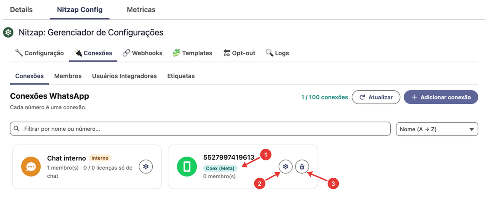

Como adicionar e reconectar um número está em [Conectar um número de WhatsApp](#nitzap/conexao-whatsapp). O cartão **Chat interno** está em [Chat interno](#nitzap/chat-interno/quem-participa-administrador), e o **Chat do site**, em [Chat do site](#nitzap/chat-site).

### Gerenciar conexão

A tela de cada conexão tem o nome, o [canal de envio vinculado](#nitzap/conexao-whatsapp/canal-de-envio-vinculado) (só nas conexões Coexistência) e cinco abas:

| Aba | O que tem | Onde está explicado |
| --- | --- | --- |
| **Membros** | Quem atende por este número. | [Adicionar membros](#nitzap/conexao-whatsapp/adicionar-membros) |
| **Configurações** | Respostas automáticas de IA, bot ou agente, atendimento e regras de compartilhamento. | [Abaixo](#nitzap/nitzap-config/configuracoes-da-conexao) |
| **Etiquetas** | Quais etiquetas valem neste número. | [Liberar etiquetas em uma conexão](#nitzap/etiquetas/liberar-etiquetas-em-uma-conexao) |
| **Prompts IA** | Instruções extras para os resumos de IA deste número. | [Abaixo](#nitzap/nitzap-config/prompts-ia-da-conexao) |
| **Templates Meta** | Criar e ver os templates da Meta (só conexões oficiais). | [Criar o template pelo Salesforce](#nitzap/templates/criar-o-template-pelo-salesforce) |

#### Configurações da conexão

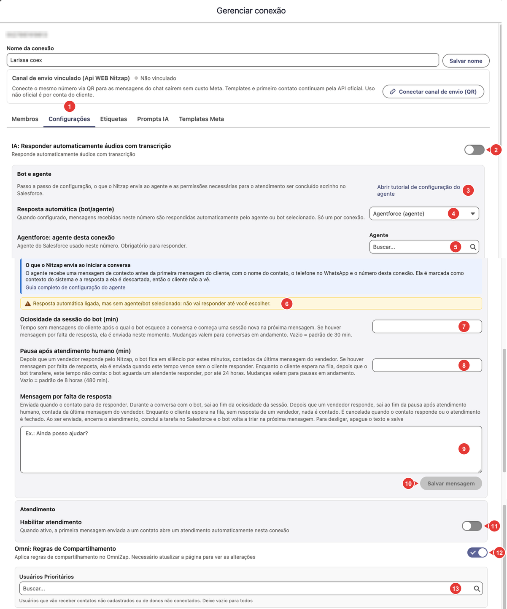

| Nº | Opção | O que faz |
| :---: | --- | --- |
| 1 | Aba **Configurações** | |
| 2 | **IA: Responder automaticamente áudios com transcrição** | Liga a resposta automática da IA aos áudios recebidos neste número, a partir da transcrição. |
| 3 | **Abrir tutorial de configuração do agente** | Abre o [guia do Einstein Bot e Agentforce](#connect_einstein_bot/configurando-o-agente-bot). |
| 4 | **Resposta automática (bot/agente)** | **Nenhum**, **Agentforce (agente)** ou **Einstein Bot**. Só um por conexão. |
| 5 | **Agentforce: agente desta conexão** | O agente do Salesforce que responde neste número. Obrigatório com **Agentforce**. |
| 6 | Aviso amarelo | Aparece quando a resposta automática está ligada sem agente ou bot escolhido: nada é respondido até você escolher. |
| 7 | **Ociosidade da sessão do bot (min)** | Tempo sem mensagens do cliente para o bot começar uma conversa nova. Vazio usa 30 minutos. |
| 8 | **Pausa após atendimento humano (min)** | Depois que alguém da equipe responde, o bot fica em silêncio por esse tempo. Vazio usa 8 horas. |
| 9 | **Mensagem por falta de resposta** | Texto enviado quando o contato para de responder. Ao ser enviada, encerra o atendimento. Vazio desliga. |
| 10 | **Salvar mensagem** | Grava a mensagem do nº 9. |
| 11 | **Habilitar atendimento** | A primeira mensagem enviada a um contato abre um atendimento sozinha. Veja [Configurar o atendimento](#nitzap/atendimento/na-conexao). |
| 12 | **Omni: Regras de Compartilhamento** | Aplica as regras de compartilhamento do Salesforce no Omni. É preciso atualizar a página para ver a mudança. |
| 13 | **Usuários Prioritários** | Quem recebe as conversas de números não cadastrados ou de donos que não estão conectados. Vazio: todos os membros recebem. |

Os tempos do bot (nº 7 a 9) e as dúvidas mais comuns sobre eles estão explicados em detalhe no [guia do Einstein Bot e Agentforce](#connect_einstein_bot/configurando-o-agente-bot).

#### Prompts IA da conexão

Instruções extras que vão para a IA quando ela gera os [resumos](#nitzap/omni/resumir-conversa) das conversas deste número. Use para dar contexto, por exemplo quem é a empresa ou o que destacar no resumo.

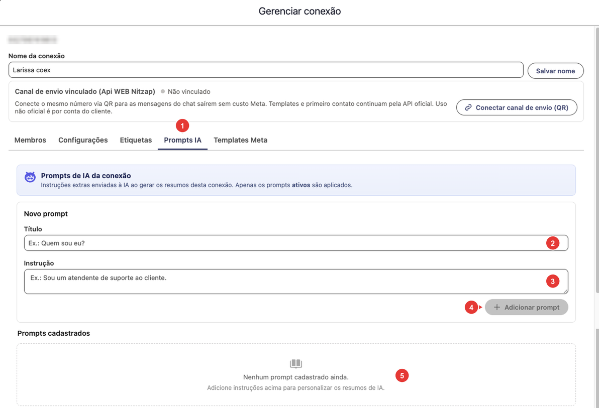

| Nº | O que é |
| :---: | --- |
| 1 | Aba **Prompts IA**. |
| 2 | **Título:** um nome para reconhecer o prompt (ex.: *Quem somos*). |
| 3 | **Instrução:** o texto que a IA recebe (ex.: *Somos uma loja de móveis; destaque prazo de entrega e forma de pagamento*). |
| 4 | **Adicionar prompt.** |
| 5 | **Prompts cadastrados:** cada prompt tem a chave **Ativo** e o botão de remover. Só os prompts ativos são usados. |

### Membros

Quem usa o Nitzap, quantas licenças estão em uso e quem é administrador.

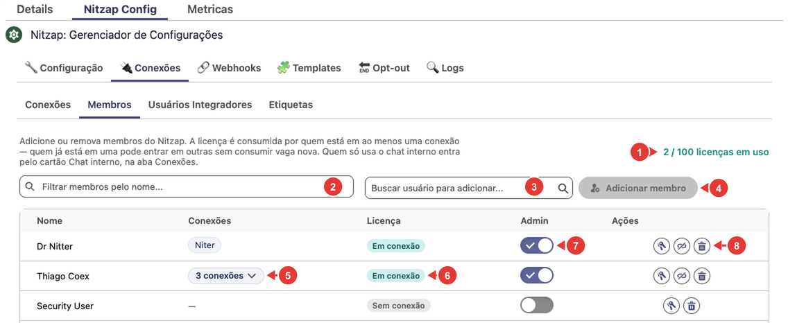

| Nº | O que é |
| :---: | --- |
| 1 | Licenças em uso, do total contratado. A licença é consumida por quem está em **pelo menos uma conexão**; quem já está em uma entra em outras sem gastar outra licença. |
| 2 | **Filtrar membros pelo nome.** |
| 3 | **Buscar usuário para adicionar:** o usuário do Salesforce que vai usar o Nitzap. |
| 4 | **Adicionar membro.** Para ele atender, adicione-o também às conexões, em [Gerenciar conexão > Membros](#nitzap/conexao-whatsapp/adicionar-membros). |
| 5 | **Conexões** em que o usuário está. Com mais de uma, clique para ver a lista. |
| 6 | **Licença:** **Em conexão** (consome licença) ou **Sem conexão** (não consome). |
| 7 | **Admin:** dá acesso ao Nitzap Config. Não dá para tirar o último administrador. |
| 8 | Ações, da esquerda para a direita: **Resetar login** (gera um novo acesso do usuário ao servidor do Nitzap), **Tirar de todas as conexões** (libera a licença; ele continua na lista) e **Remover membro** (tira o usuário do Nitzap e de todas as conexões e apaga o login dele). |

Quem só usa o chat interno, sem atender WhatsApp, não entra por aqui: veja [Chat interno](#nitzap/chat-interno/quem-participa-administrador).

Se ainda não houver nenhum administrador, aparece o aviso **Nenhum administrador definido** com o botão **Tornar-me administrador**.

### Usuários Integradores

Logins para sistemas externos (ERP, site, automações e o [Claude, via MCP](#nitzap/mcp-claude)) enviarem e lerem mensagens pela API. Não consomem licença; o máximo é 5.

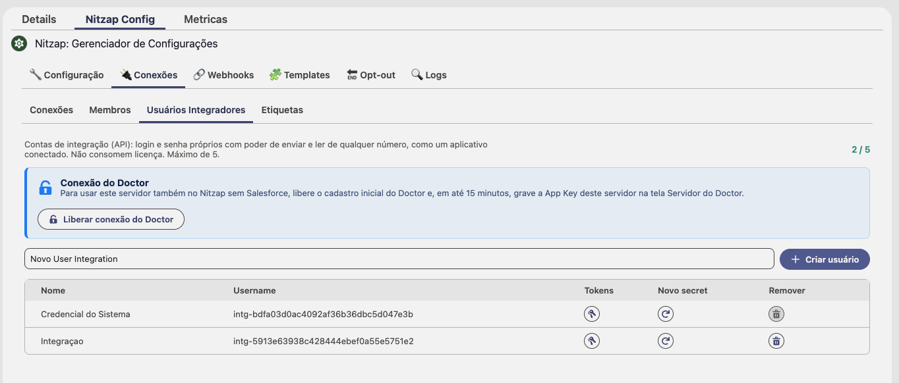

Como criar e usar: [Usuário integrador](#nitzap/usuario-integrador-postman/1-criar-a-credencial). Como gerar o token do MCP: [Gerar o token no Salesforce](#nitzap/mcp-claude/1-gerar-o-token-no-salesforce).

### Etiquetas

O cadastro das etiquetas coloridas usadas no Omni, e em quais conexões cada uma vale.

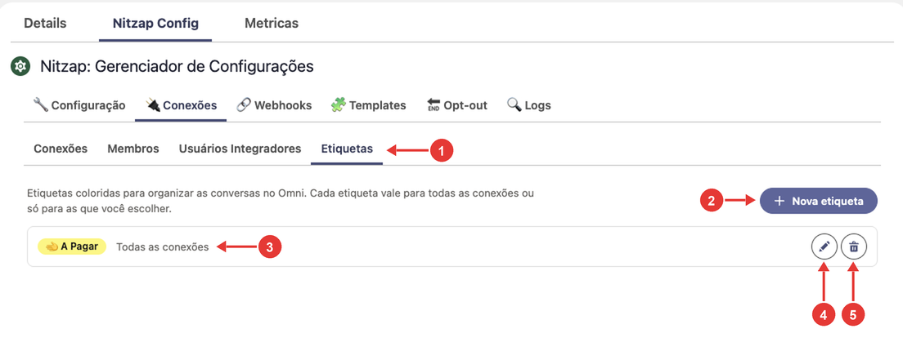

Como criar, editar e usar: [Etiquetas](#nitzap/etiquetas).

## Webhooks

Envia para outro sistema, em tempo real, o que acontece no WhatsApp: mensagens recebidas e enviadas, leituras, cliques em botões, erros.

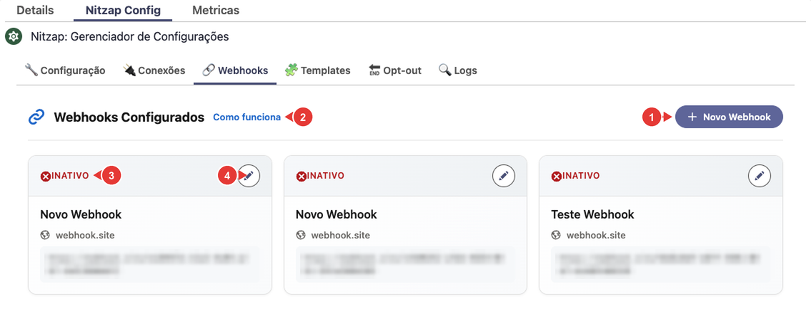

| Nº | O que é |
| :---: | --- |
| 1 | **Novo Webhook.** |
| 2 | **Como funciona:** a explicação dentro do Nitzap. |
| 3 | Situação: **Ativo** ou **Inativo**. |
| 4 | **Editar.** |

Campo a campo e exemplos de cada evento: [Webhooks](#nitzap/webhooks).

## Templates

Aqui ficam as **mensagens prontas internas** do Nitzap, que não passam pela Meta. Não confunda com os templates da Meta, que ficam em cada conexão, na aba **Templates Meta** (veja [Templates do WhatsApp](#nitzap/templates)).

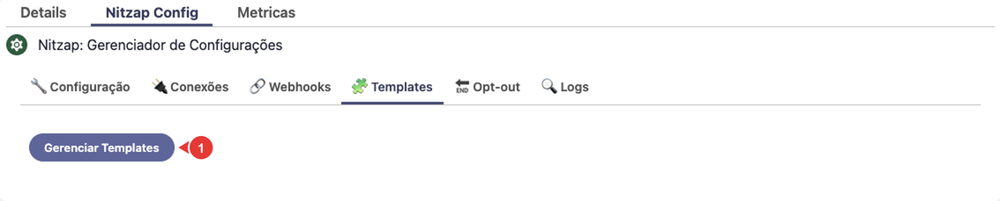

| Nº | O que é |
| :---: | --- |
| 1 | **Gerenciar Templates:** abre a janela **Nitzap Templates**, onde você cria pastas e mensagens prontas, e pode compartilhar com outros usuários. |

As mensagens prontas aparecem para os usuários na aba **Nitzap** do botão de templates, na caixa de mensagem do Omni, e no [agendamento](#nitzap/omni/agendar-envio). Elas funcionam em qualquer conexão; nas conexões oficiais, só são entregues se o cliente escreveu nas últimas 24 horas.

## Opt-out

A lista de números que **não recebem template**, as palavras que tiram e colocam de volta na lista e as respostas automáticas de confirmação.

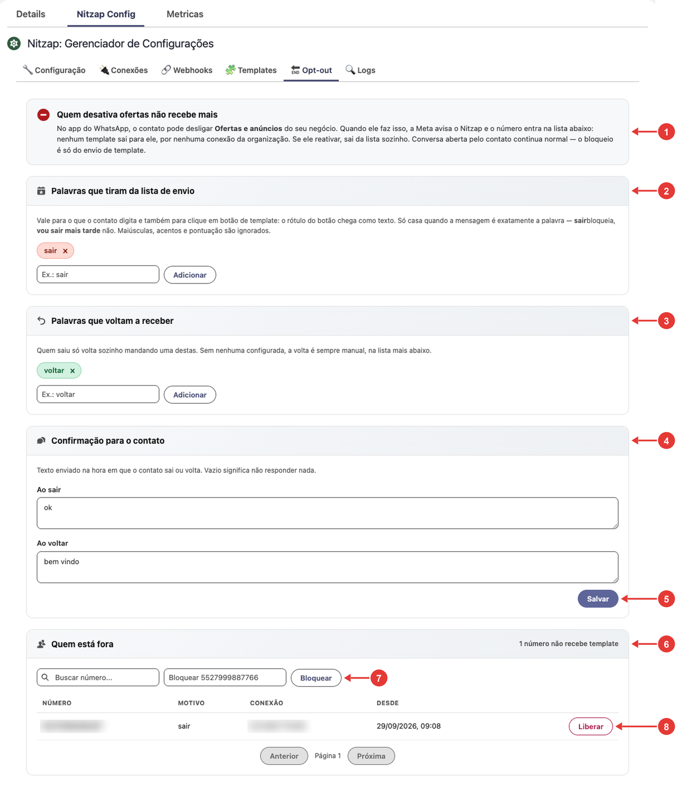

Explicação completa: [Opt-out: quem não quer receber](#nitzap/disparo-campanha/opt-out-quem-nao-quer-receber).

## Logs

### Log de disparos da campanha

Cada mensagem enviada nos disparos em massa das campanhas, com status, número de origem e destino e o erro devolvido pela Meta.

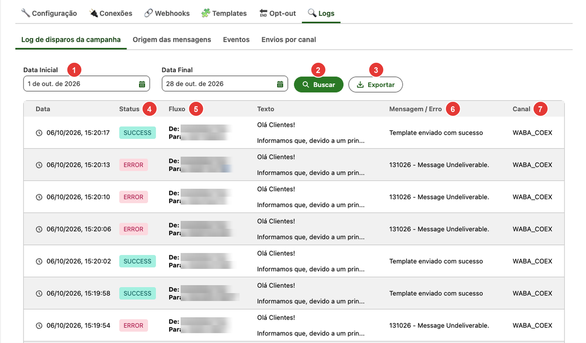

Explicação completa: [Log de disparos](#nitzap/disparo-campanha/log-de-disparos-administrador).

### Origem das mensagens

Conversa por conversa, quem enviou: um usuário pelo Nitzap, uma integração ou alguém direto no celular.

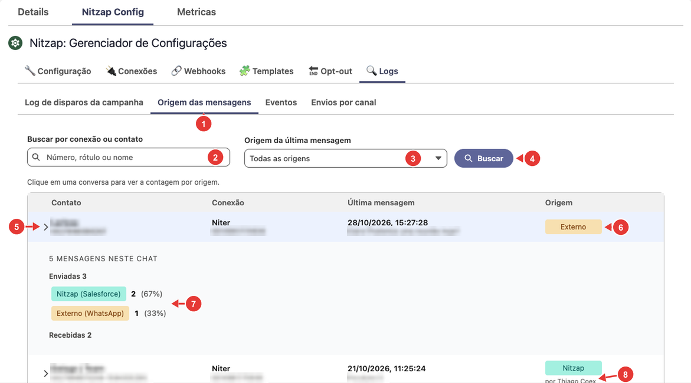

Explicação completa: [Origem das mensagens](#nitzap/conexao-whatsapp/origem-das-mensagens).

### Eventos

Registra o que acontece no WhatsApp e não vira uma mensagem comum na conversa: fotos e vídeos de visualização única e chamadas de voz.

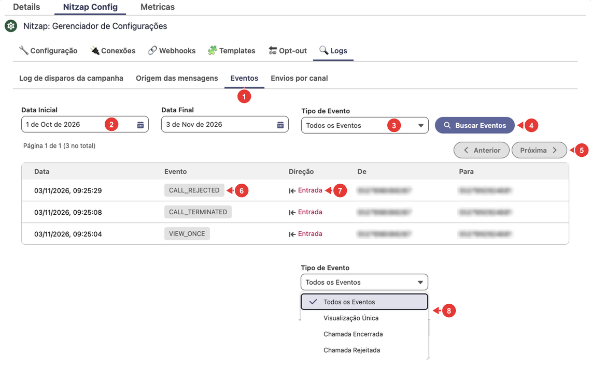

| Nº | O que é |
| :---: | --- |
| 1 | Subaba **Eventos**. |
| 2 | **Data Inicial** e **Data Final.** Ao abrir, as duas ficam no dia de hoje. |
| 3 | **Tipo de Evento** (veja o nº 8). |
| 4 | **Buscar Eventos.** |
| 5 | **Anterior** e **Próxima:** 50 eventos por página. |
| 6 | **Evento:** o tipo do evento. |
| 7 | **Direção:** **Entrada** (veio do contato) ou **Saída**. As colunas **De** e **Para** mostram os números. |
| 8 | Os tipos: **Visualização Única** (`VIEW_ONCE`: o contato mandou foto ou vídeo de visualização única, que só abre no celular), **Chamada Encerrada** (`CALL_TERMINATED`) e **Chamada Rejeitada** (`CALL_REJECTED`). |

### Envios por canal

Quantas mensagens saíram por dia em cada conexão: pela API oficial, pela Api WEB (QR Code e canal vinculado) e fora do Nitzap.

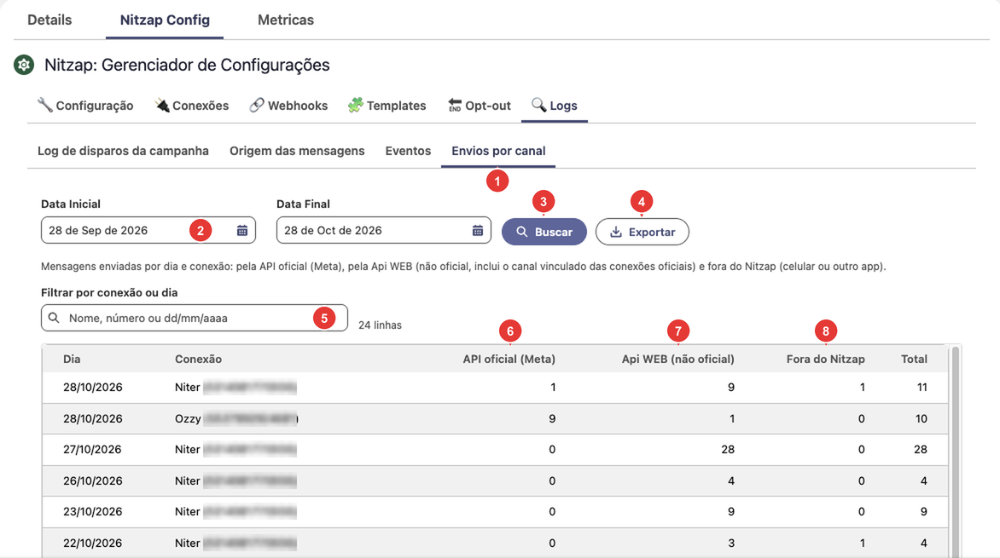

Explicação completa: [Envios por canal](#nitzap/conexao-whatsapp/envios-por-canal).

## Metricas

Na aba **Metricas**, ao lado do Nitzap Config, ficam os resumos de números do Salesforce enviados automaticamente pelo WhatsApp.

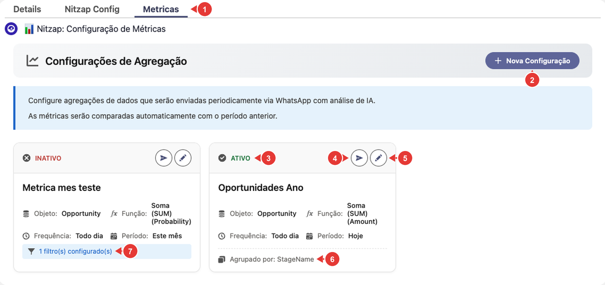

Explicação completa: [Métricas no WhatsApp](#nitzap/metricas).
