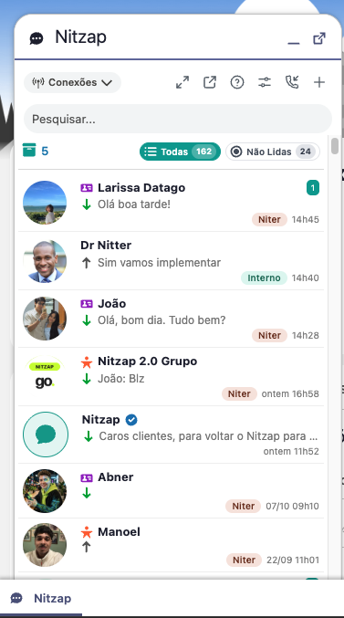

# 02. Nitzap Omni: conversas dentro do Salesforce

O Nitzap Omni é onde você conversa com os clientes pelo WhatsApp sem sair do Salesforce. Ele mostra as conversas de todas as conexões das quais você é membro, indica por qual número cada cliente falou com você e liga cada conversa ao Lead, Contato ou Conta correspondente. Este guia mostra as formas de abrir o Omni, como filtrar e ler a lista de conversas, as opções dentro de uma conversa e as suas preferências.

## Formas de visualizar as conversas

O Omni pode ser usado de três jeitos. As conversas são as mesmas nos três; muda o espaço na tela e o que acontece quando você clica em um cliente.

| Forma | Onde fica | Quando clicar em um cliente |
| --- | --- | --- |
| **Compacto** | Item **Nitzap** na barra de utilitários, no canto inferior esquerdo de qualquer página do Salesforce. | Se o número está salvo como Lead, Contato ou Conta, abre direto o registro no Salesforce. Se não está salvo, abre a conversa em uma janela. |
| **Ampliado** | O mesmo painel da barra de utilitários, aumentado pelo botão de ampliar. | A conversa abre em abas ao lado da lista, dentro do painel. Você continua navegando no Salesforce com o painel aberto. |
| **Nitzap Web** | Aba **Nitzap Web**, em tela cheia, no estilo do WhatsApp Web. | A conversa abre em abas ao lado da lista. A tela fica fixa, e o botão **i** mostra as informações do cliente sem sair da conversa. |

### Compacto

Clique em **Nitzap**, no canto inferior esquerdo, para abrir o painel.

### Ampliado

No painel compacto, clique no botão de ampliar (as duas setas, no topo da lista). Para voltar ao tamanho compacto, clique no mesmo botão, que passa a se chamar **Reduzir painel**. O Nitzap lembra no navegador qual tamanho você usou por último.

### Nitzap Web

Clique no botão **Abrir Nitzap Web** (o quadrado com a seta, no topo da lista) ou abra a aba **Nitzap Web** pelo menu de aplicativos do Salesforce.

Cada conversa aberta vira uma aba no topo. Clique na aba para trocar de conversa e no **×** para fechá-la. Ficam abertas no máximo 10 abas: ao abrir a 11ª, a que está há mais tempo sem uso fecha sozinha.

O botão **i**, à direita das abas, aparece quando a conversa está ligada a um Lead, Contato ou Conta. Ele abre o painel **Detalhes** ao lado da conversa, com os dados do registro. Os campos com lápis podem ser editados ali mesmo, sem sair da conversa.

No fim do painel aparecem até 10 Casos, Oportunidades e Tarefas ligados ao registro. Clique em um item para ver os detalhes e em **Voltar ao registro** para retornar. O botão no topo do painel abre o registro completo em uma nova aba, e o **×** fecha o painel.

## A lista de conversas

### Botões do topo

| Botão | O que faz |
| --- | --- |
| **Conexões** | Filtra a lista por conexão. Veja [Filtrar por conexão](#nitzap/omni/filtrar-por-conexao). |
| **Ampliar painel / Reduzir painel** (setas) | Alterna entre o compacto e o ampliado. Só aparece na barra de utilitários. |
| **Abrir Nitzap Web** (quadrado com seta) | Abre a aba Nitzap Web. Não aparece quando você já está nela. |
| **Ajuda e Recursos** (?) | Links para as notas de lançamento, a documentação, a configuração de bot e o canal do Nitzap no YouTube. |
| **Preferências** (controles deslizantes) | Abre as suas preferências. Veja [Preferências](#nitzap/omni/preferencias). |
| **Chamadas Recebidas** (telefone com seta) | Lista as ligações de WhatsApp recebidas e feitas. Em vermelho, as recusadas ou perdidas; em verde, as atendidas. Clique em uma para abrir a conversa. Não aparece se todas as suas conexões forem oficiais (Coex ou Cloud). |
| **Meus Contatos** (+) | Abre a lista de contatos para começar uma conversa nova. A aba **Internos** traz os colegas, para o chat interno. |

### Filtrar por conexão

Quando você participa de mais de uma conexão, o botão **Conexões** aparece no topo. Passe o mouse ou clique nele e escolha o que quer ver:

- **Todas as conexões:** conversas de todos os números.
- **Interno:** conversas com a equipe (chat interno entre colegas).
- **Uma conexão específica:** só as conversas daquele número. Embaixo do nome aparecem o número e o tipo de conexão (**Nitzap** para conexões via QR Code, **Coex (Meta)** ou **Cloud API (Meta)** para as oficiais).

Só dá para escolher uma opção por vez. A escolhida fica marcada com ✓ e o botão passa a mostrar o nome dela. O Nitzap lembra a sua escolha na próxima vez.

A bolinha colorida ao lado de cada conexão não indica se ela está online: é só a cor que identifica a conexão. A mesma cor aparece na etiqueta da conexão em cada conversa da lista.

### Busca, arquivadas e não lidas

- **Pesquisar:** encontra conversas pelo nome, pelo número ou pelo nome da empresa.
- **Arquivadas** (ícone de caixa com um número): mostra quantas conversas estão arquivadas. Clique para ver a lista e em **<** para voltar.
- **Todas:** mostra todas as conversas que não estão arquivadas.
- **Não Lidas:** mostra só as conversas com mensagens não lidas. O número ao lado é a quantidade dessas conversas.

### O que cada conversa mostra

| Elemento | O que significa |
| --- | --- |
| **👤 Nome · 🏢 Empresa** (acima do nome) | O proprietário do registro no Salesforce e a empresa (do Lead, ou da Conta do Contato). Só aparece quando o número está salvo. Dá para esconder nas [Preferências](#nitzap/omni/preferencias). |
| **Ícone antes do nome** | Tipo do registro ligado ao número: cartão roxo para **Contato**, pessoa laranja para **Lead** e prédio azul para **Conta**. Sem ícone, o número não está salvo no Salesforce. |
| **Seta verde para baixo** | A última mensagem foi **recebida** do cliente. |
| **Seta cinza para cima** | A última mensagem foi **enviada** por você e ainda não foi lida. Depois de lida, vira um ✓ azul. |
| **Etiqueta colorida no canto direito** (ex.: **Niter**) | A **conexão por onde o cliente falou**, ou seja, para qual número ele mandou a mensagem. **Interno** indica uma conversa com um colega. Só aparece quando você participa de mais de uma conexão. |
| **Número verde** | Quantidade de mensagens não lidas na conversa. |
| **✓ azul ao lado do nome** | Canal oficial de anúncios do Nitzap. |

Clicando com o botão direito em uma conversa, você pode **marcar como lida ou não lida**, **fixar** no topo, aplicar **etiquetas** e **arquivar** ou **desarquivar**.

## Dentro da conversa

### Cabeçalho

- **Foto e nome do cliente:** mostram também quando ele está digitando ou online.
- **Foto do usuário com seta** (à direita): escolhe **de qual usuário e de qual conexão** é a conversa que você está vendo. Quando mais de uma pessoa já falou com o cliente, cada uma aparece aqui com os números que usou. Não é transferência de atendimento.
- **Menu ⋮:** mais opções da conversa (tabela abaixo).

| Opção | O que faz |
| --- | --- |
| **Excluir conversa** | Apaga as mensagens com esse cliente na conexão selecionada, depois de uma confirmação. Só aparece se o administrador liberou a exclusão. |
| **Copiar Número** | Copia o número do cliente, só com os dígitos. |
| **Copiar ChatID** | Copia o identificador da conversa. |
| **Mídias** | Abre a galeria com as fotos, vídeos e arquivos trocados na conversa. |
| **Buscar** | Procura um texto nas mensagens da conversa. |
| **Novo Lead / Novo Contato / Nova Conta** | Abre o cadastro do Salesforce já preenchido com o nome e o número do WhatsApp. Não aparece quando o cliente pertence a outro usuário e o seu acesso é limitado. Nesse caso, o cabeçalho mostra quem é o proprietário. |

### Opções da mensagem

Passe o mouse sobre uma mensagem e clique na seta que aparece no canto do balão. À esquerda, as opções de uma mensagem **recebida**; à direita, as de uma mensagem **enviada**.

| Opção | Recebida | Enviada | O que faz |
| --- | :---: | :---: | --- |
| **Lida (data e hora)** | | ✓ | Não é um botão: mostra quando o cliente leu a mensagem. |
| **✨ IA: Resumir** | ✓ | ✓ | Resume a mensagem (texto, áudio, imagem ou documento). Só aparece se a IA estiver configurada pelo administrador. |
| **Responder** | ✓ | ✓ | Responde citando a mensagem. |
| **Encaminhar** | ✓ | ✓ | Seleciona a mensagem para encaminhar. Você pode marcar outras e depois escolher o contato. |
| **Reagir** | ✓ | | Envia uma reação com emoji. |
| **Copiar** | ✓ | ✓ | Seleciona a mensagem para copiar. Você pode marcar outras e copiar todas de uma vez, em ordem. |
| **Copiar ID** | ✓ | ✓ | Copia o identificador da mensagem, útil para o suporte. |
| **Editar** | | ✓ | Altera o texto da mensagem enviada. Até **10 minutos** depois do envio. |
| **Apagar** | | ✓ | Apaga a mensagem para todos, depois de uma confirmação. Até **2 dias** depois do envio. |

**Editar** e **Apagar** não existem nas conexões oficiais (Coex e Cloud API), só nas conexões via QR Code. Em imagens também aparece a opção de **download**.

### Caixa de mensagem

Escreva a mensagem e tecle **Enter** para enviar. Para pular uma linha sem enviar, use **Shift + Enter**. Em grupos, digite **@** para mencionar um participante.

| Botão | O que faz |
| --- | --- |
| **+ Arquivos** | Envia um arquivo do computador (clique em **Selecionar** ou arraste) ou um arquivo já salvo no Salesforce (**Do Salesforce**). Limite de 100 MB; vídeos até 40 MB, pelo limite do WhatsApp. |
| **Emoji** | Insere um emoji no texto. |
| **Enviar contato** | Envia um cartão de contato. Escolha a conexão e busque o contato. Não aparece nas conexões oficiais nem no chat interno. |
| **Modo sussurro** (balão) | Escreve uma nota interna na conversa: só a equipe vê, o cliente não recebe. |
| **Registrar histórico** (telefone) | Cria uma Tarefa no Salesforce com um trecho da conversa. Só aparece quando o número está salvo. |
| **Templates** (quatro quadrados) | Veja [Templates](#nitzap/omni/templates). |
| **Agendar envio** (relógio) | Veja [Agendar envio](#nitzap/omni/agendar-envio). |
| **Microfone** | Grava um áudio. Antes de enviar, dá para ouvir e descartar. |

Acima da caixa de mensagem ficam três botões de IA, que só aparecem quando o administrador configurou a IA:

- **Gerar com IA** (varinha): lê as últimas 10 mensagens e escreve uma sugestão de resposta na caixa. A mensagem não é enviada sozinha: revise antes de enviar.
- **Correção ortográfica** (✓): corrige o texto que você está escrevendo.
- **Resumir conversa** (raio): resume a conversa em um período. O resumo pode ser copiado, enviado ao cliente ou salvo como nota interna (sussurro).

#### Arquivos

#### Emoji

#### Enviar contato

#### Registrar histórico

Use para guardar no Salesforce um trecho importante da conversa, como uma negociação ou um atendimento por telefone.

1. Clique no ícone de telefone.
2. Confira o **Assunto** (o padrão é *Conversa Whatsapp*).
3. Informe o **Início do histórico** e o **Fim do histórico**. O fim precisa ser depois do início.
4. Se quiser, escreva **Comentários**.
5. Clique em **Registrar**.

O Nitzap cria uma Tarefa concluída, do tipo **HISTORY**, ligada ao cliente, e abre a Tarefa em seguida.

## Preferências

Clique no botão **Preferências** (controles deslizantes), no topo da lista de conversas. As preferências são suas: valem em qualquer computador e não mudam nada para os outros usuários.

| Preferência | O que faz |
| --- | --- |
| **🎨 Cor do meu balão** | Muda a cor dos balões das mensagens que você envia. Nas conversas que já estavam abertas, clique em **Atualizar agora** para aplicar. |
| **Silenciar todos os grupos** | Desliga o som, a notificação e o alerta de mensagens novas em grupos. O contador de não lidas continua funcionando. |
| **Silenciar todos os chats individuais** | O mesmo, para as conversas individuais. |
| **Assinar mensagens com meu nome** | Coloca o seu primeiro nome em negrito no início de cada mensagem enviada (ex.: **#Thiago:**). |
| **Exibir proprietário** | Mostra o 👤 proprietário do registro acima do nome de cada conversa. |
| **Exibir nome da empresa** | Mostra a 🏢 empresa acima do nome de cada conversa. |
| **Marcar como lida apenas ao responder** | Ligada: abrir a conversa não zera as não lidas, só responder. Desligada: abrir a conversa já marca como lida. |
| **Abrir conversas em uma nova guia do navegador** | No modo compacto, quando o clique na conversa abre o registro do cliente, ele abre em uma nova guia do navegador. |
| **Habilitar filtros de atendimento** | Troca o botão **Não Lidas** pelos filtros de atendimento. Veja [Filtros de atendimento](#nitzap/omni/filtros-de-atendimento). |
| **Receber notificações apenas de quem eu estiver atendendo** | Só avisa sobre conversas cujo atendimento aberto é seu. |
| **IA: Transcrever e exibir automaticamente áudios** | Transcreve os áudios e mostra o texto embaixo de cada um. Depende da IA configurada. Se o administrador deixou obrigatório, aparece **Ativado pelo administrador** e não dá para desligar. |

Ao mudar **Assinar mensagens com meu nome**, **IA: Transcrever** ou **Habilitar filtros de atendimento**, o Nitzap pede confirmação e recarrega a página.

Com **Exibir proprietário** e **Exibir nome da empresa** desligados, a lista fica mais enxuta:

