# 02. Nitzap Omni: conversas dentro do Salesforce

O Nitzap Omni é onde você conversa com os clientes pelo WhatsApp sem sair do Salesforce. Ele mostra as conversas de todas as conexões das quais você é membro, indica por qual número cada cliente falou com você e liga cada conversa ao Lead, Contato ou Conta correspondente. Este guia mostra as formas de abrir o Omni, como filtrar e ler a lista de conversas, as opções dentro de uma conversa, os recursos de IA e as suas preferências.

**Como ler as imagens:** os círculos vermelhos numerados apontam para a parte da tela que está sendo explicada. O número no círculo é o mesmo da coluna **Nº** da tabela ou da lista logo abaixo da imagem.

<!-- sumario:inicio -->
**Neste artigo:**

- [Formas de abrir o Omni: compacto, ampliado e Nitzap Web](#nitzap/omni/formas-de-visualizar-as-conversas)
- [Lista de conversas: filtros, ícones e ações](#nitzap/omni/a-lista-de-conversas)
- [Iniciar uma conversa nova](#nitzap/omni/iniciar-uma-conversa-nova)
- [Opções da conversa e das mensagens](#nitzap/omni/dentro-da-conversa)
- [Ver conversas de outros usuários](#nitzap/omni/ver-conversas-de-outros-usuarios)
- [Enviar arquivos, contatos e registrar histórico](#nitzap/omni/caixa-de-mensagem)
- [Agendar mensagens](#nitzap/omni/agendar-envio)
- [Recursos de IA e transcrição de áudio](#nitzap/omni/recursos-de-ia)
- [Preferências](#nitzap/omni/preferencias)

<!-- sumario:fim -->

## Formas de visualizar as conversas

O Omni pode ser usado de três jeitos. As conversas são as mesmas nos três; muda o espaço na tela e o que acontece quando você clica em um cliente.

| Forma | Onde fica | Quando clicar em um cliente |
| --- | --- | --- |
| **Compacto** | Item **Nitzap** na barra de utilitários, no canto inferior esquerdo de qualquer página do Salesforce. | Se o número está salvo como Lead, Contato ou Conta, abre direto o registro no Salesforce. Se não está salvo, abre a conversa em uma janela. |
| **Ampliado** | O mesmo painel da barra de utilitários, aumentado pelo botão de ampliar. | A conversa abre em abas ao lado da lista, dentro do painel. Você continua navegando no Salesforce com o painel aberto. |
| **Nitzap Web** | Aba **Nitzap Web**, em tela cheia, no estilo do WhatsApp Web. | A conversa abre em abas ao lado da lista. A tela fica fixa, e o botão **i** mostra as informações do cliente sem sair da conversa. |

### Compacto

Clique em **Nitzap**, no canto inferior esquerdo (onde a seta aponta), para abrir o painel.

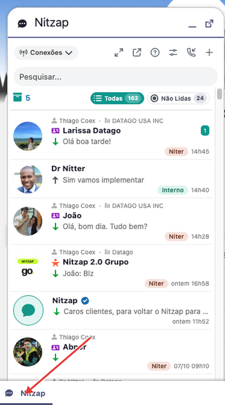

### Ampliado

No painel compacto, clique no botão de ampliar, no topo da lista. Para voltar ao tamanho compacto, clique no mesmo botão, que passa a se chamar **Reduzir painel**. O Nitzap lembra no navegador qual tamanho você usou por último.

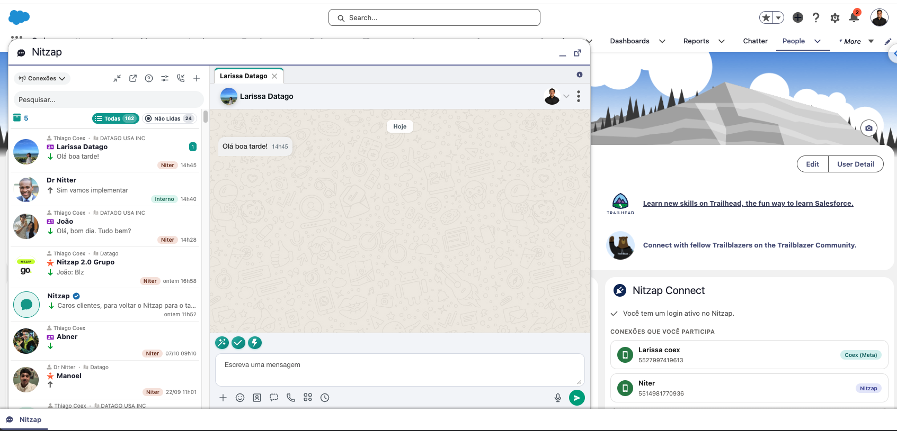

| Nº | O que é |
| :---: | --- |
| 1 | Botão **Ampliar painel / Reduzir painel**. |
| 2 | A conversa aberta, em uma aba ao lado da lista. O resto do Salesforce continua acessível atrás do painel. |

### Nitzap Web

Clique no botão **Abrir Nitzap Web** (nº 3 em [Botões do topo](#nitzap/omni/botoes-do-topo)) ou abra a aba **Nitzap Web** pelo menu de aplicativos do Salesforce.

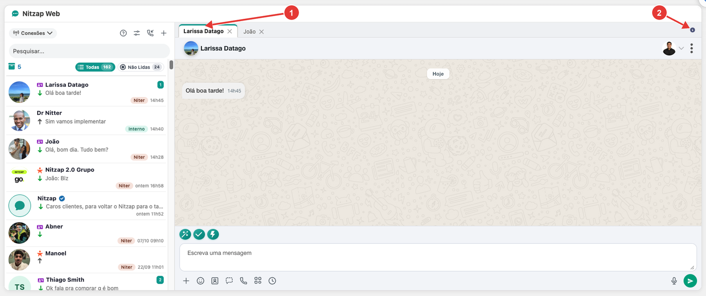

| Nº | O que é |
| :---: | --- |
| 1 | **Abas das conversas abertas.** Clique na aba para trocar de conversa e no **×** para fechá-la. Ficam abertas no máximo 10 abas: ao abrir a 11ª, a que está há mais tempo sem uso fecha sozinha. |
| 2 | Botão **i**: abre os detalhes do cliente (veja abaixo). |

#### Detalhes do cliente (botão i)

O botão **i** aparece quando a conversa está ligada a um Lead, Contato ou Conta. Ele abre o painel **Detalhes** ao lado da conversa, com os dados do registro.

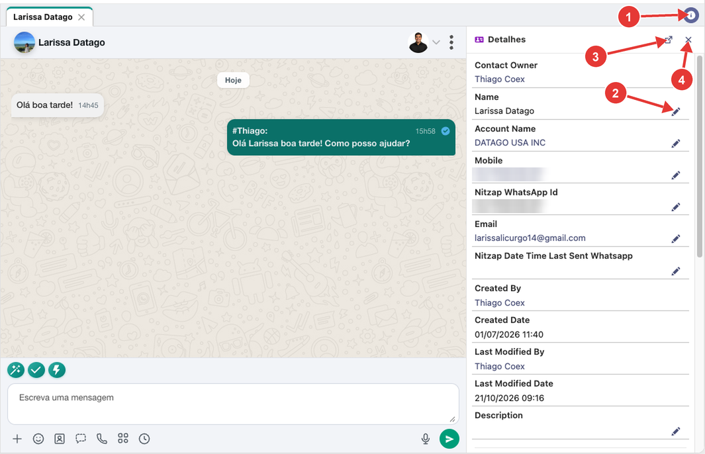

| Nº | O que é |
| :---: | --- |
| 1 | Botão **i**, que abre e fecha o painel. |
| 2 | **Lápis:** edita o campo ali mesmo, sem sair da conversa. |
| 3 | Abre o registro completo em uma nova aba. |
| 4 | Fecha o painel. |

No fim do painel aparecem até 10 Casos, Oportunidades e Tarefas ligados ao registro. Clique em um item para ver os detalhes e em **Voltar ao registro** para retornar.

## A lista de conversas

### Botões do topo

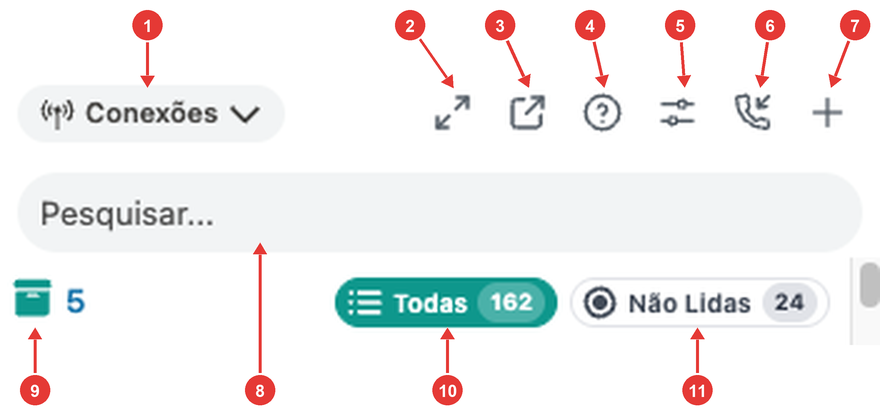

| Nº | Botão | O que faz |
| :---: | --- | --- |
| 1 | **Conexões** | Filtra a lista por conexão. Veja [Filtrar por conexão](#nitzap/omni/filtrar-por-conexao). |
| 2 | **Ampliar painel / Reduzir painel** | Alterna entre o compacto e o ampliado. Só aparece na barra de utilitários. |
| 3 | **Abrir Nitzap Web** | Abre a aba Nitzap Web. Não aparece quando você já está nela. |
| 4 | **Ajuda e Recursos** | Links para as notas de lançamento, a documentação, a configuração de bot e o canal do Nitzap no YouTube. |
| 5 | **Preferências** | Abre as suas preferências. Veja [Preferências](#nitzap/omni/preferencias). |
| 6 | **Chamadas Recebidas** | Lista as ligações de WhatsApp recebidas e feitas. Em vermelho, as recusadas ou perdidas; em verde, as atendidas. Clique em uma para abrir a conversa. Não aparece se todas as suas conexões forem oficiais (Coex ou Cloud). |
| 7 | **Meus Contatos** | Abre a lista de contatos para começar uma conversa nova. Veja [Iniciar uma conversa nova](#nitzap/omni/iniciar-uma-conversa-nova). |
| 8 | **Pesquisar** | Encontra conversas pelo nome, pelo número ou pelo nome da empresa. |
| 9 | **Arquivadas** | Mostra quantas conversas estão arquivadas. Clique para ver a lista e em **<** para voltar. |
| 10 | **Todas** | Mostra todas as conversas que não estão arquivadas. |
| 11 | **Não Lidas** | Mostra só as conversas com mensagens não lidas. O número ao lado é a quantidade dessas conversas. |

### Filtrar por conexão

Quando você participa de mais de uma conexão, o botão **Conexões** aparece no topo. Passe o mouse ou clique nele e escolha o que quer ver.

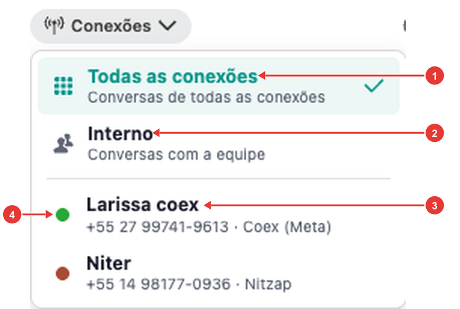

| Nº | Opção | O que mostra |
| :---: | --- | --- |
| 1 | **Todas as conexões** | Conversas de todos os números. |
| 2 | **Interno** | Conversas com a equipe (chat interno entre colegas). |
| 3 | **Uma conexão específica** | Só as conversas daquele número. Embaixo do nome aparecem o número e o tipo de conexão: **Nitzap** para conexões via QR Code, **Coex (Meta)** ou **Cloud API (Meta)** para as oficiais. |
| 4 | **Bolinha colorida** | Não indica se a conexão está online: é só a cor que identifica a conexão. A mesma cor aparece na etiqueta da conexão em cada conversa da lista (nº 6 em [O que cada conversa mostra](#nitzap/omni/o-que-cada-conversa-mostra)). |

Só dá para escolher uma opção por vez. A escolhida fica marcada com ✓ e o botão passa a mostrar o nome dela. O Nitzap lembra a sua escolha na próxima vez.

### O que cada conversa mostra

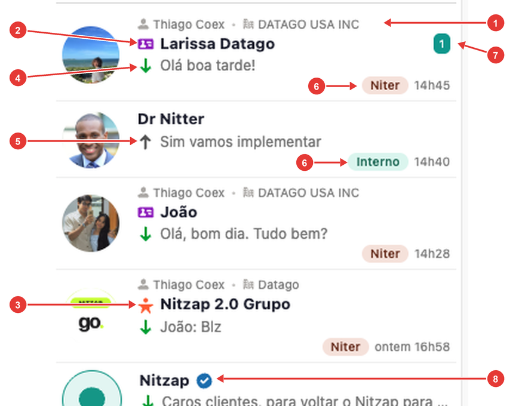

| Nº | Elemento | O que significa |
| :---: | --- | --- |
| 1 | **👤 Nome · 🏢 Empresa** | O proprietário do registro no Salesforce e a empresa (do Lead, ou da Conta do Contato). Só aparece quando o número está salvo. Dá para esconder nas [Preferências](#nitzap/omni/preferencias). |
| 2 | **Cartão roxo** antes do nome | O número está salvo como **Contato**. |
| 3 | **Pessoa laranja** antes do nome | O número está salvo como **Lead**. Um **prédio azul** indica **Conta**. Sem ícone, o número não está salvo no Salesforce. |
| 4 | **Seta verde para baixo** | A última mensagem foi **recebida** do cliente. |
| 5 | **Seta cinza para cima** | A última mensagem foi **enviada** por você e ainda não foi lida. Depois de lida, vira um ✓ azul. |
| 6 | **Etiqueta colorida** (ex.: **Niter**, **Interno**) | A **conexão por onde o cliente falou**, ou seja, para qual número ele mandou a mensagem. **Interno** indica uma conversa com um colega. Só aparece quando você participa de mais de uma conexão. |
| 7 | **Número verde** | Quantidade de mensagens não lidas na conversa. |
| 8 | **✓ azul ao lado do nome** | Canal oficial de anúncios do Nitzap. |

### Botão direito na conversa

Clique com o botão direito em uma conversa da lista para ver as ações rápidas. O menu abre logo abaixo da conversa.

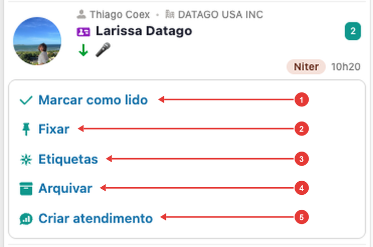

| Nº | Ação | O que faz |
| :---: | --- | --- |
| 1 | **Marcar como lido** / **Marcar como não lido** | Zera o contador de não lidas da conversa ou volta a marcá-la como não lida, para lembrar de responder depois. O texto muda conforme a conversa já está lida ou não. |
| 2 | **Fixar** / **Desfixar** | Prende a conversa no topo da lista, com um alfinete. |
| 3 | **Etiquetas** | Abre a lista de etiquetas da conexão da conversa para você aplicar à conversa. As etiquetas aparecem coloridas embaixo do nome do cliente. Se a conexão não tiver etiquetas, aparece **Nenhuma etiqueta disponível nesta conexão**. Veja o guia [Etiquetas](etiquetas.md). |
| 4 | **Arquivar** / **Desarquivar** | Tira a conversa da lista principal e a guarda nas **Arquivadas** (nº 9 em [Botões do topo](#nitzap/omni/botoes-do-topo)). Para trazer de volta, abra as arquivadas e use **Desarquivar**. |
| 5 | **Criar atendimento** | Abre um atendimento para o cliente. Veja [Atendimento](#nitzap/omni/atendimento). |

As ações de atendimento mudam conforme a situação da conversa:

- **Criar atendimento** aparece quando o número está salvo no Salesforce, não há atendimento aberto e a conversa não é de grupo.
- **Puxar atendimento** aparece quando a conversa está na fila de uma equipe.
- **Fechar Atendimento** aparece quando a conversa está em atendimento.

### Iniciar uma conversa nova

Clique em **Meus Contatos** (o **+**, nº 7 em [Botões do topo](#nitzap/omni/botoes-do-topo)).

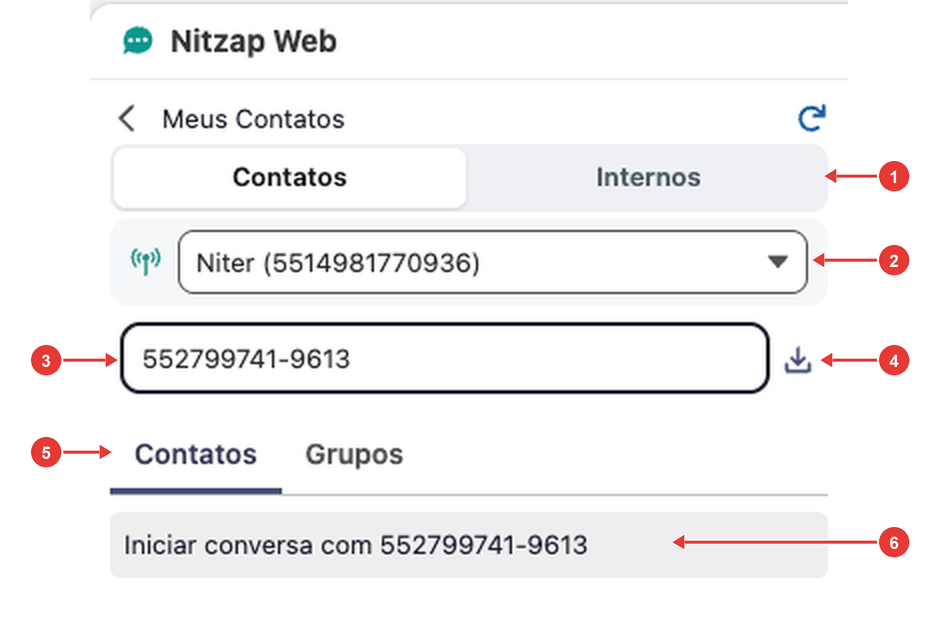

| Nº | O que é |
| :---: | --- |
| 1 | **Contatos** traz os clientes; **Internos** traz os colegas, para o chat interno. A aba **Internos** só aparece quando o chat interno está disponível. |
| 2 | **Conexão:** escolhe de qual número você quer ver os contatos e os grupos. Só aparece quando você participa de mais de uma conexão. |
| 3 | **Busca:** digite o nome ou o número. |
| 4 | **Exportar contatos:** baixa a lista de contatos da conexão escolhida em uma planilha (CSV). |
| 5 | **Contatos / Grupos:** alterna entre os contatos e os grupos. Conexões oficiais (Coex e Cloud API) não têm grupos. |
| 6 | **Iniciar conversa com (número):** aparece quando você digita um número. Clique para abrir a conversa, mesmo que o número ainda não esteja nos contatos. |

Digite o número completo, só com dígitos: DDI + DDD + número (exemplo: `5511999999999`). O Nitzap não acrescenta o DDI sozinho. Para números do Brasil, ele também procura a versão com e sem o 9 extra.

A conversa abre pela última conexão que você usou. Antes de escrever, confira no cabeçalho por qual número a mensagem vai sair e troque se precisar (nº 2 em [Cabeçalho](#nitzap/omni/cabecalho)).

Nas conexões oficiais (Coex e Cloud API), uma conversa nova começa **fechada**: a Meta só permite iniciar o contato com um template aprovado. Veja [Templates](#nitzap/omni/templates). Quando o cliente responder, a conversa abre e você pode escrever livremente.

## Dentro da conversa

### Cabeçalho

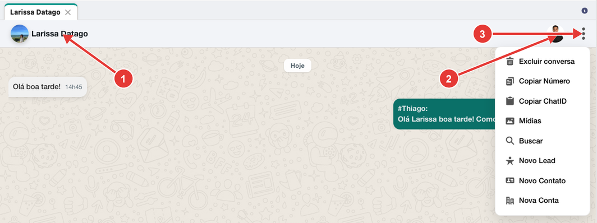

| Nº | O que é |
| :---: | --- |
| 1 | **Foto e nome do cliente.** Mostram também quando ele está digitando ou online. |
| 2 | **Foto do usuário com seta:** escolhe **de qual usuário e de qual conexão** é a conversa que você está vendo. Não é transferência de atendimento. Veja [Ver conversas de outros usuários](#nitzap/omni/ver-conversas-de-outros-usuarios). |
| 3 | **Menu ⋮:** mais opções da conversa (tabela abaixo). |

| Opção do menu ⋮ | O que faz |
| --- | --- |
| **Excluir conversa** | Apaga as mensagens com esse cliente na conexão selecionada, depois de uma confirmação. Só aparece se o administrador liberou a exclusão. |
| **Copiar Número** | Copia o número do cliente, só com os dígitos. |
| **Copiar ChatID** | Copia o identificador da conversa. |
| **Mídias** | Abre a galeria com as fotos, vídeos e arquivos trocados na conversa. |
| **Buscar** | Procura um texto nas mensagens da conversa. |
| **Novo Lead / Novo Contato / Nova Conta** | Abre o cadastro do Salesforce já preenchido com o nome e o número do WhatsApp. Não aparece quando o cliente pertence a outro usuário e o seu acesso é limitado. Nesse caso, o cabeçalho mostra quem é o proprietário. |

### Ver conversas de outros usuários

O mesmo cliente pode ter falado com mais de uma pessoa da equipe, ou por mais de um número. Clique na foto do usuário, à direita do nome do cliente, para escolher qual conversa ver.

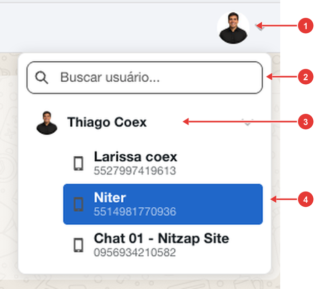

| Nº | O que é |
| :---: | --- |
| 1 | Foto do usuário dono da conversa que está na tela. Clique para trocar. |
| 2 | **Buscar usuário:** encontra um usuário pelo nome. |
| 3 | Cada usuário que já conversou com esse cliente. |
| 4 | As conexões desse usuário em que a conversa aconteceu. A que está na tela fica destacada. |

Você sempre aparece na lista, com **todas** as suas conexões, para poder falar com o cliente por qualquer uma delas. Conexões desconectadas aparecem por último, marcadas como **Conexão desconectada**.

Quais outros usuários aparecem depende da configuração do administrador:

| Configuração | O que você vê |
| --- | --- |
| **Respeitar Hierarquia** desligada | As conversas de todos os usuários que têm login no Nitzap. |
| **Respeitar Hierarquia** ligada | As suas conversas e as dos usuários abaixo de você na hierarquia de papéis do Salesforce. Sem papel definido, só as suas. |
| Conjunto de permissões **Nitzap: Ver todas as conversas** | As conversas de todos os usuários, mesmo com a hierarquia ligada. |

Ser administrador do Salesforce ou do Nitzap não libera, sozinho, as conversas dos outros: vale a configuração acima. Nas conversas de outros usuários você acompanha o histórico, mas só envia mensagens na sua própria conversa, por uma conexão sua que esteja conectada.

### Opções da mensagem

Passe o mouse sobre uma mensagem e clique na seta que aparece no canto do balão.

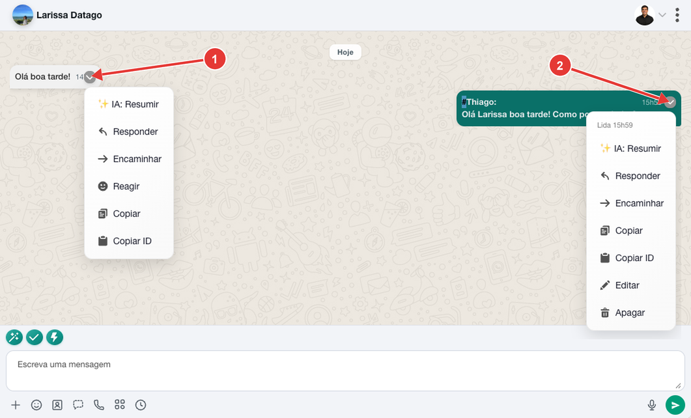

- **1:** seta de uma mensagem **recebida** e o menu que ela abre.
- **2:** seta de uma mensagem **enviada** e o menu que ela abre.

| Opção | Recebida (1) | Enviada (2) | O que faz |
| --- | :---: | :---: | --- |
| **Lida (data e hora)** | | ✓ | Não é um botão: mostra quando o cliente leu a mensagem. |
| **✨ IA: Resumir** | ✓ | ✓ | Resume a mensagem (texto, áudio, imagem ou documento). Veja [Recursos de IA](#nitzap/omni/recursos-de-ia). |
| **Responder** | ✓ | ✓ | Responde citando a mensagem. |
| **Encaminhar** | ✓ | ✓ | Seleciona a mensagem para encaminhar. Você pode marcar outras e depois escolher o contato. |
| **Reagir** | ✓ | | Envia uma reação com emoji. |
| **Copiar** | ✓ | ✓ | Seleciona a mensagem para copiar. Você pode marcar outras e copiar todas de uma vez, em ordem. |
| **Copiar ID** | ✓ | ✓ | Copia o identificador da mensagem, útil para o suporte. |
| **Editar** | | ✓ | Altera o texto da mensagem enviada. Até **10 minutos** depois do envio. |
| **Apagar** | | ✓ | Apaga a mensagem para todos, depois de uma confirmação. Até **2 dias** depois do envio. |

**Editar** e **Apagar** não existem nas conexões oficiais (Coex e Cloud API), só nas conexões via QR Code. Em imagens também aparece a opção de **download**.

### Caixa de mensagem

Escreva a mensagem e tecle **Enter** para enviar. Para pular uma linha sem enviar, use **Shift + Enter**. Em grupos, digite **@** para mencionar um participante.

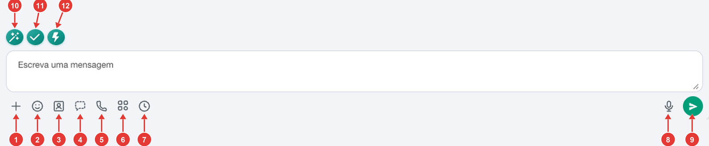

| Nº | Botão | O que faz |
| :---: | --- | --- |
| 1 | **Arquivos** (+) | Envia um arquivo do computador ou do Salesforce. Veja [Arquivos](#nitzap/omni/enviar-arquivos). |
| 2 | **Emoji** | Insere um emoji no texto. |
| 3 | **Enviar contato** | Envia um cartão de contato. Veja [Enviar contato](#nitzap/omni/enviar-contato). |
| 4 | **Modo sussurro** | Escreve uma nota interna na conversa: só a equipe vê, o cliente não recebe. |
| 5 | **Registrar histórico** | Cria uma Tarefa no Salesforce com um trecho da conversa. Veja [Registrar histórico](#nitzap/omni/registrar-historico). |
| 6 | **Templates** | Veja [Templates](#nitzap/omni/templates). |
| 7 | **Agendar envio** | Veja [Agendar envio](#nitzap/omni/agendar-envio). |
| 8 | **Microfone** | Grava um áudio. Antes de enviar, dá para ouvir e descartar. |
| 9 | **Enviar** | Envia a mensagem (o mesmo que **Enter**). |
| 10 | **Gerar com IA** | Escreve uma sugestão de resposta. Veja [Recursos de IA](#nitzap/omni/recursos-de-ia). |
| 11 | **Correção ortográfica** | Corrige o texto que você está escrevendo. Veja [Recursos de IA](#nitzap/omni/recursos-de-ia). |
| 12 | **Resumir conversa** | Resume a conversa em um período. Veja [Recursos de IA](#nitzap/omni/recursos-de-ia). |

### Enviar arquivos

Clique no **+** (indicado pela seta embaixo). O botão vira um **×**, que fecha o menu.

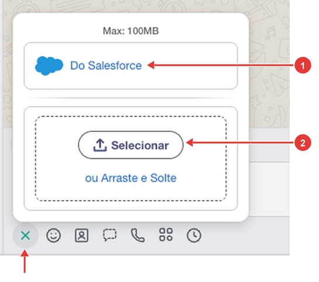

| Nº | Opção | O que faz |
| :---: | --- | --- |
| 1 | **Do Salesforce** | Envia um arquivo que já está salvo no Salesforce. |
| 2 | **Selecionar** ou arrastar | Envia um arquivo do computador. Também dá para arrastar o arquivo para dentro da área tracejada. |

O limite é de 100 MB por arquivo; vídeos aceitam até 40 MB, pelo limite do WhatsApp.

### Emoji

Clique no ícone de carinha (indicado pela seta) e escolha o emoji. Use **Procurar** para buscar pelo nome.

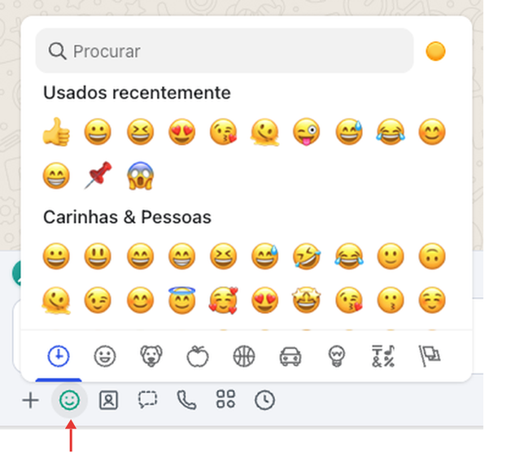

### Enviar contato

Clique no ícone de cartão (indicado pela seta embaixo).

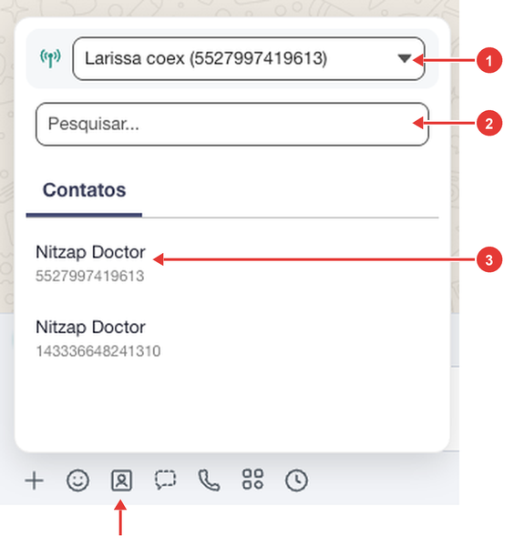

| Nº | O que fazer |
| :---: | --- |
| 1 | Escolha por qual conexão o contato vai ser enviado. Já vem selecionada a conexão da conversa. |
| 2 | Busque o contato pelo nome ou número. |
| 3 | Clique no contato para enviar o cartão. |

O botão não aparece nas conexões oficiais (Coex e Cloud API) nem no chat interno.

### Registrar histórico

Use para guardar no Salesforce um trecho importante da conversa, como uma negociação ou um atendimento por telefone. O botão só aparece quando o número está salvo como Lead, Contato ou Conta.

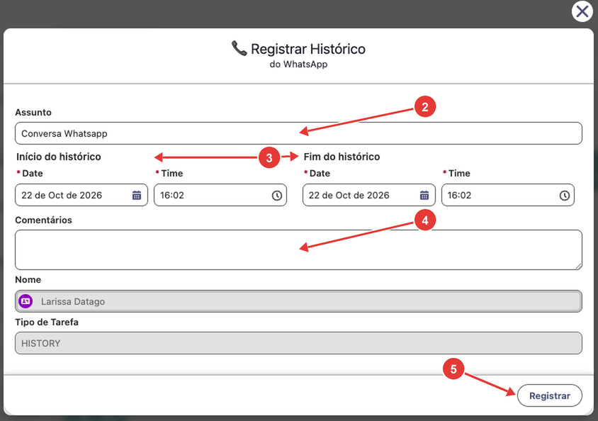

1. Clique no ícone de telefone (nº 5 da caixa de mensagem).
2. Confira o **Assunto** (o padrão é *Conversa Whatsapp*).
3. Informe o **Início do histórico** e o **Fim do histórico**. O fim precisa ser depois do início.
4. Se quiser, escreva **Comentários**.
5. Clique em **Registrar**.

Os números da imagem são os mesmos dos passos. O Nitzap cria uma Tarefa concluída, do tipo **HISTORY**, ligada ao cliente, e abre a Tarefa em seguida.

### Agendar envio

Use para deixar uma mensagem programada, como um lembrete de pagamento ou um retorno combinado. O botão do relógio (nº 7 da caixa de mensagem) só aparece quando o número está salvo como Lead, Contato ou Conta.

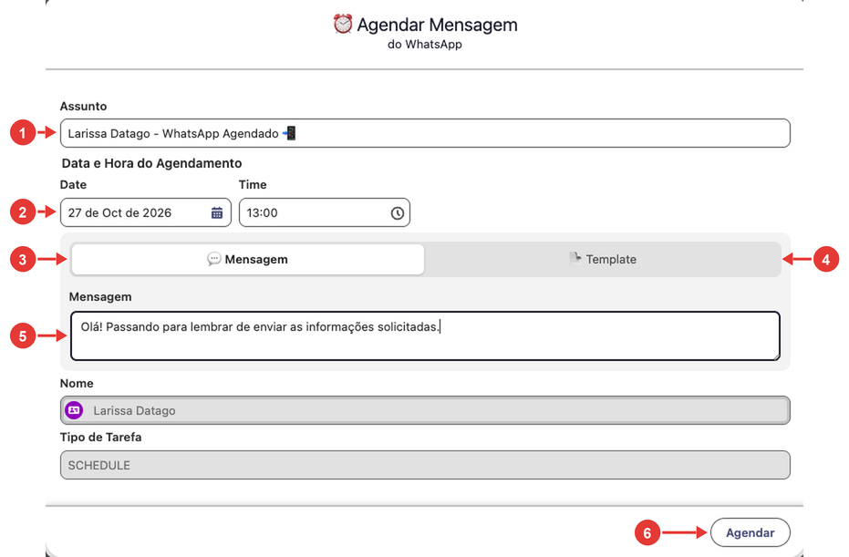

| Nº | O que fazer |
| :---: | --- |
| 1 | **Assunto:** vira o assunto da Tarefa. O padrão é *(nome do cliente) - WhatsApp Agendado 📲*. |
| 2 | **Data e hora** do envio. O padrão é daqui a 1 minuto. |
| 3 | Aba **Mensagem:** para escrever um texto livre. |
| 4 | Aba **Template:** para usar uma mensagem pronta (veja abaixo). |
| 5 | O texto da mensagem. |
| 6 | **Agendar:** confirma. Aparece **⏰ Agendado com sucesso** e a página recarrega. |

Para usar uma mensagem pronta, abra a aba **Template**:

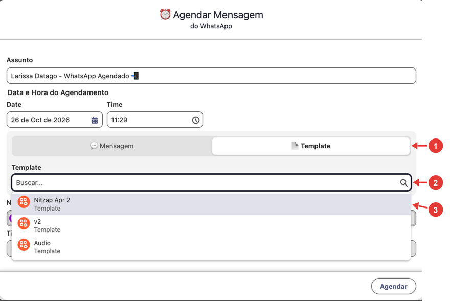

| Nº | O que é |
| :---: | --- |
| 1 | Aba **Template**. |
| 2 | **Buscar:** encontra o template pelo nome. |
| 3 | A lista traz os seus templates e os compartilhados com você. Nas conexões oficiais, também aparecem os templates da Meta importados. |

Nas conexões oficiais (Coex e Cloud API), uma mensagem sem template da Meta só é entregue se o cliente tiver mandado alguma mensagem nas últimas 24 horas. O Nitzap mostra esse aviso na tela. Para falar com quem não escreveu nesse período, agende com um template da Meta.

#### A Tarefa do agendamento

Cada agendamento vira uma **Tarefa** no Salesforce, em seu nome, ligada ao cliente.

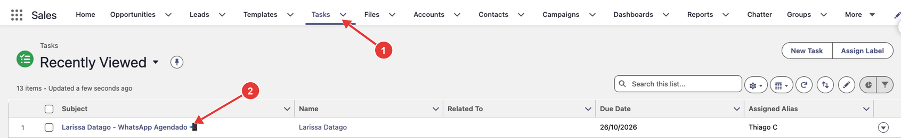

- **1:** aba **Tasks** (Tarefas) do Salesforce.
- **2:** a Tarefa criada pelo agendamento, com o assunto escolhido.

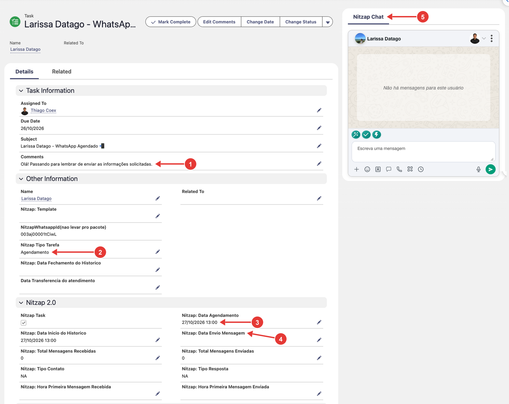

| Nº | Campo | O que mostra |
| :---: | --- | --- |
| 1 | **Comments** | O texto da mensagem agendada. |
| 2 | **Nitzap Tipo Tarefa** | **Agendamento** (ou **Agendamento Meta**, nas conexões oficiais). |
| 3 | **Nitzap: Data Agendamento** | Dia e hora marcados para o envio. |
| 4 | **Nitzap: Data Envio Mensagem** | Fica vazio até o envio; é preenchido quando o Nitzap processa o agendamento. |
| 5 | **Nitzap Chat** | A conversa com o cliente, na própria página da Tarefa. |

#### Como o envio acontece

- O Nitzap confere os agendamentos a cada minuto e envia no horário marcado, em seu nome, pela conexão que estava selecionada na conversa.
- Depois disso, a Tarefa é **concluída** e o campo **Nitzap: Data Envio Mensagem** é preenchido.
- O envio automático precisa estar ligado pelo administrador (**Agendamento Ativo**, no Nitzap Config).

Cuidados:

- **A Tarefa é concluída mesmo quando a mensagem não pode sair**, por exemplo se o cliente não tem WhatsApp cadastrado no registro ou se o seu usuário está inativo no Nitzap. Depois do horário, confira na conversa se a mensagem foi enviada.
- **A mensagem só sai no dia agendado.** Se ela não for enviada naquele dia (por exemplo, com o agendamento desligado), não é enviada nos dias seguintes.
- **Para cancelar**, conclua ou exclua a Tarefa antes do horário. **Para mudar o horário**, cancele e agende de novo.

## Recursos de IA

Os recursos de IA só aparecem quando o administrador configurou a IA no Nitzap.

| Recurso | Onde fica | O que faz |
| --- | --- | --- |
| **Gerar com IA** | Botão nº 10 da caixa de mensagem | Escreve uma sugestão de resposta. |
| **Correção ortográfica** | Botão nº 11 da caixa de mensagem | Corrige o texto que você está escrevendo. |
| **Resumir conversa** | Botão nº 12 da caixa de mensagem | Resume a conversa em um período. |
| **IA: Resumir** | [Opções da mensagem](#nitzap/omni/opcoes-da-mensagem) | Resume uma mensagem só. |
| **Transcrição de áudio** | Embaixo de cada áudio | Transforma o áudio em texto. |

### Gerar com IA

Clique na varinha. A IA lê as últimas 10 mensagens da conversa, inclusive imagens e áudios, e escreve uma sugestão de resposta na caixa de mensagem.

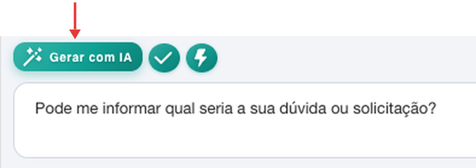

A mensagem **não é enviada sozinha**: leia, ajuste se precisar e envie.

### Correção ortográfica

Escreva a mensagem e clique no ✓. A IA corrige a ortografia do texto que está na caixa. Com a caixa vazia, o botão não faz nada.

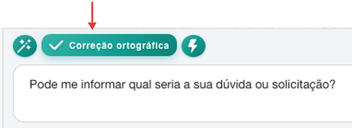

### Resumir conversa

Clique no raio para abrir a janela **Resumir Conversa**.

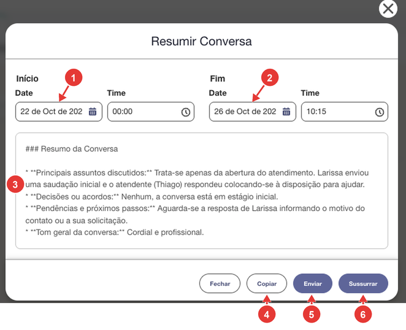

| Nº | O que fazer |
| :---: | --- |
| 1 | **Início:** data e hora a partir das quais a conversa entra no resumo. O padrão é hoje, à meia-noite. |
| 2 | **Fim:** data e hora finais. O padrão é agora. |
| 3 | O resumo gerado: principais assuntos, decisões, pendências e tom da conversa. |
| 4 | **Copiar:** copia o resumo. |
| 5 | **Enviar:** manda o resumo para o cliente, como mensagem. |
| 6 | **Sussurrar:** salva o resumo na conversa como nota interna. Só a equipe vê. |

Um resumo sussurrado fica na conversa com fundo amarelo, para quem assumir o atendimento depois:

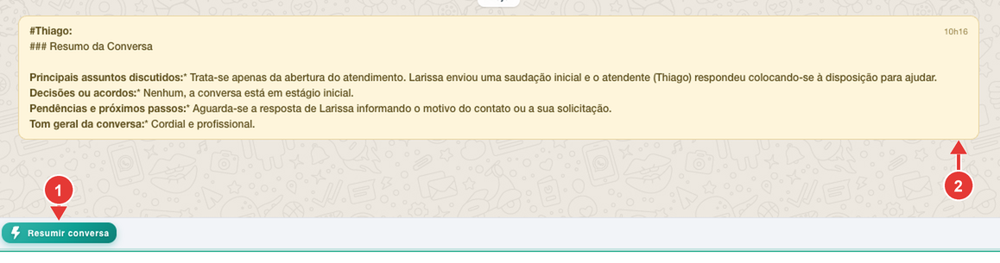

- **1:** botão **Resumir conversa**.
- **2:** o resumo salvo como sussurro. O cliente não recebe.

### Transcrição de áudio

A IA transforma os áudios em texto, que aparece entre aspas embaixo do áudio (indicado pela seta).

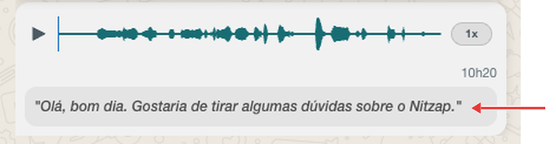

Há dois jeitos de usar:

- **Automático:** ligue a preferência **IA: Transcrever e exibir automaticamente áudios** (nº 11 em [Preferências](#nitzap/omni/preferencias)). Todo áudio é transcrito sozinho. Se o administrador deixou a transcrição obrigatória, ela já vem ligada.
- **Um áudio por vez:** com a preferência desligada, clique em **Transcrever**, embaixo do áudio que você quer ler.

A transcrição fica salva na mensagem: quem abrir a conversa depois vê o texto sem transcrever de novo.

## Preferências

Clique no botão **Preferências** (nº 5 em [Botões do topo](#nitzap/omni/botoes-do-topo)). As preferências são suas: valem em qualquer computador e não mudam nada para os outros usuários.

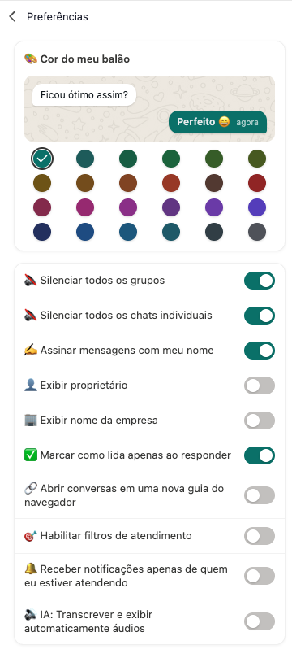

| Nº | Preferência | O que faz |
| :---: | --- | --- |
| 1 | **🎨 Cor do meu balão** | Muda a cor dos balões das mensagens que você envia. Nas conversas que já estavam abertas, clique em **Atualizar agora** para aplicar. |
| 2 | **Silenciar todos os grupos** | Desliga o som, a notificação e o alerta de mensagens novas em grupos. O contador de não lidas continua funcionando. |
| 3 | **Silenciar todos os chats individuais** | O mesmo, para as conversas individuais. |
| 4 | **Assinar mensagens com meu nome** | Coloca o seu primeiro nome em negrito no início de cada mensagem enviada (ex.: **#Thiago:**). |
| 5 | **Exibir proprietário** | Mostra o 👤 proprietário do registro acima do nome de cada conversa. |
| 6 | **Exibir nome da empresa** | Mostra a 🏢 empresa acima do nome de cada conversa. |
| 7 | **Marcar como lida apenas ao responder** | Ligada: abrir a conversa não zera as não lidas, só responder. Desligada: abrir a conversa já marca como lida. |
| 8 | **Abrir conversas em uma nova guia do navegador** | No modo compacto, quando o clique na conversa abre o registro do cliente, ele abre em uma nova guia do navegador. |
| 9 | **Habilitar filtros de atendimento** | Troca o botão **Não Lidas** pelos filtros de atendimento. Veja [Filtros de atendimento](#nitzap/omni/filtros-de-atendimento). |
| 10 | **Receber notificações apenas de quem eu estiver atendendo** | Só avisa sobre conversas cujo atendimento aberto é seu. |
| 11 | **IA: Transcrever e exibir automaticamente áudios** | Transcreve os áudios sozinho. Veja [Transcrição de áudio](#nitzap/omni/transcricao-de-audio). Se o administrador deixou obrigatório, aparece **Ativado pelo administrador** e não dá para desligar. |

Ao mudar **Assinar mensagens com meu nome**, **IA: Transcrever** ou **Habilitar filtros de atendimento**, o Nitzap pede confirmação e recarrega a página.

Veja a diferença na lista com **Exibir proprietário** e **Exibir nome da empresa** ligados e desligados:

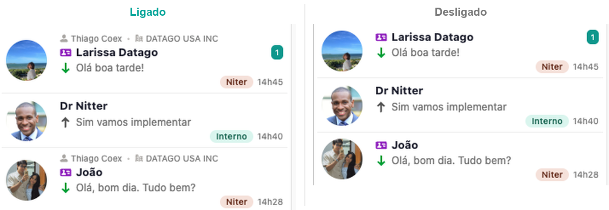
