# 10. Templates do WhatsApp (modelos da Meta)

O template (na Meta, **modelo de mensagem**) é uma mensagem pronta que precisa ser aprovada pela Meta antes de ser usada. Nas conexões oficiais (**Coexistência** e **API Cloud**), ele é obrigatório para iniciar uma conversa, para retomar uma conversa em que o cliente não escreve há mais de 24 horas e para os [disparos de campanha](#nitzap/disparo-campanha).

Este guia mostra como criar o template pelo Salesforce ou pela Meta, acompanhar a aprovação e enviar o template pelo Nitzap Omni.

**Como ler as imagens:** os círculos vermelhos numerados apontam para a parte da tela que está sendo explicada. O número no círculo é o mesmo da coluna **Nº** da tabela logo abaixo da imagem.

<!-- sumario:inicio -->
**Neste artigo:**

- [O que é preciso antes](#nitzap/templates/antes-de-comecar)
- [Criar pelo Salesforce ou pela Meta?](#nitzap/templates/qual-caminho-usar)
- [Criar o template pelo Salesforce](#nitzap/templates/criar-o-template-pelo-salesforce)
- [Criar o template na Meta](#nitzap/templates/criar-o-template-na-meta)
- [Acompanhar a aprovação na Meta](#nitzap/templates/5-acompanhar-a-analise)
- [Limites de envio da Meta](#nitzap/templates/limites-de-envio-da-meta)
- [Enviar o template pelo Omni](#nitzap/templates/enviar-o-template-pelo-omni)
- [Problemas comuns](#nitzap/templates/problemas-comuns)

<!-- sumario:fim -->

## Antes de começar

- **Conexão oficial.** Templates só existem nas conexões pela API oficial (Coexistência ou API Cloud). Nas conexões só QR Code, não há template da Meta. Veja [Conectar um número de WhatsApp](#nitzap/conexao-whatsapp).
- **Para criar pelo Salesforce:** ser administrador do Nitzap, porque a criação fica em **Nitzap Config**.
- **Para criar pela Meta:** acesso ao portfólio empresarial na Meta (o antigo Business Manager) em que está a conta do WhatsApp da conexão.

## Qual caminho usar

| | Pelo Salesforce (Nitzap Config) | Pela Meta (Gerenciador do WhatsApp) |
| --- | --- | --- |
| **Categorias** | Marketing e Utilidade. | Marketing, Utilidade e Autenticação. |
| **Cabeçalho** | Nenhum, texto ou imagem. | Também vídeo, documento e outros tipos de mensagem (catálogo, flows...). |
| **Botões** | Até 3, de resposta rápida. | Até 10, incluindo link e copiar código. |
| **Quando usar** | Templates do dia a dia, sem sair do Salesforce. | Quando precisa de um recurso que o Nitzap não tem. |

Os dois caminhos mandam o template para a mesma análise da Meta, e o resultado aparece nos dois lugares.

## Criar o template pelo Salesforce

### 1. Abrir a conexão

Em **Nitzap Config** > **Conexões**, clique na engrenagem (⚙) da conexão oficial.

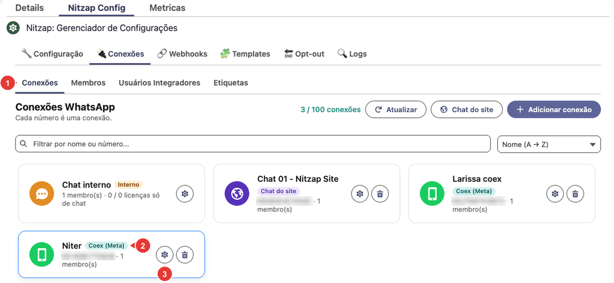

| Nº | O que é |
| :---: | --- |
| 1 | Subaba **Conexões**. |
| 2 | Selo **Coex (Meta)**: a conexão é oficial e tem templates. |
| 3 | **Engrenagem:** abre **Gerenciar conexão**. |

### 2. Preencher o template

Abra a aba **Templates Meta**. Ela só aparece nas conexões oficiais e precisa da conexão online.

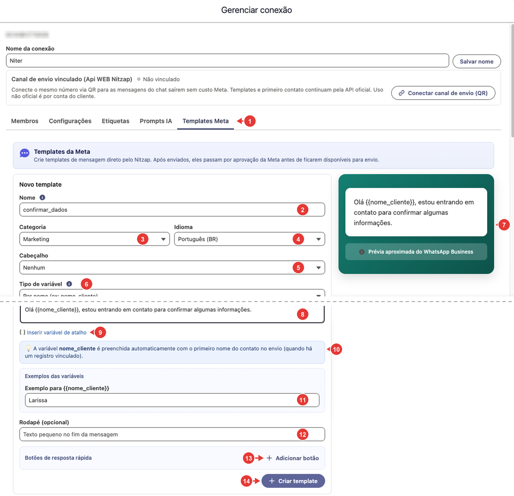

| Nº | Campo | O que fazer |
| :---: | --- | --- |
| 1 | Aba **Templates Meta** | Onde ficam os templates da conexão. |
| 2 | **Nome** | Só letras minúsculas, números e `_`. Ao digitar, o Nitzap já troca maiúsculas por minúsculas e espaços e acentos por `_`. |
| 3 | **Categoria** | **Marketing** ou **Utilidade** (veja [as categorias](#nitzap/templates/3-escolher-a-categoria)). |
| 4 | **Idioma** | **Português (BR)**, **Inglês (US)**, **Inglês** ou **Espanhol**. |
| 5 | **Cabeçalho** | **Nenhum**, **Texto** (abre o campo **Texto do cabeçalho**) ou **Imagem** (abre **Imagem do cabeçalho**, para enviar um PNG ou JPG). |
| 6 | **Tipo de variável** | **Por nome** (`{{nome_cliente}}`) ou **Por número** (`{{1}}`, `{{2}}`). Não dá para misturar os dois no mesmo texto: se misturar, aparece um aviso e o botão **Criar template** fica desligado. |
| 7 | Prévia | Como a mensagem vai chegar no WhatsApp. Atualiza enquanto você digita. |
| 8 | **Corpo** | O texto da mensagem. Escreva as variáveis entre chaves duplas, como `{{nome_cliente}}`. |
| 9 | **Inserir variável de atalho** | Só com **Por nome**. Insere uma das variáveis que o Nitzap preenche sozinho no envio (tabela abaixo). |
| 10 | Aviso da variável de atalho | Explica como a variável vai ser preenchida. |
| 11 | **Exemplos das variáveis** | Um exemplo para cada variável do corpo. É obrigatório e serve só para a análise da Meta. Não use dados reais de clientes. |
| 12 | **Rodapé (opcional)** | Uma linha curta no fim da mensagem. |
| 13 | **Adicionar botão** | Botões de resposta rápida, até 3. Digite o texto de cada um; a lixeira remove. |
| 14 | **Criar template** | Envia para a Meta. Aparece **Template enviado para aprovação** e o formulário fica limpo para o próximo. |

O botão **Criar template** só liga quando o nome, o corpo e todos os exemplos estão preenchidos (e a imagem foi enviada, se o cabeçalho for **Imagem**).

| Variável de atalho | Como é preenchida no envio pelo Omni |
| --- | --- |
| `{{nome_cliente}}` | Primeiro nome do contato, quando a conversa tem um registro vinculado no Salesforce. |
| `{{nome_usuario}}` | Primeiro nome do usuário que está enviando. |

Elas funcionam também em templates criados direto na Meta, desde que a variável tenha exatamente esse nome.

### 3. Acompanhar a aprovação

Abaixo do formulário fica a lista **Templates da conexão**, com todos os templates da conta desse número, criados pelo Nitzap ou pela Meta.

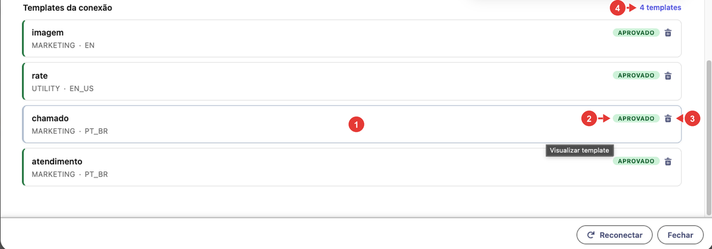

| Nº | O que é |
| :---: | --- |
| 1 | Clique no template para ver como ele é (só visualização). |
| 2 | **Status:** **Aprovado**, **Pendente** (em análise na Meta) ou **Rejeitado**. |
| 3 | **Lixeira:** apaga o template, depois de uma confirmação. Ele é apagado também na Meta, e não dá para desfazer. |
| 4 | Quantos templates a conexão tem. |

Abaixo do nome aparecem a categoria e o idioma. Quando o status mudar para **Aprovado**, o template já pode ser usado no Omni e nos disparos de campanha.

## Criar o template na Meta

### 1. Abrir o Gerenciador do WhatsApp

Entre em [business.facebook.com](https://business.facebook.com), abra **Configurações** e escolha o portfólio empresarial da empresa.

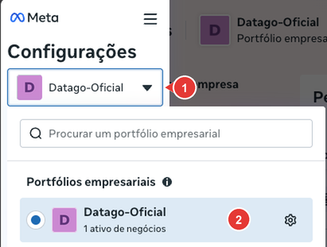

| Nº | O que é |
| :---: | --- |
| 1 | Portfólio aberto no momento. Clique para trocar. |
| 2 | O portfólio da empresa, onde está o número do WhatsApp. |

Em **Contas**, abra **Contas de mensagens**, escolha a conta do número e clique em **Gerenciador do WhatsApp**.

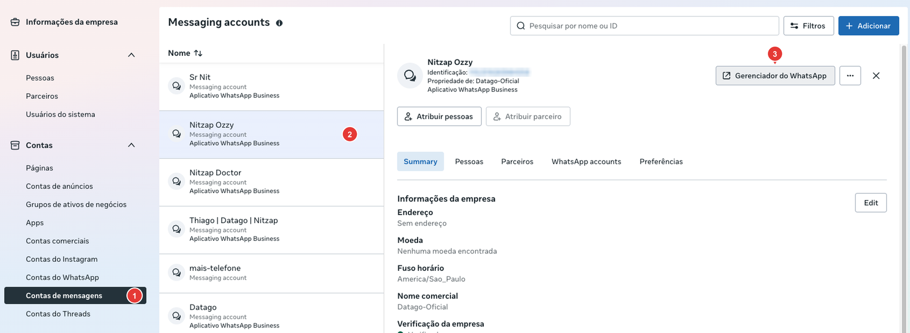

| Nº | O que é |
| :---: | --- |
| 1 | **Contas de mensagens.** |
| 2 | A conta do número que vai usar o template. |
| 3 | **Gerenciador do WhatsApp:** abre a tela dos modelos. |

### 2. Criar o modelo

No Gerenciador do WhatsApp, abra **Modelos de mensagem** > **Gerenciar modelos**.

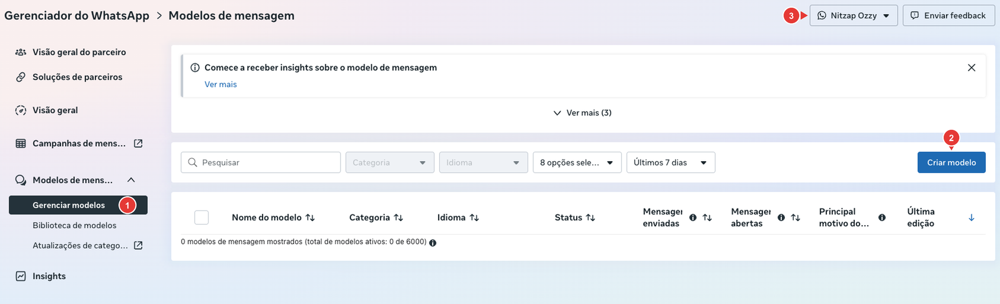

| Nº | O que é |
| :---: | --- |
| 1 | **Gerenciar modelos:** a lista de templates da conta. |
| 2 | **Criar modelo.** |
| 3 | A conta em que você está. O template vale só para os números dessa conta: confira antes de criar. |

### 3. Escolher a categoria

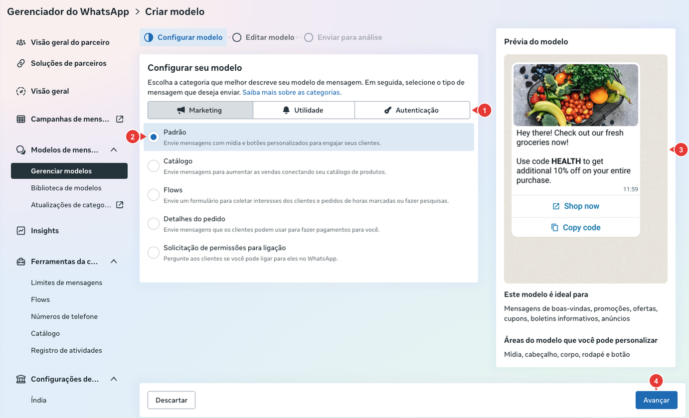

| Nº | O que é |
| :---: | --- |
| 1 | **Categoria** do template (tabela abaixo). |
| 2 | **Tipo** de mensagem. Para uma mensagem com texto e botões, use **Padrão**. |
| 3 | **Prévia do modelo:** um exemplo de como fica no WhatsApp. |
| 4 | **Avançar.** |

| Categoria | Para que serve |
| --- | --- |
| **Marketing** | Boas-vindas, promoções, ofertas, convites, novidades e retomada de contato. |
| **Utilidade** | Avisos sobre algo que o cliente já pediu ou contratou: pedido, pagamento, agendamento, atualização de conta. |
| **Autenticação** | Códigos de verificação e de acesso. |

A Meta confere a categoria na análise e pode mudá-la se o texto não combinar. O preço de cada mensagem também depende da categoria.

### 4. Preencher o modelo

Na etapa **Editar modelo**, preencha o nome, o idioma e o conteúdo. A prévia, à direita, mostra o resultado enquanto você digita.

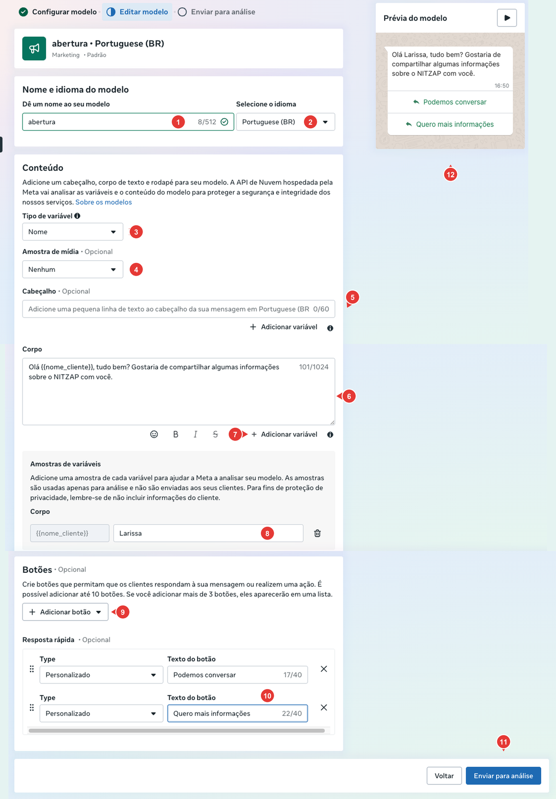

| Nº | Campo | O que fazer |
| :---: | --- | --- |
| 1 | **Nome do modelo** | Só letras minúsculas, números e `_` (ex.: `abertura`, `lembrete_pagamento`). É o nome que aparece na lista de templates do Nitzap. |
| 2 | **Idioma** | **Portuguese (BR)** para clientes no Brasil. |
| 3 | **Tipo de variável** | **Nome** cria variáveis com nome, como `{{nome_cliente}}`. **Número** cria `{{1}}`, `{{2}}`. Com nome, fica mais fácil saber o que preencher no Nitzap. |
| 4 | **Amostra de mídia** | Opcional: imagem, vídeo ou documento no topo da mensagem. |
| 5 | **Cabeçalho** | Opcional: uma linha de título, até 60 caracteres. |
| 6 | **Corpo** | O texto da mensagem, até 1.024 caracteres. Os botões abaixo formatam o texto (negrito, itálico, tachado e código). |
| 7 | **Adicionar variável** | Insere uma variável onde está o cursor. É o que muda a cada envio, como o nome do cliente. |
| 8 | **Amostras de variáveis** | Um exemplo para cada variável (ex.: `Larissa`). Serve só para a Meta analisar e não é enviado ao cliente. Não use dados reais de clientes. |
| 9 | **Adicionar botão** | Opcional: até 10 botões. Com mais de 3, eles aparecem em uma lista. |
| 10 | **Texto do botão** | Em **Resposta rápida**, o texto que o cliente toca para responder (até 40 caracteres). |
| 11 | **Enviar para análise** | Manda o template para a Meta aprovar. |
| 12 | **Prévia do modelo** | Como a mensagem vai chegar, com as amostras no lugar das variáveis. |

Entre o corpo e os botões fica o **Rodapé**, também opcional: uma linha curta no fim da mensagem, até 60 caracteres.

**Dicas para ser aprovado:**

- Não comece nem termine o corpo com uma variável e não coloque duas variáveis seguidas.
- Escreva o texto completo, com a empresa identificada e o motivo do contato.
- Em **Marketing**, um botão de resposta rápida para sair da lista (ex.: **Não quero receber**) ajuda o cliente a pedir opt-out. Veja [Opt-out](#nitzap/disparo-campanha/opt-out-quem-nao-quer-receber).

### 5. Acompanhar a análise

Depois de enviado, o template aparece em **Gerenciar modelos** com o status **Em análise**. A Meta costuma responder em poucos minutos, mas pode levar até 24 horas.

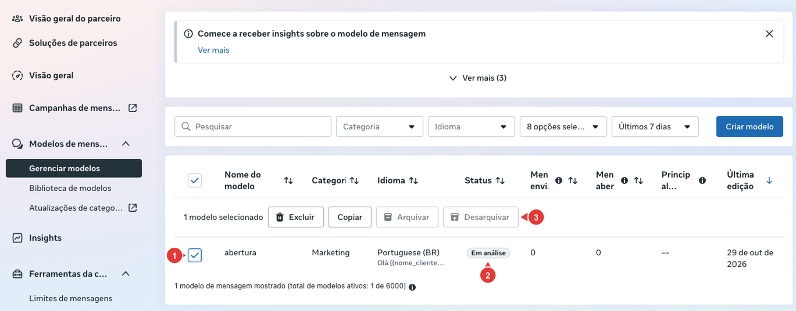

| Nº | O que é |
| :---: | --- |
| 1 | Marque o template para ver as ações. |
| 2 | **Status** do template. |
| 3 | Ações: **Excluir**, **Copiar** (cria um template novo a partir deste), **Arquivar** e **Desarquivar**. |

| Status | O que significa |
| --- | --- |
| **Em análise** | A Meta ainda está avaliando. Ainda não aparece no Nitzap. |
| **Ativo** | Aprovado. Já aparece no Nitzap para envio. |
| **Rejeitado** | Recusado. Abra o template para ver o motivo, corrija e envie de novo. |
| **Pausado** ou **Desativado** | A Meta suspendeu o template por reclamações ou bloqueios dos clientes. Ele some do Nitzap enquanto estiver assim. |

O Nitzap mostra **só os templates aprovados**, e só os da conta do número que você está usando.

## Limites de envio da Meta

A Meta limita quantos clientes **diferentes** cada número pode procurar por template em 24 horas. Veja o seu limite em **Ferramentas da conta** > **Limites de mensagens**, no Gerenciador do WhatsApp.

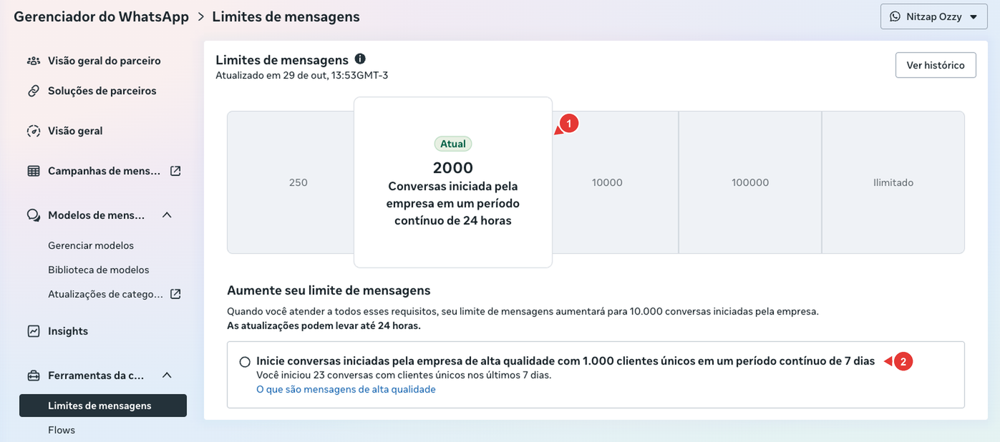

| Nº | O que é |
| :---: | --- |
| 1 | **Limite atual:** quantas conversas iniciadas pela empresa o número pode abrir em 24 horas. Os degraus são 250, 2.000, 10.000, 100.000 e Ilimitado. |
| 2 | **Como subir de degrau:** o requisito para o próximo limite e quanto já foi feito. A mudança pode levar até 24 horas. |

O limite conta só as conversas que a **empresa inicia**. Responder quem escreveu para você não entra na conta. Leve isso em conta antes de um [disparo de campanha](#nitzap/disparo-campanha) grande.

## Enviar o template pelo Omni

Quando a conversa está fechada (o cliente nunca escreveu ou não escreve há mais de 24 horas), a caixa de mensagem dá lugar a um aviso, e o único jeito de falar com o cliente é por template.

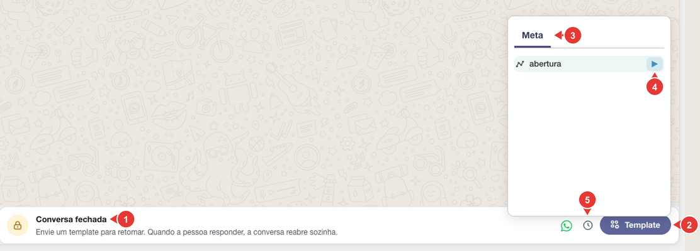

| Nº | O que é |
| :---: | --- |
| 1 | **Conversa fechada:** envie um template para retomar. Quando o cliente responder, a conversa reabre sozinha. |
| 2 | **Template:** abre a lista. |
| 3 | Aba **Meta:** os templates aprovados da conta deste número. |
| 4 | **Play:** abre o template para preencher e enviar. |
| 5 | **Agendar envio:** para mandar o template mais tarde. Veja [Agendar envio](#nitzap/omni/agendar-envio), no guia do Omni. |

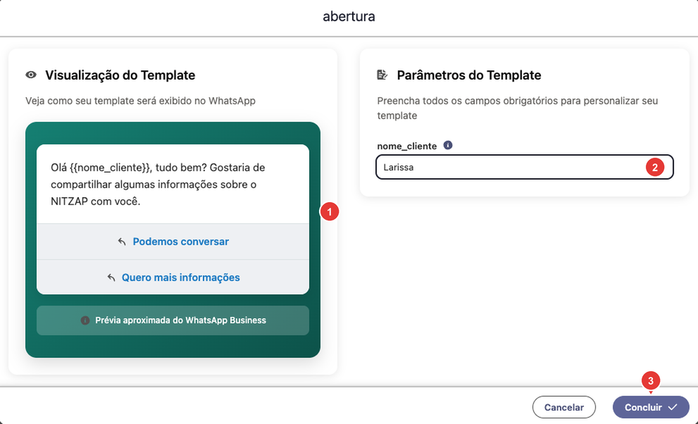

| Nº | O que é |
| :---: | --- |
| 1 | **Visualização do Template:** como a mensagem vai chegar. |
| 2 | **Parâmetros do Template:** um campo para cada variável, com o nome usado na Meta (aqui, **nome_cliente**). Preencha todos. Se o template tiver mídia ou link dinâmico, os campos aparecem aqui também. Se não tiver variáveis, aparece **Este template não possui variáveis**. As variáveis `{{nome_cliente}}` e `{{nome_usuario}}` já vêm preenchidas (veja [as variáveis de atalho](#nitzap/templates/2-preencher-o-template)); confira antes de enviar. |
| 3 | **Concluir:** envia o template na hora. O Nitzap mostra **Template enviado com sucesso** ou o erro devolvido pela Meta. |

Com a conversa aberta, o botão de templates também fica na caixa de mensagem (nº 6 em [Caixa de mensagem](#nitzap/omni/caixa-de-mensagem)). Ali a aba **Meta** fica ao lado da aba **Nitzap**, que tem as mensagens prontas internas, sem aprovação da Meta.

O template enviado pelo Omni chega mesmo para quem está na lista de [opt-out](#nitzap/disparo-campanha/opt-out-quem-nao-quer-receber): o bloqueio vale só para os disparos de campanha.

## Problemas comuns

| Situação | O que fazer |
| --- | --- |
| O template não aparece no Nitzap. | Confira se o status na Meta é **Ativo** e se ele foi criado na mesma conta do número da conversa (nº 3 em [Criar o modelo](#nitzap/templates/2-criar-o-modelo)). |
| Não aparece o botão **Template** nem a aba **Meta**. | A conexão não é oficial. Templates da Meta só existem em conexões Coexistência e API Cloud. |
| Não aparece a aba **Templates Meta** na conexão. | A conexão não é oficial ou está offline. A aba só aparece nas conexões Coexistência e API Cloud conectadas. |
| O botão **Criar template** não liga. | Falta o nome, o corpo ou algum exemplo de variável, ou o texto mistura variáveis por nome e por número. |
| O template foi rejeitado. | Abra o template na Meta para ver o motivo. Os mais comuns são categoria errada, variável no começo ou no fim do texto e conteúdo pouco claro. Corrija e envie de novo, ou use **Copiar** para criar outro. |
| Erro ao enviar pelo Omni. | O texto do erro é o motivo da Meta. Confira se todos os parâmetros foram preenchidos e se o template não foi pausado. |
| A conversa continua fechada depois do envio. | É normal: ela reabre quando o cliente responder. |
| Muitos envios falham no mesmo dia. | O número pode ter atingido o limite de conversas em 24 horas. Veja [Limites de envio da Meta](#nitzap/templates/limites-de-envio-da-meta). |
